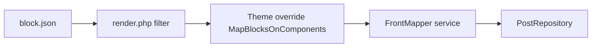

# Creating a new Query Loop Post Card Block

## Goal

Builds a Query Loop Post Card block that delegates rendering to a theme or plugin component via a markup filter, wiring `render.php`, theme-override hooks, `FrontMapper`, and repository usage.

## Rules

- This skill assumes the block already exists. If not, first use *creating-a-new-block*.
- **Mandatory inputs:** block type to work with (fully-qualified block name); plugin where the block is stored.
- Always go through `PostRepository` for data in the mapper; do not query post meta directly in the mapper.
- Run the plugin build from the project root with `npm run build:<plugin-slug>` when verifying.
- `MapBlocksOnComponents` is a valid **service-delegating hook** pattern: it delegates presentation to `FrontMapper` without Request/Response when an existing service suffices. For new transactional logic with a full stack, follow [service-delegation-architecture.md](../../../wonderwp-backend/references/service-delegation-architecture.md).

## Workflow



### Step 1: Gather inputs and locate the block

**Do:**

When the user wants a Query Loop Post Card block, gather the mandatory inputs (block type, plugin).

1. If block type is not given, ask for it.
2. In the plugin’s `src/blocks` folder, locate the block and read its `block.json`.

**Success criteria:** Block type and `block.json` are identified.

### Step 2: Prepare `block.json`

**Do:**

Ensure the block declares:

```json
{
  "usesContext": ["postId"],
  "parent": ["core/post-template"]
}
```

If these fields are missing, add them.

**Success criteria:** `usesContext` includes `postId` and `parent` includes `core/post-template`.

### Step 3: Check `render.php`

**Do:**

Open the block’s `render.php`:

- If it still has the default “hello from a block” boilerplate, you can safely replace it.
- If it contains custom logic, ask the user whether to reset it to the standard Query Loop Post Card pattern.

**Success criteria:** User has agreed on replacing or preserving existing `render.php` logic.

### Step 4: Implement `render.php`

**Do:**

Replace `render.php` with the markup filter pattern from [assets/render.php.tpl](assets/render.php.tpl).

- Replace `<the-block-namespace>` and `<the-block-name>` with actual values.

**Success criteria:** `render.php` applies the markup filter and wraps output with block wrapper attributes.

### Step 5: Locate the plugin override in the theme

**Do:**

1. Determine the theme:
   - By default, use the active theme.
   - Often `wwp_child_theme`.
2. Look under `web/app/themes/<theme>/plugins/` for the plugin override.
3. If a plugin override for this plugin does not exist:
   - Inform the user and point them to *setting-up-a-plugin-theme-override*.
   - Stop until the override is available.

**Success criteria:** Theme plugin override path exists or user is blocked with the correct pointer.

### Step 6: Create the mapping hook in the override

**Do:**

In the plugin override:

1. Ensure `includes/Hooks` exists; create if needed.
2. Look for a `MapBlocksOnComponents` hook:
   - If missing, create a class from [assets/MapBlocksOnComponents.php.tpl](assets/MapBlocksOnComponents.php.tpl) that:
     - Implements `RegistrableInterface`, `ManagerAwareInterface`, and `HasHookManagerInterface`.
     - Uses `ManagerAwareTrait` and `HasHookManager`.
3. Adapt placeholders (`[PluginNamespace]`, block namespace/name) and register the markup filter in `register()`.

**Success criteria:** `MapBlocksOnComponents` (or equivalent) registers the markup filter with the full callback.

### Step 7: FrontMapper service

**Do:**

In the override project:

1. Ensure `includes/Services` exists; create if needed.
2. Look for a `FrontMapper` service:
   - If missing, create a class from [assets/FrontMapper.php.tpl](assets/FrontMapper.php.tpl).
   - Use `WonderWp\Theme\Core\Component\AbstractComponent`.
3. Register `FrontMapper` in the override Manager:
   - Add a constant, e.g. `const FRONT_MAPPER_SERVICE = 'FrontMapper';`
   - In `register()`:

   ```php
   $this->addService(self::FRONT_MAPPER_SERVICE, function () {
       return new FrontMapper();
   });
   ```

4. Ensure Manager namespace matches the override and that the service is autoloaded.

**Success criteria:** `FrontMapper` exists and is registered on the override Manager with `FRONT_MAPPER_SERVICE`.

### Step 8: Wire FrontMapper and repository into the hook

**Do:**

The [assets/MapBlocksOnComponents.php.tpl](assets/MapBlocksOnComponents.php.tpl) template includes `wire()`, `register()`, and `mapQueryLoopPostCardBlock()` wiring. Adapt namespace and block filter name.

**Success criteria:** Hook resolves post from block context, calls `FrontMapper`, and returns component markup.

### Step 9: Repository prerequisites

**Do:**

In the plugin:

1. Ensure `includes/Repositories` exists.
2. Ensure there is a `PostRepository` for the relevant post type:
   - If not, follow *creating-a-post-repository*.
3. Confirm the repository is registered under `ServiceInterface::REPOSITORY_SERVICE_NAME` in the Manager.

**Success criteria:** Repository exists for the CPT and is registered on the Manager.

### Step 10: Implement `FrontMapper` mapping logic

**Do:**

In `FrontMapper`, complete `mapQueryLoopPostCardBlock()` and `getDataToMap()` from [assets/FrontMapper.php.tpl](assets/FrontMapper.php.tpl).

> Important: Always go through `PostRepository` for data; do not query post meta directly in the mapper.

**Success criteria:** Mapper builds card data via repository methods and returns an `AbstractComponent` implementation (when complete).

### Step 11: Block styles

**Do:**

1. In the block folder, locate `style.css` and `editor.css`.
2. Remove default styles if they exist, but keep:
   - The files themselves.
   - The default block selector.
3. Use the theme to provide actual styles:
   - Follow *adding-a-theme-stylesheet-to-an-existing-block* in the WonderWP theme domain to add a theme-level stylesheet for this block.

**Success criteria:** Block CSS files remain minimal; theme owns presentation per theme skill.

### Step 12: Build and test

**Do:**

1. Run the plugin build from the project root:

```bash
npm run build:<plugin-slug>
```

2. In the editor and frontend:
   - Confirm the block shows query loop cards with mapped data.
   - Verify markup is coming from the mapped component via the filter.

**Success criteria:** Build passes; editor and frontend show mapped card markup from the filter.

### Step 13: Document and ship

**Documentation:**

- In the plugin and/or theme README:
  - Document the Query Loop Post Card block:
    - Where it is defined.
    - How it’s mapped to a component.
    - Styling expectations.

**Proposing a commit:**

- Once everything works end-to-end:
  - Propose a commit describing:
    - Block render changes.
    - New hook and FrontMapper logic.
    - Repository and style adjustments.
  - Provide the `git commit` command.

**Success criteria:** README documents definition, mapping, and styling; commit message matches the listed scope.

## Advanced Features

### Example – Formation card block

User intent:

> \"I want a Formation card block that shows title, image, excerpt, and date from my Formation CPT.\" 

Flow:

1. Ensure the block exists and update `block.json` and `render.php` as above.
2. Ensure a Formation repository exists and is registered.
3. Create or update override hook and `FrontMapper` to build a Formation card component.
4. Compile and verify the block renders Formation posts correctly in a query loop.

### Follow-ups

After this foundation, users can:

- Add query loop filters, variations, or styles specific to this card block.
- Extend the mapper to handle extra metadata or relationships.

Ask which enhancement they want next and use the relevant backend and block editor skills.

## Resources

| Type     | Path | Description |
| -------- | ---- | ----------- |
| Template | [assets/render.php.tpl](assets/render.php.tpl) | Block render.php with markup filter |
| Template | [assets/MapBlocksOnComponents.php.tpl](assets/MapBlocksOnComponents.php.tpl) | Theme override hook wiring FrontMapper |
| Template | [assets/FrontMapper.php.tpl](assets/FrontMapper.php.tpl) | FrontMapper service with data mapping stubs |
