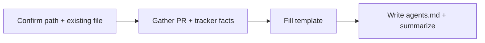

# Initializing agents.md

## Goal

Add or udpate the root `/agents.md` at the **consumer project root** with a structured starter that documents **project overview and description**, **technical stack**, **architecture**, plus git/PR tooling and issue-tracker settings (including **allowed ticket categories**) so assistants have product context and skills such as **create-pull-request** and **creating-an-issue** can resolve tools without hardcoding a provider.

## Rules

- **Default path:** `./agents.md` relative to the project the user is working in (same root as `.cursor/` when using Wonderful’s Cursor install).
- **Do not overwrite** an existing `agents.md` without explicit user confirmation; if the file exists, offer to **append missing sections**, **show a diff**, or **abort**.
- **Template sections:** keep **Project overview and description**, **Technical Stack**, **Architecture**, then **Git and pull requests**, **GitHub / issue-tracker configuration**, and optional **other MCP or local tools**—in that order unless merging into an existing file dictates otherwise.
- **Match downstream skills:** use a **GitHub / issue-tracker configuration** section (including **Allowed ticket categories**) and a **Git and pull requests** section so text searches in other skills stay reliable.
- **Project context:** prefer inferring overview, stack, and architecture from the repo (README, manifests, folder layout) when the user does not supply prose; use placeholders only where the codebase is ambiguous.
- **Placeholders:** use clear HTML comments or short placeholders where the user has not decided yet; avoid inventing MCP names or category lists—ask or leave `TODO` with a single line the user can edit.
- **Security:** never paste API tokens or secrets into `agents.md`; mention auth in prose only.

## Instructions

1. **Confirm path and intent**  
   - Use `./agents.md` unless the user specifies another path.  
   - If the file already exists, read it, summarize what is already covered, and only proceed per user choice (merge, replace, or stop).

2. **Collect minimal facts** (ask only what is missing and relevant):  
   - **Project overview and description** (purpose, audience, key capabilities)—from the user and/or the repo.  
   - **Technical stack** and **architecture**—from the user and/or the repo.  
   - Git host / PR workflow (GitHub, GitLab, etc.) and how PRs should be created (MCP id, `gh` CLI, etc.).  
   - Issue tracker (if different from git host) what is the issue tracker provider, what is the reference repository and project, and how issues are created.  
   - Repository or project scope (e.g. `owner/repo`).  
   - **Allowed ticket categories** (canonical list) or explicit note that the list will be filled later.
   - List of users associated with the project (if any).

3. **Materialize the file**  
   - Start from [references/agents-md-template.md](references/agents-md-template.md).  
   - Replace comments and placeholders with the user’s answers; keep section headings stable.  
   - If the user deferred categories, keep the **Allowed ticket categories** subsection with a short note such as “To be defined—downstream skills will prompt and persist.”

4. **Validate**  
   - Ensure both major sections exist and that **Allowed ticket categories** is present as a list or explicit deferral.  
   - Tell the user which skills will read this file (e.g. PR creation, epic/issue creation, backlog enrichment).

## Workflow

### Step 1: Path and collision check

**Do:**

1. Resolve the target path (`./agents.md` by default).
2. If the file exists, read it and list existing sections before editing.

**Success criteria:** You know whether you are creating, merging, or replacing content—with user approval for destructive changes.

### Step 2: Gather configuration

**Do:**

1. Ask for git/PR tool identification and issue-creation tool identification if not already known.
2. Ask for allowed ticket categories or accept an explicit “defer” for a later skill run.

**Success criteria:** Enough information to replace placeholders without guessing secrets or category names.

### Step 3: Write and hand off

**Do:**

1. Write the completed document to the chosen path.
2. Briefly list what you set and what the user should edit next.

**Success criteria:** `agents.md` exists, is valid Markdown, and matches the structure expected by consumer skills in this repository.

## Advanced Features

- **Canonical starter body:** [references/agents-md-template.md](references/agents-md-template.md)

## Resources

| Type      | Path                                              | Description                          |
| --------- | ------------------------------------------------- | ------------------------------------ |
| Template  | `references/agents-md-template.md`              | Default sections and placeholder text |
| Reference | `plugins/wonderwp-version-control/skills/create-pull-request/SKILL.md` | Reads `agents.md` for PR tooling     |
| Reference | `plugins/wonderwp-product-manager/skills/creating-an-issue/SKILL.md`   | Reads tracker + categories           |
