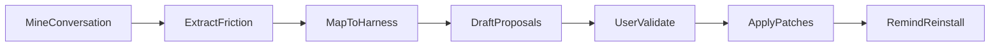

# Learn (harness retrospective)

## Goal

Turn end-of-session friction (user corrections, late clarifications, retries) into concrete, validated patches to the **ai-rules** harness so the same failure modes do not recur.

## Rules

- **Source of truth:** patch only the **ai-rules** repo under `plugins/` (skills, agents, commands, rules, templates, references). Never patch the consumer project’s `.cursor/` or local skill copies.
- **Evidence only:** invent no frictions; every proposal needs a conversational proof (see [references/friction-taxonomy.md](./references/friction-taxonomy.md)).
- **Propose then apply:** present proposals first; write files only after explicit user validation (item-by-item or batch).
- **Prefer edit over create:** amend an existing skill/reference/template before proposing a `new-skill`, unless the gap is clearly uncovered.
- **No git side effects:** do not commit, push, or open a PR unless the user explicitly asks.
- **Language:** write proposals and summaries in **French**; keep paths, skill `name`s, and technical identifiers in English.
- **After apply:** remind the user to reinstall Cursor skills from the consumer project:

```bash
./.wonderful/scripts/install.sh cursor
```

## Workflow



### Step 1: Mine the conversation

**Do:**

1. Use the **current chat** as the primary source. If the user pastes a transcript or path, include that too.
2. Collect candidate signals: user corrections, late clarifications, “not like that”, retries, undocumented expectations (paths, naming, tools).
3. Label each signal with a type from [references/friction-taxonomy.md](./references/friction-taxonomy.md).
4. Drop items with no clear harness implication (pure product one-offs the user wants session-local).

**Success criteria:** A short list of evidence-backed frictions with types; empty list is allowed (say so and stop).

### Step 2: Map to harness files

**Do:**

1. For each friction, search **this** ai-rules tree only, focusing on:
   - `plugins/*/skills/**/SKILL.md`
   - `plugins/*/skills/**/assets/*` and `**/references/**`
   - `plugins/*/agents/*.md`
   - `plugins/*/commands/*.md`
   - `plugins/*/rules/*.md` when present
   - root `skills-index.json` and skill frontmatter `description` / `Use when` (routing)
2. Prefer Grep/Glob + targeted reads over broad dumps.
3. Attach one or more **candidate targets** (exact paths) to each friction. If nothing matches, note a possible `new-skill` / `new-reference` / `new-template` and which plugin it would live under.

**Success criteria:** Every retained friction has at least one candidate path or an explicit “new file” recommendation under `plugins/<pluginName>/`.

### Step 3: Draft proposals (do not write yet)

**Do:**

1. Format output per [references/proposal-format.md](./references/proposal-format.md): summary table first, then per-item proposals.
2. Prefer the smallest change that would have prevented the friction (`edit` / `add-section` before `new-skill`).
3. Ask which proposals to apply (`all`, selected numbers, or `none`).

**Success criteria:** User sees prioritized proposals and has been asked for validation; **no files written** yet.

### Step 4: Apply validated patches and remind reinstall

**Do:**

1. Apply only the proposals the user accepted.
2. If creating a new skill, follow [create-ai-skill](../create-ai-skill/SKILL.md) conventions (folder, template headings, frontmatter).
3. After any skill add/rename, regenerate the catalogue from the ai-rules root:

```bash
python3 scripts/generate-skills-index.py
```

4. Summarize what changed (paths). Remind:

```bash
./.wonderful/scripts/install.sh cursor
```

**Success criteria:** Accepted patches are on disk in ai-rules; user was told to reinstall; no unsolicited git commit/PR.

## Advanced Features

- **Friction taxonomy:** [references/friction-taxonomy.md](./references/friction-taxonomy.md)
- **Proposal shape:** [references/proposal-format.md](./references/proposal-format.md)
- **New skill scaffolding:** [../create-ai-skill/SKILL.md](../create-ai-skill/SKILL.md)

## Resources

| Type      | Path | Description |
| --------- | ---- | ----------- |
| Reference | [references/friction-taxonomy.md](./references/friction-taxonomy.md) | Signal types and what counts as evidence |
| Reference | [references/proposal-format.md](./references/proposal-format.md) | Required summary table + per-item fields |
| Related   | [../create-ai-skill/SKILL.md](../create-ai-skill/SKILL.md) | When a proposal needs a new skill |
| Script    | `scripts/generate-skills-index.py` (repo root) | Refresh `skills-index.json` after skill add/rename |
| Install   | `./.wonderful/scripts/install.sh cursor` | Propagate ai-rules changes into Cursor |
