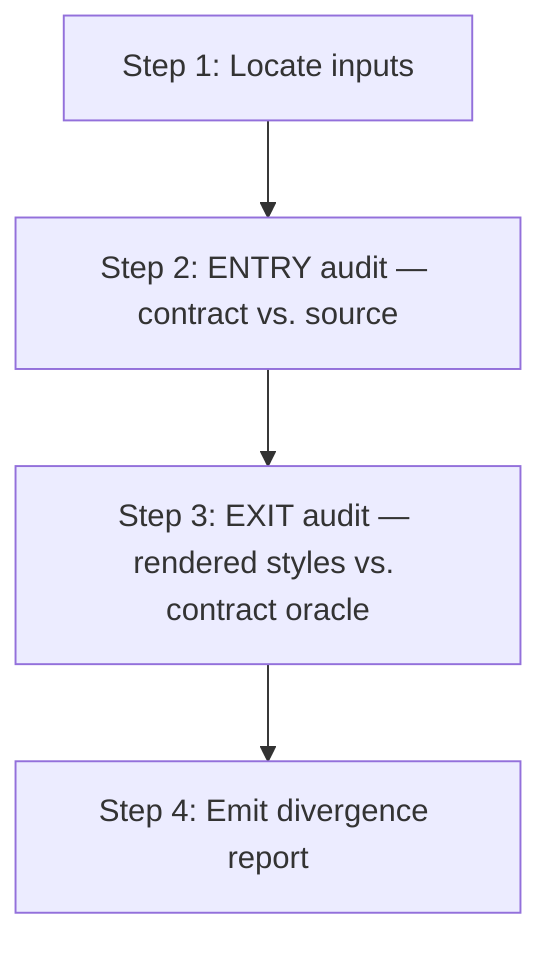

> **Path convention:** `{ds}` = project design-system root (default
> `ai_resources/design-system`). `{p}` = `plugins/wonderwp-design-system`.

# Auditing render fidelity

## Goal

Detect divergences between **what the design source shows** and **what the
pipeline produces**, at two checkpoints:

- **ENTRY** — the measured values in `contract.json` faithfully transcribe the
  source (R-FIDELITY-1..5 from `rules/source-fidelity.md`): no rounding, no
  silent snapping, no invented states, no structural flattening.
- **EXIT** — the CSS/HTML emitted by the pipeline (contract → mapping → build)
  matches those measured values when rendered: computed styles match the
  contract oracle, and the screenshot gestalt matches the source image.

On completion, emit a **divergence report** (corrective table) with severity and
correction location. The skill is **read-only** — it reports, never fixes.

## Scope

Always scoped to one component via `--target`:

```
--target atoms/<slug>
--target molecules/<slug>
```

Both ENTRY and EXIT checks run by default. Pass `--entry-only` or `--exit-only`
to isolate a phase.

## Dependency: Playwright + Chromium

The EXIT phase uses Playwright to render `preview.html` and read computed
styles. Before running, check availability:

```bash
node -e "require('@playwright/test')" 2>/dev/null || \
  npx playwright --version 2>/dev/null
```

If absent, the script detects this and surfaces installation guidance
(see [playwright-setup](references/playwright-setup.md)) rather than crashing.
The ENTRY phase runs without Playwright.

## Workflow



### Step 1: Locate inputs

**Do:**

```bash
node {p}/scripts/audit-render-fidelity.mjs \
  --design-system {ds}                      \
  --target        <layer>/<slug>            \
  [--entry-only | --exit-only]
```

The script resolves:
- `{ds}/components/<layer>/<slug>/contract.json` — contract under audit
- `com.wonderwp.source.url` inside the contract — design source URL
- `{ds}/preview.html` — rendered styleguide (built by `build.mjs --targets styleguide`)
- `{ds}/tokens.json` — token oracle for value resolution

**If `preview.html` is missing or stale (older than `contract.json`):**
Surface the gap and offer:
> "`preview.html` is missing or older than the contract. Regenerate it now?
> (`yes` — run `build-design-system` → then continue / `no` — skip EXIT phase)"

**Success criteria:** Contract found; source URL present (or clearly absent with
a note); preview available or user has explicitly skipped EXIT.

### Step 2: ENTRY audit — contract vs. source

**Goal:** Verify the transcription. Each value in `aesthetic.base` and declared
variant overrides was correctly read off the source — no estimation, no silent
snapping, no missing/invented parts.

**Do:** Run the entry-phase checker:

```bash
node {p}/scripts/audit-render-fidelity.mjs \
  --design-system {ds}                      \
  --target        <layer>/<slug>            \
  --entry-only
```

The script applies the R-FIDELITY-1..5 checks listed in
[entry-checks](references/entry-checks.md). Each finding carries:
- the offending `part.property` path
- the value recorded in the contract
- the expected behaviour (what R-FIDELITY rule demands)
- the correction location (`contract` = transcription error)

**What is checked:** See [entry-checks](references/entry-checks.md) for the full
checklist. The canonical rule definitions live in `rules/source-fidelity.md`.

**Success criteria:** Script exits; entry-phase findings captured (zero or more).

### Step 3: EXIT audit — rendered styles vs. contract oracle

**Goal:** Verify that the build chain faithfully materialises the contract. For
each `part` declared in `aesthetic.base`, compare the CSS computed value (read
by Playwright from the live preview) against the token-resolved value from the
contract (the oracle).

**Do:**

```bash
node {p}/scripts/audit-render-fidelity.mjs \
  --design-system {ds}                      \
  --target        <layer>/<slug>            \
  --exit-only
```

The script:
1. Launches a headless Chromium via Playwright.
2. Loads `{ds}/preview.html` (file:// URL).
3. Navigates to the component's card (matched by its `.comp-card__slug` chip)
   and scopes to the default-variant instance (`.live-preview__variant--default`).
4. For each `part` in `aesthetic.base`, queries its **BEM class** — `root` →
   `.<rootClass>` (default `ds-<slug>`, detected from the component's
   `styles.css`), other parts → `.<rootClass>__<part>` — and calls
   `getComputedStyle` on every CSS property declared in the contract. The
   rendered output carries no `part=""` attributes; parts are BEM classes.
5. Compares each computed value against the token-resolved oracle from
   `tokens.json`.
6. Takes a full-card screenshot and saves to a temp path for gestalt overlay.

Each divergence carries:
- `part.property`, computed value, oracle value, delta
- correction location: `mapping` (wrong CSS property target) or `token` (token
  resolves to the wrong value)

**Success criteria:** Playwright ran; per-part computed-style findings and
screenshot captured.

### Step 4: Emit divergence report

**Do:** Render one markdown table combining ENTRY and EXIT findings. Format
spec: [corrective-table](references/corrective-table.md).

**On zero findings (all pass):**
```
✓ fidelity audit passed — <layer>/<slug>
  ENTRY: 0 findings  |  EXIT: 0 divergences
```

**On at least one finding:** emit the corrective table, then summarise:
```
<layer>/<slug> — N finding(s): E entry / X exit
```

The skill does NOT auto-fix. Each row names the exact file and field to correct:
- `contract` = re-read the value off the source (R-FIDELITY-1..3)
- `mapping` = the `to-css.json` mapping points to the wrong CSS property
- `token` = the token resolves to a value that does not match what was measured

If a gestalt screenshot was captured, add a note:
> "Screenshot saved to `<path>`. Compare visually against the source at `<url>`."

## Side-effect guarantee

This skill is **read-only**. It runs validators and Playwright in observe-only
mode. It never writes to `contract.json`, `tokens.json`, any mapping, or any
generated artefact.

## Caller contract

| Caller | When invoked | Mode |
|---|---|---|
| standalone | After `create-atom` / `create-molecule` + `build-design-system` | `--target <layer>/<slug>` |
| standalone | When the source mockup is updated | `--target <layer>/<slug>` |
| standalone | When suspecting silent token snapping | `--entry-only` |
| standalone | When rendered output diverges visually | `--exit-only` |

## Resources

| Type | Path | Description |
|---|---|---|
| Script | `{p}/scripts/audit-render-fidelity.mjs` | Orchestrator CLI (entry + exit phases) |
| Reference | `rules/source-fidelity.md` | R-FIDELITY-1..5 — canonical fidelity rules |
| Reference | [references/entry-checks.md](references/entry-checks.md) | ENTRY phase checklist (what the script checks per rule) |
| Reference | [references/corrective-table.md](references/corrective-table.md) | Divergence report format, severity legend, example rows |
| Reference | [references/playwright-setup.md](references/playwright-setup.md) | Playwright / Chromium installation guide |
| Input | `{ds}/components/<layer>/<slug>/contract.json` | Contract under audit |
| Input | `{ds}/tokens.json` | Token oracle (value resolution) |
| Input | `{ds}/preview.html` | Rendered styleguide (EXIT phase) |
| Sibling | `skills/validate-contract/SKILL.md` | Structural/schema validation (not fidelity) |
| Sibling | `skills/validate-tokens/SKILL.md` | Token file validation |
| Sibling | `skills/validate-mapping/SKILL.md` | Mapping document validation |
| Sibling | `skills/build-design-system/SKILL.md` | Rebuild preview before EXIT phase |
