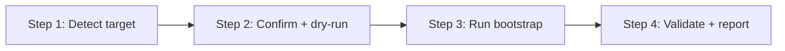

> **Path convention:** `{ds}` refers to the project's design-system root folder.
> Defaults to `ai_resources/design-system`. `{p}` = `plugins/wonderwp-design-system`.

# Bootstrapping a design system

## Goal

Create an empty but DTCG-valid design-system root so the rest of the plugin
(create-token, create-atom, …) can operate immediately. A **mechanical script
invocation** with confirmation gates — no inline file building, no fabricated
content. After bootstrap, the user is one `/extract-from-figma` (or a manual
`create-token`) call away from their first real artefact.

The exact tree the script writes is in
[references/skeleton.md](references/skeleton.md).

## Rules

- **Idempotence:** If `{ds}` exists, refuse to write without explicit `--force`.
  On a partly populated tree `--force` only overwrites missing or top-level
  files; it never deletes atoms / molecules / tokens already in place.
- **R-PIPE-2 — No invention:** Never write design tokens or component contracts.
  Only the empty skeleton.
- **R-PIPE-8 — Surface, don't silence:** If the script fails (permissions, disk
  full, …), surface the full error and stop.
- **Verify after write:** Run `validate-tokens` against the freshly written
  tokens before reporting success — an invalid tokens is a bug, not a usable DS.

## Workflow



### Step 1: Detect target

**Do:**

1. Pick the target directory: the user's explicit path, else default
   `ai_resources/design-system` relative to the project root.
2. If the target already exists, list its top-level files + folders and ask:
   > "`<path>` already exists. Overwrite top-level files only (keep existing
   > tokens and components), or abort?"

   Never propose to delete anything.

**Success criteria:** A target path is confirmed; the user has explicitly opted
in if anything was already there.

### Step 2: Confirm with a dry-run

**Do:** Show exactly what will be written, then ask to proceed:

```bash
node {p}/scripts/bootstrap-design-system.mjs --ds <target-path> --dry-run
```

The output lists every directory created and every file written. Ask:
> "Proceed with this bootstrap? (yes / no — edit the target path / abort)"

This is the only confirmation before disk writes.

**Success criteria:** The user has approved the planned writes.

### Step 3: Run bootstrap

**Do:** Run the script (`--force` only if the user opted in at Step 1):

```bash
node {p}/scripts/bootstrap-design-system.mjs --ds <target-path> [--force]
```

Capture stdout/stderr. If it exits non-zero, surface the full error (R-PIPE-8)
and stop.

**Success criteria:** Script exits 0; the target tree exists on disk.

### Step 4: Validate and report

**Do:**

1. Run `validate-tokens` against the new tokens:
   ```bash
   node {p}/scripts/validate-dtcg.mjs --tokens <target-path>/tokens.json --tokens-only
   ```
   On any finding, render the corrective table per the `validate-tokens`
   SKILL.md and stop — do not declare success until the tokens is clean.
2. On success, report: the absolute `{ds}` path, the 8 token-families ready to
   receive tokens, the empty `components.json`, and next steps —
   `/extract-from-figma <figma-url>` to seed from Figma, `create-token` to add
   the first token manually, `create-atom` once its needed tokens exist.

**Success criteria:** Tokens validates clean; user knows where to go next.

## When to invoke

- **First-time setup** where no `ai_resources/design-system/` folder exists.
- **Re-bootstrap** of a corrupted layout, after the user confirms the missing
  files can safely be overwritten.

Do NOT auto-invoke when another skill detects a missing file — those skills
(create-token, validate-tokens, …) should surface a "design system not
initialised — run bootstrap-design-system" prompt instead.

## Resources

| Type | Path | Description |
|---|---|---|
| Script | `{p}/scripts/bootstrap-design-system.mjs` | Writes the skeleton; supports `--ds`, `--force`, `--dry-run` |
| Reference | [references/skeleton.md](references/skeleton.md) | Exact tree written + what the script never writes |
| Sibling | `skills/validate-tokens/SKILL.md` | Post-bootstrap validation (Step 4) |
| Sibling | `skills/create-token/SKILL.md` | First populating step after bootstrap |
| Sibling | `commands/extract-from-figma.md` | Alternative populating step starting from a Figma file |
| Reference | `rules/contract-schema.md` | Schema each future contract will follow |
| Reference | `rules/pipeline.md` | Pipeline rules (R-PIPE-*) |
