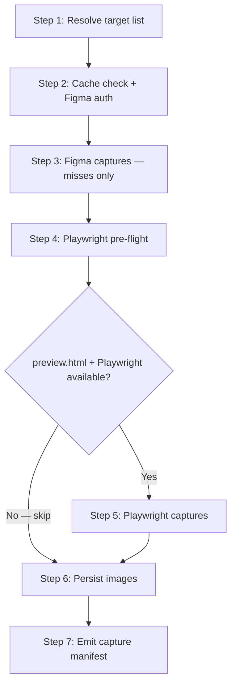

> **Path convention:** `{ds}` = project design-system root (default
> `ai_resources/design-system`). `{p}` = `plugins/wonderwp-design-system`.
> All paths are relative to the project root unless stated otherwise.

# Capturing design system screenshots (Figma + Playwright)

## Goal

For each target component:

1. **Figma capture** — read `contract.json` to get `com.wonderwp.source.url`,
   serve the screenshot from the snapshot cache (`rules/figma-cache.md`),
   fetching via the Figma MCP only on miss, and write to
   `{ds}/components/<layer>/<slug>/screenshots/figma-reference.png`.
2. **Playwright capture** (conditional — graceful degradation) — if `{ds}/preview.html`
   exists and Playwright is available, navigate to the component's card, and
   write a screenshot to `{ds}/components/<layer>/<slug>/screenshots/rendered.png`.
   When either condition is absent, skip without error and record the reason.

Emit a **capture manifest** at the end. The manifest drives the PR's
side-by-side conformance comparison table.

## Input

Arguments are passed as a free-form string. Accepted forms:

| Form | Meaning |
|---|---|
| `badge, button` | Those slugs only (layer auto-detected from `components.json`) |
| `atoms/badge, atoms/button` | Explicit `<layer>/<slug>` form |
| `--layer atoms` | Every atom registered in `components.json` |
| `--layer molecules` | Every molecule registered in `components.json` |
| `--preview-url <path-or-url>` | Override the default preview target (see Playwright section) |
| `--refresh` | Treat cached Figma screenshots as stale — re-fetch via the MCP (R-CACHE-4) |
| _(empty)_ | Every registered component (atoms + molecules) |

Multiple forms may be combined: `badge, --layer molecules`.

## Workflow



### Step 1: Resolve target list

**Do:**

1. Parse arguments (slugs, `--layer` flags, `--preview-url`, empty).
2. Read `{ds}/components.json` to resolve every slug to its layer and confirm
   it is registered.
3. For each resolved component, read
   `{ds}/components/<layer>/<slug>/contract.json` and extract:
   - `$extensions.com.wonderwp.source.url` — Figma URL with `node-id`
   - `$extensions.com.wonderwp.source.type` — must be `"figma"`
   - `$extensions.com.wonderwp.defaultVariant` — default variant combination
   - `$extensions.com.wonderwp.cascadeOrder` — variant axis order
4. Build target list: `[ { slug, layer, figmaUrl, nodeId, defaultVariant, cascadeOrder } ]`.

**Error handling (non-blocking — skip and continue):**
- Slug not in `components.json` → warn and skip.
- `contract.json` absent → warn and skip.
- `source.type !== "figma"` → record `figmaSkipped: "no Figma source"`.
- `source.url` missing `node-id` → record `figmaSkipped: "URL has no node-id"`.

**Success criteria:** At least one valid target resolved.

### Step 2: Check the snapshot cache, then pre-flight Figma auth

For each target, resolve the cache location first (`rules/figma-cache.md`):

```bash
node {p}/scripts/figma-cache.mjs status --url "<figmaUrl>"
```

The JSON reply gives `fileKey` / `nodeId` and whether
`nodes/<node-dir>/screenshot.png` exists (with `ageHours`). Split the targets:

- **Cache hit** (screenshot exists, no `--refresh`) → reuse the cached PNG;
  record `figmaStatus: "cache (<ageHours>h old)"`. `extract-from-figma`
  populates this during extraction, so a same-run capture never re-fetches.
- **Miss or `--refresh`** → this target needs an MCP fetch (Step 3).

Call the Figma MCP `whoami` once **only when at least one target needs a
fetch**. If it fails, surface the error and stop — every Figma fetch will
fail without a live session. All targets cached → skip the Figma MCP
entirely and jump to Step 4. (Figma MCP bindings: `rules/harness.md`.)

### Step 3: Figma captures (parallel, misses only)

For each target needing a fetch, call the Figma MCP `get_screenshot` with:

```
fileKey: <fileKey from figma-cache.mjs status>
nodeId:  <nodeId from figma-cache.mjs status (colon form)>
```

Run all calls in parallel (Figma MCP supports concurrent requests). Download
each result straight to the cache path
`{ds}/.cache/figma/<file-key>/nodes/<node-dir>/screenshot.png` (R-CACHE-2)
— run `figma-cache.mjs init --url "<figmaUrl>"` first if the folder does not
exist yet. On per-target failure, record the error and continue — do not
abort.

### Step 4: Playwright pre-flight

Determine whether Playwright capture is available. Two conditions must both be true:

**Condition A — rendered preview exists:**
- If `--preview-url` was passed, use that path/URL.
- Otherwise check `{ds}/preview.html`. It exists when `build-design-system` (or
  `generate-styleguide`) has been run at least once.
- If neither exists → set `playwrightSkipReason: "no preview target"` for ALL
  targets and jump to Step 6.

**Condition B — Playwright is installed:**

```bash
node -e "require('@playwright/test')" 2>/dev/null && echo ok
```

If this fails → set `playwrightSkipReason: "Playwright not installed"` for ALL
targets and jump to Step 6. Emit a hint:
> "Playwright not found. Install with: npm install --save-dev @playwright/test && npx playwright install chromium"

When both conditions are met, proceed to Step 5.

### Step 5: Playwright captures

Launch a headless Chromium browser and load the preview:

```js
const page = await chromium.launch().newPage();
await page.goto(`file://${resolve(previewPath)}`, { waitUntil: 'networkidle' });
```

For each target:

1. Navigate to the correct tab:
   ```js
   const tabBtn = page.locator(`button[data-tab="${layer}"]`);
   if (await tabBtn.count() > 0) await tabBtn.click();
   ```
2. Locate the component card by its slug chip:
   ```js
   const card = page.locator('.comp-card')
     .filter({ has: page.locator('.comp-card__slug', { hasText: /^\s*<slug>\s*$/ }) })
     .first();
   ```
3. If the card is not found → record `renderedSkipped: "component card not found in preview — rebuild styleguide"`.
4. If found → take screenshot:
   ```js
   await card.screenshot({ path: '<screenshots-dir>/rendered.png' });
   ```

On per-target Playwright error, record the error in `renderedStatus` and continue.

### Step 6: Persist images

For each target:

1. Ensure `{ds}/components/<layer>/<slug>/screenshots/` exists.
2. Write `figma-reference.png` if a Figma capture is available: copy the
   cached PNG (`cp <cache-path> <screenshots-dir>/figma-reference.png`) —
   whether it came from a cache hit (Step 2) or a fresh fetch (Step 3), the
   cache path is the single source.
3. Write `rendered.png` if Playwright capture succeeded (already written in Step 5).
4. Always overwrite — this skill is idempotent.

### Step 7: Emit capture manifest

Print the manifest (see [references/manifest-format.md](references/manifest-format.md))
and return it as structured output for callers.

Compact terminal summary:

```
capture-figma-screenshots — manifest
─────────────────────────────────────────────────────────────────
Component                 Figma            Playwright       Status
─────────────────────────────────────────────────────────────────
atoms/badge               ✓ captured       ✓ captured       ✅ both
atoms/button              ✓ captured       ✓ captured       ✅ both
molecules/card-editorial  ✓ captured       ⊘ card not found ⚠ partial
atoms/heading             ⊘ no node-id     ⊘ no preview     ❔ skipped
atoms/thumbnail           ✗ rate-limited   ✗ launch error   ✗ errors
─────────────────────────────────────────────────────────────────
figma: 3 captured, 1 skipped, 1 error
playwright: 2 captured, 2 skipped, 1 error
```

## Playwright trigger vs skip — decision table

| Condition | Result |
|---|---|
| `preview.html` exists AND Playwright installed | Capture `rendered.png` |
| `preview.html` exists, Playwright absent | Skip — emit install hint |
| `preview.html` absent, `--preview-url` provided | Capture using the given URL |
| `preview.html` absent, no `--preview-url` | Skip — emit "run build-design-system first" hint |
| Component card not found in preview | Skip per-target — emit "rebuild styleguide" hint |
| Any Playwright runtime error | Skip per-target — record error, continue |

All Playwright skips are **non-blocking**. Figma captures still proceed.

## Side-effect guarantee

Write only inside `{ds}/components/<layer>/<slug>/screenshots/` and the
snapshot cache `{ds}/.cache/figma/` (R-CACHE-2/5). Never modify
`contract.json`, `tokens.json`, `components.json`, or any mapping/transform
artefact.

## Caller contract

`extract-from-figma` invokes this skill just before opening a PR, via
DELEGATE (`rules/harness.md`):

```
DELEGATE(capture-figma-screenshots,
  "<comma-separated list of <layer>/<slug> for every component created in the current run>")
```

The returned manifest drives:
1. Staging PNG files (`git add`) alongside contract changes.
2. Generating the PR's side-by-side conformance table (see `references/manifest-format.md`).
3. Generating the PR's "How to use" section (variant examples).

## Resources

| Type | Path | Description |
|---|---|---|
| Reference | [references/manifest-format.md](references/manifest-format.md) | Structured manifest + PR table format |
| Rule | `rules/figma-cache.md` | Snapshot cache — read-through protocol (R-CACHE-1..5) |
| Helper | `{p}/scripts/figma-cache.mjs` | Cache path resolution + per-artifact state (Step 2) |
| Cache | `{ds}/.cache/figma/<file-key>/nodes/<node-dir>/screenshot.png` | Cached Figma screenshot — single fetch source |
| Input | `{ds}/components.json` | Component registry — slug → layer resolution |
| Input | `{ds}/components/<layer>/<slug>/contract.json` | Figma URL, defaultVariant, cascadeOrder |
| Input | `{ds}/preview.html` | Playwright render target (built by `build-design-system`) |
| Output | `{ds}/components/<layer>/<slug>/screenshots/figma-reference.png` | Figma reference screenshot |
| Output | `{ds}/components/<layer>/<slug>/screenshots/rendered.png` | Playwright rendered screenshot |
| MCP op | Figma MCP `whoami` | Auth pre-flight (bindings: `rules/harness.md`) |
| MCP op | Figma MCP `get_screenshot` | Figma screenshot fetch |
| Sibling | `commands/extract-from-figma.md` | Primary caller |
| Sibling | `skills/audit-render-fidelity/SKILL.md` | Uses persisted screenshots for gestalt overlay |
| Sibling | `skills/build-design-system/SKILL.md` | Produces `preview.html` required by Playwright |
