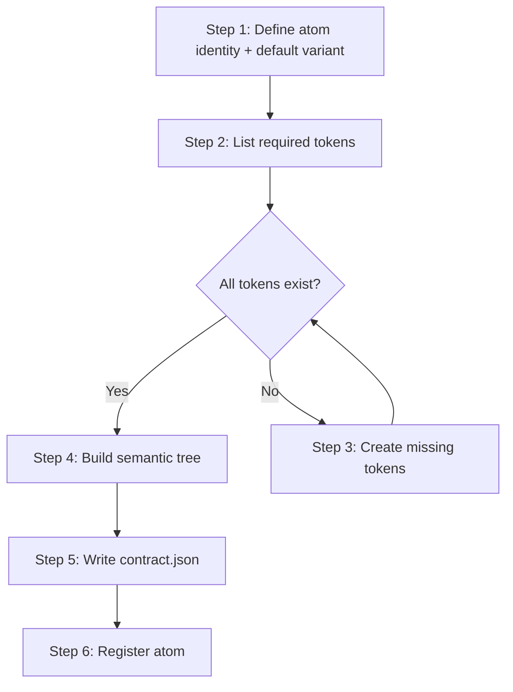

> **Path convention:** `{ds}` = the project's design-system root folder
> (default: `ai_resources/design-system`). Paths are relative to the project root.

# Creating an atom

## Goal

Produce a token-backed atom **contract**: verify all required tokens exist
(create gaps via `create-token`), compose **aesthetic** (DTCG tokens +
variants) and **semantic** (WHATWG DOM tree), join the two on `part`, write
one `contract.json` under `{ds}/components/atoms/<slug>/`. The contract is
the validated source of truth for transform engines — it never emits
implementation artifacts.

## Rules

- **Dialogue (R-ASK-1, `rules/interaction.md`):** batch by default — Steps 1–4
  collect + propose, ONE consolidated review (identity + token table +
  variants + semantic tree, R-ASK-2/3) gates Step 5's writes; `--interactive`
  = step-by-step. Ambiguities (unreadable value, unmappable variable) always
  interrupt individually, in both profiles.
- **Source fidelity (R-FIDELITY-1..5, `rules/source-fidelity.md`):** the
  contract transcribes the design source (`com.wonderwp.source.url`), never
  interprets it — measure every value; no estimates, no rounding to "nicer"
  numbers, no assumed symmetry, no invented states/wrappers, no silent
  snapping to a near token. Source ambiguous or value missing → ask the
  user, never fill from imagination.
- **STOP at the contract — emit only `contract.json` + `README.md`** under
  `{ds}/components/atoms/<slug>/`: no `template.html` / `styles.css`, no
  framework file (`.tsx`, `.vue`, `.swift`, `theme.json`, Tailwind config, …).
  HTML/CSS artifacts are **derived** later by `load-contract` + a mapping
  JSON — enforced by the `hooks/whitelist-component-files.sh` PreToolUse
  hook; refuse any other write here. Display **no** CSS/HTML anywhere — not
  in files, **not even in chat**; rendering is the Load phase. A
  `create-token` sub-call generates **no** CSS either (its Step 9 is skipped).
- **`$type` MUST be `"component-contract"`.**
- **Atom =** minimal, self-contained UI element with no child components
  (button, icon, badge, label, input, avatar, divider, tag). Needs child
  atoms → it is a molecule: redirect to `create-molecule`.
- **Token-first:** every visual property maps to a token path; hardcoded
  values forbidden in `aesthetic.base` / `aesthetic.variants`.
- **DOM-faithful:** `semantic` is a literal WHATWG DOM subset (PascalCase
  `nodeName`) — `rules/contract-schema.md`.
- **Part jointure (R-CONTRACT-1/3):** every semantic Element carries a `part`
  matching a key in `aesthetic.base`; root Element = `part: "root"`; atoms
  never use `Slot`.
- **Verify before compose:** every referenced token must exist in
  `{ds}/token-families/` and `{ds}/tokens.json`; missing → `create-token`.
- **Consent per token, never silent:** table rows in batch (R-ASK-3), one
  prompt per token in interactive.
- **Idempotence:** existing `{ds}/components/atoms/<slug>/contract.json` →
  surface before overwriting.

## Workflow

### Step 1: Define atom identity

1. Collect from caller context, or ask. Batch: derive + propose, confirmation
   deferred to the consolidated review (R-ASK-2). Interactive: ask now.
   - **Name**: human-readable (e.g. "Button").
   - **Slug**: kebab-case (e.g. `button`) — suggest from name, confirm.
   - **Description**: one sentence.
   - **Source URL** (optional): design source (Figma link, Storybook URL,
     screenshot) → `com.wonderwp.source.url`; auto-detect when the caller
     provides a Figma URL.
   - **Visual parts**: sub-parts (e.g. `root`, `inner`, `label`, `icon-left`,
     `arrow`).
   - **Variant axes** (optional): axes with allowed values (e.g.
     `size: sm | md | lg`, `style: brand | dark-blue | white | blue`,
     `interaction: hover | pressed | focus | disabled`).
2. Variant axes declared → delegate to `declare-variant` in ONE batch
   invocation (R-ASK-5) carrying the full axis/value list (it owns axis-group
   classification, `{axis}:{kebab-value}` naming, selector derivation, DTCG
   override declarations, one final validation pass). Then define the
   mandatory default combination —
   [default variant rules](references/default-variant.md).
3. Confirm no child atom dependencies — any → redirect to `create-molecule`.
4. `{ds}/components/atoms/<slug>/contract.json` exists → show existing files,
   ask: "Atom already exists. Overwrite, extend, or abort?"

**Success:** identity confirmed; default variant combination declared (when
variants exist); no child atom dependencies.

### Step 2: List required tokens

Read each value **off the design source** — measure, never estimate
(R-FIDELITY-1..3).

1. Per visual part, walk the full property set (box, layout, color,
   typography, border, effect — table in R-FIDELITY-2) and capture the
   **measured value** for each property in use. Property the source uses →
   MUST be captured; property it does not use → absent, never invented.
2. Pair each measured value with its token path.
3. Resolve against `{ds}/tokens.json`: **exact** match → **found**; else
   **missing** (keep the measured value — no snapping, R-FIDELITY-3 / Step 3).
4. Display:

   | Part | Property | Measured value | Token Path | Status |
   |---|---|---|---|---|
   | root | background | `#1B49C2` | `color.primary.blue.500` | found |
   | label | font-size | `13px` | _(no exact token)_ | missing |

**Success:** every property the source shows captured with exact measured
value + found/missing status — nothing estimated, snapped, or invented.

### Step 3: Create missing tokens (conditional)

1. Per missing token, surface **measured value** + nearest existing token +
   proposed resolution (create / bind-nearest / re-measure / skip).
   **Batch (R-ASK-3):** all missing tokens are rows of one decision table in
   the consolidated review — proposal defaults to `create` with the measured
   value; the user amends rows. **Interactive:** ask per token
   (R-FIDELITY-3): "Measured `<value>` has no exact token. Create, bind to
   nearest `<token>` (`<token-value>`), re-measure, or skip?". Both profiles:
   never silently snap — `bind-nearest` is only ever the **user's** choice.
2. **create** → invoke `create-token` ONCE with the confirmed batch (path +
   **measured value**, unaltered — R-ASK-4/5); it checks silently, surfaces
   only anomalies. Re-check `{ds}/tokens.json` to confirm existence.
3. **bind-nearest** → bind to the user-picked token, mark **found** — the
   only sanctioned non-exact resolution.
4. **re-measure** → re-read off the source, re-resolve.
5. **skip** → note it; at the end warn: "Skipped tokens will leave hardcoded
   gaps in the atom composition. Proceed with skipped tokens? (yes / abort)".
6. Repeat until every token is found, bound, or explicitly skipped.

**Success:** zero missing tokens, or user explicitly accepted the skips.

### Step 4: Build semantic tree (WHATWG DOM)

Build `semantic` as a WHATWG DOM tree of `Element` / `Text` nodes (shapes:
`rules/contract-schema.md`). Every Element carries a `part` matching a key in
`aesthetic.base`. The tree **mirrors the source's actual structure**
(R-FIDELITY-5): real nesting, real reading order — no flattened wrappers, no
added ones.

1. **Root semantic type:** suggest a PascalCase `nodeName` —
   [atom nodeName table](references/semantic-nodename-table.md) (list not
   closed; the transform phase maps it to a target tag). Batch: confirmed in
   the consolidated review (R-ASK-2). Interactive: ask "What is this atom,
   semantically?".
2. **Per part from Step 1/aesthetic, decide:** Element child of root or
   deeper? `nodeName`? text content (→ `Text` child with `data`)?
   accessibility attributes (`name`, `description`, `aria-hidden`,
   `aria-label`, `role`, …)?
3. **Compose the tree** — node shapes in `rules/contract-schema.md`, fill-in
   skeletons in [contract skeleton](references/contract-skeleton.md).
4. **Validate the jointure.** Part in `aesthetic.base` with no Element → ask:
   "Part `<name>` is declared in `aesthetic.base` but absent from `semantic`.
   Add an Element, mark it `aesthetic.base.<name>: {}` (pure wrapper, no
   tokens), or remove it from aesthetic?"
5. **Skip-with-warning (migration-only):** `"semantic": null` allowed after
   surfacing:
   > "semantic section is null — transform engines cannot reconstitute
   > structure until it is filled. Proceed? (yes / cancel)"

   New atoms SHOULD always populate `semantic`.

**Success:** fully-jointured tree (every `part` matches an `aesthetic.base`
key), or explicit `semantic: null` with user confirmation.

### Step 5: Write contract.json

0. **Batch gate (R-ASK-2):** present the ONE consolidated review — identity,
   token decision table (Steps 2/3), variant axes + default combination,
   semantic root + parts. Apply amendments; write nothing before it passes.
   (Interactive: per-step confirmations already covered this.)
1. Compose **aesthetic** from the validated tokens
   (`aesthetic.base["<part>"]["<property>"]`,
   `aesthetic.variants["<axis>:<value>"]`). DTCG + WHATWG rules are canonical
   in `rules/contract-schema.md` (DTCG specifics: `rules/normalization.md`) —
   follow them, do not restate them.
2. Combine with the Step 4 tree; write
   `{ds}/components/atoms/<slug>/contract.json` — fill-in
   [atom contract skeleton](references/contract-skeleton.md).
3. Invoke `validate-contract` with `--target atoms/<slug> --strict` — it
   surfaces every finding (DTCG aesthetic, WHATWG semantic, jointure
   R-CONTRACT-1..3/7, plus R-CONTRACT-12: an atom contains no `Slot`) as a
   corrective table with per-row fixes.

**Success:** `contract.json` written with both sections; `--strict`
validation passes; `defaultVariant` declared; jointure verified.

### Step 6: Register the atom

1. Generate `{ds}/components/atoms/<slug>/README.md`: purpose, default
   variant, contract summary, parts + semantic nodeNames, variant axes +
   values, usage notes. Documentation, not an implementation artefact.
2. Update `{ds}/components.json` — add an entry under `atoms[]`.
3. Final summary: name + slug; default variant combination; token count
   (base + variant overrides); semantic root nodeName + part count; CSS
   contract surface (`cssContract.required` + `cssContract.optional`); files
   written.

**Success:** atom registered (contract + docs + index entry). No
HTML/CSS/framework files — those are derived later by the appropriate
transform.

## Resources

| Type | Path | Description |
|---|---|---|
| Skill | `skills/create-token/SKILL.md` | Creates missing tokens (Step 3) |
| Skill | `skills/declare-variant/SKILL.md` | Declares the variant axis/value batch (Step 1) |
| Skill | `skills/validate-contract/SKILL.md` | Contract validation (Step 5) — `--target atoms/<slug> --strict` |
| Reference | `references/semantic-nodename-table.md` | Atom-kind → PascalCase `nodeName` suggestions (Step 4) |
| Reference | `references/default-variant.md` | Default variant combination rules (Step 1) |
| Reference | `references/contract-skeleton.md` | Fill-in `contract.json` + node-shape skeletons (Step 5) |
| Rule | `rules/interaction.md` | Dialogue protocol (R-ASK-1..6) — batch profile, consolidated review, decision tables, caller-confirmed sub-calls |
| Rule | `rules/source-fidelity.md` | Reproduce the source, never interpret (R-FIDELITY-1..5) — Steps 2–4 |
| Rule | `rules/contract-schema.md` | Canonical contract schema (aesthetic + semantic, WHATWG DOM shape, jointure R-CONTRACT-*) |
| Rule | `rules/normalization.md` | DTCG value normalization (R-NORM-*) |
| Hook | `hooks/whitelist-component-files.sh` | Enforces the `contract.json` + `README.md` whitelist under `components/<layer>/<slug>/` |
| Output | `{ds}/components/atoms/<slug>/contract.json` | **Single source of truth** — atom contract |
| Output | `{ds}/components/atoms/<slug>/README.md` | Human documentation |
| Output | `{ds}/components.json` | Component library index |
| Reference | `{ds}/tokens.json` | Token existence checks |
| Reference | `{ds}/token-families/` | Token family files |
