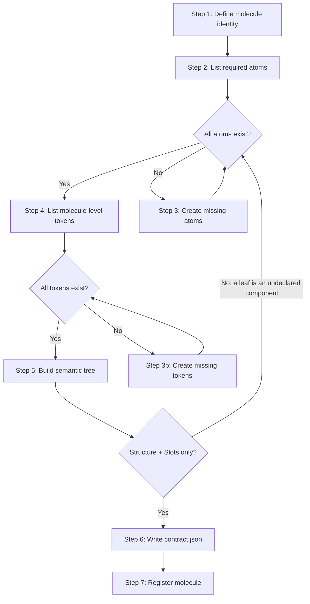

> **Path convention:** `{ds}` = the project's design-system root folder
> (default: `ai_resources/design-system`). `{p}` = `plugins/wonderwp-design-system`.
> Paths are relative to the project root.

# Creating a molecule

## Goal

Produce a token-backed molecule **contract**: verify all child atoms exist
(create gaps via `create-atom`), resolve molecule-level token gaps, compose
**aesthetic** (DTCG tokens + variants for molecule-level parts) and
**semantic** (WHATWG DOM tree where each child atom is a reserved `Slot`
Element), join the two on `part`, write one `contract.json` under
`{ds}/components/molecules/<slug>/`. The contract is the validated source of
truth for transform engines — it never emits implementation artifacts.

## Rules

- **Dialogue (R-ASK-1, `rules/interaction.md`):** batch by default — Steps
  1–5 collect + propose, ONE consolidated review (identity + atom checklist +
  token table + variants + semantic tree, R-ASK-2/3) gates Step 6's writes;
  `--interactive` = step-by-step. Ambiguities always interrupt individually,
  in both profiles. A `create-atom` spawned for a missing child atom runs its
  OWN consolidated review — one review per component, not one for the tree.
- **Source fidelity (R-FIDELITY-1..5, `rules/source-fidelity.md`):** the
  contract transcribes the design source (`com.wonderwp.source.url`), never
  interprets it — measure every molecule-level value; reproduce its exact
  layout, child set, and reading order; no estimates, no assumed symmetry, no
  invented states/wrappers, no silent snapping to a near token. Source
  ambiguous or value missing → ask the user, never fill from imagination.
  Applies recursively: a `create-atom` invoked here transcribes its atom from
  the same source with the same rigor.
- **STOP at the contract — emit only `contract.json` + `README.md`** under
  `{ds}/components/molecules/<slug>/`: no `composition.json` (legacy schema,
  gone), no `template.html` / `styles.css`, no framework file (`.tsx`,
  `.vue`, `.swift`, `theme.json`, Tailwind config, …). HTML/CSS artifacts are
  **derived** later by `load-contract` + a mapping JSON — enforced by the
  `hooks/whitelist-component-files.sh` PreToolUse hook. Applies recursively:
  a `create-atom` invoked here MUST obey the same constraint — if the child
  flow produces implementation files, stop it. Display **no** CSS/HTML
  anywhere — not in files, **not even in chat**; rendering is the Load phase.
  The `create-atom` / `create-token` sub-calls generate **no** CSS either.
- **`$type` MUST be `"component-contract"`** — never `"component-composition"`
  (legacy type of the removed `composition.json`).
- **Molecule =** a UI component whose composition references one or more
  atoms as children (card = image + badge + button; form field = label +
  input + error; nav item = icon + label + badge).
- **No free electrons (R-CONTRACT-9..12, `rules/contract-schema.md`):** a
  molecule contains **only** its own structural wrappers and `Slot`s onto
  declared components. Every leaf that renders something — a label, a
  paragraph, an icon, a tag — is a component, and a component is declared in
  the atom board or it does not exist. Concretely, the `semantic` tree may
  **not** contain a Text node, and may not inline a component `nodeName`
  (`Label`, `Icon`, `Badge`, `Heading`, `Text`, `Paragraph`, `Button`, …;
  full table in `rules/contract-schema.md`). Content reaches a child through
  the Slot's `props` attribute, never by sitting in the molecule.
- **Atom prerequisite, checked upstream:** before composing, every child
  component must be registered in `{ds}/components.json` **and** have its
  `{ds}/components/<layer>/<slug>/contract.json` on disk. Registration alone
  is not enough — a registered slug with no contract fails at load time.
- **Consent per atom, never silent, never skipped:** rows of the atom
  checklist in batch (R-ASK-3: proposal `create via create-atom` / `use
  different slug` / `abort`), one prompt per atom in interactive. There is no
  "proceed anyway" — a molecule referencing an undeclared component is not a
  molecule, and `validate-contract --strict` rejects it at Step 6 regardless.
- **Token inheritance:** a molecule may reference tokens directly
  (molecule-level layout, gap, background) besides inheriting through child
  atoms; molecule-level tokens follow the `create-token` flow.
- **Slot for child atoms (R-CONTRACT-2):** each child atom appears in
  `semantic` as a `Slot` Element carrying `atom` (child slug) + `part`
  (hosting molecule-level part), with **empty `childNodes`** — the child's
  tree resolves at transform time. See `rules/contract-schema.md`.
- **Part jointure (R-CONTRACT-1/3):** every non-Slot Element carries a `part`
  matching a key in `aesthetic.base`.
- **Idempotence:** existing `{ds}/components/molecules/<slug>/contract.json`
  → surface before overwriting.
- **No deep nesting:** a child that is itself a molecule (not an atom) →
  flag as advanced case, ask the user to verify the hierarchy first.

## Workflow



### Step 1: Define molecule identity

1. Collect from caller context, or ask. Batch: derive + propose, confirmation
   deferred to the consolidated review (R-ASK-2). Interactive: ask now.
   - **Name**: human-readable (e.g. "Article Card").
   - **Slug**: kebab-case (e.g. `card-article`) — suggest from name, confirm.
   - **Description**: one sentence.
   - **Source URL** (optional): design source (Figma link, Storybook URL,
     screenshot) → `com.wonderwp.source.url`; auto-detect when the caller
     provides a Figma URL.
   - **Child components**: the slug of every component composing the molecule
     (e.g. `image-featured`, `badge-category`, `button-primary`). Read the
     source **leaf by leaf**: every element that renders something — a title,
     a label, a paragraph, an icon, a tag — is a child component, not
     molecule structure. A leaf with no obvious atom is a missing atom, not a
     licence to inline it.
   - **Molecule-level parts**: layout wrappers / structural elements only
     (e.g. `root`, `header`, `footer`, `content-area`) + the **slot parts**
     hosting child components (e.g. `media-slot`, `cta-slot`). A part that
     ends up carrying text or an icon is a mis-classified child component —
     move it to the list above.
   - **Variants** (optional): axes (e.g. `orientation: horizontal | vertical`).
2. `{ds}/components/molecules/<slug>/contract.json` exists → surface existing
   files, ask: "Molecule already exists. Overwrite, extend, or abort?"

With a design source, the child component set and molecule-level parts are
read **from the source** — every component and wrapper it shows, in the order
it shows them; none added, none dropped (R-FIDELITY-5).

**Success:** identity confirmed — named child components, molecule-level
parts, slot parts hosting each child — matching what the source shows, with
every content-rendering leaf accounted for as a child component.

### Step 2: List required atoms

Two facts to establish per child, not one: the registry entry, and the
contract file. A slug registered without a contract passes registry checks and
then breaks at load time (`generate-php-components.mjs` exits 1). Do not read
`components.json` by hand — ask the script, which crosses the registry with
the disk and never forgets the second half.

1. **Do:**

   ```bash
   node {p}/scripts/components-status.mjs \
     --design-system {ds}                 \
     --slug <child-slug>[,<child-slug>...] \
     --json
   ```

   It answers for exactly the slugs asked, in the order asked. Exit is always
   0 — branch on each component's `status`, never on the exit code.

2. Display the returned statuses:

   | Slug | Status | Meaning |
   |---|---|---|
   | `image-featured` | `ready` | registered + contract on disk — slot onto it |
   | `tag-filter` | `hollow` | registered, no contract — `create-atom` on the slug |
   | `badge-category` | `missing` | nowhere — `create-atom` |
   | `legacy-tag` | `unseen` | contract on disk, unregistered — register it |

3. Any status other than `ready` → Step 3; else → Step 4.

Run it without `--slug` to see the whole board (`--layer atoms` for the atom
board alone) when the child set is still open.

**Success:** every child component resolved to one of the four statuses.

### Step 3: Create missing atoms (conditional)

Creating the atom is the default, and it is what makes the molecule possible —
propose it, never route around it. There is **no skip**: a molecule that
references an undeclared component is a free electron (R-CONTRACT-9..11), and
Step 6's `--strict` validation rejects it anyway.

1. Per unresolved child, propose a resolution. **Batch (R-ASK-3):** rows of
   the consolidated review's checklist (default: `create via create-atom`);
   the user amends rows. **Interactive:** ask per child: "Atom `<slug>` does
   not exist. Create it now using create-atom? (yes / provide different atom
   slug / abort)".
2. **yes** → invoke `create-atom`, wait for full completion (its own token
   checks + registration), re-check registry **and** contract file.
3. **different slug** → update the checklist, re-check.
4. **abort** → stop the flow, write nothing. The molecule is not composable
   until its children exist; leaving a half-composed contract behind is worse
   than no contract.
5. For a `hollow` row (registered, no contract), do not re-register — run
   `create-atom` on the existing slug so the missing contract is written. For
   an `unseen` row (contract on disk, unregistered), register it rather than
   recreating it.
6. Repeat until `components-status.mjs` reports `ready` for every child.

**Success:** zero unresolved children — every one registered *and* carrying a
contract on disk.

### Step 4: List molecule-level tokens

Read each molecule-level value **off the design source** — measure, never
estimate (R-FIDELITY-1..3).

1. Per molecule-level part (layout wrappers, structural elements — not child
   atoms), walk the full property set (box, layout, color, border, effect —
   table in R-FIDELITY-2): real gap between atoms, padding,
   max-width/min-height, background, border, shadow. Capture what the source
   uses; never invent a property to "round out" the layout.
2. Build the token checklist (measured value + token path — same format as
   `create-atom` Step 2).
3. Resolve against `{ds}/tokens.json`: **exact** match → found; else missing
   (keep the measured value — no snapping).
4. For missing tokens: measured value + nearest token + proposed resolution
   (same decision protocol as `create-atom` Step 3 / R-FIDELITY-3) — token
   table rows in batch (R-ASK-3), one prompt each in interactive. On
   `create`, invoke `create-token` ONCE with the confirmed batch (measured
   values unaltered — R-ASK-4/5).

**Success:** every molecule-level token path exists in the tokens.

### Step 5: Build semantic tree (WHATWG DOM)

Build `semantic` as a WHATWG DOM tree made of **structural Elements and
`Slot`s — nothing else** (shapes: `rules/contract-schema.md`). Every non-Slot
Element carries a `part` matching `aesthetic.base`; every `Slot` references a
child component by slug. The tree **mirrors the source's actual layout**
(R-FIDELITY-5): real nesting, real **reading order of children/slots**, every
structural wrapper it shows, none it lacks.

1. **Root semantic type:** suggest a PascalCase `nodeName` —
   [molecule nodeName table](references/semantic-nodename-table.md)
   (containers open, component names reserved). Batch: confirmed in the
   consolidated review (R-ASK-2). Interactive: ask "What is this molecule,
   semantically?".
2. **Per molecule-level part from Step 1, decide:** Element `nodeName`
   (`Layout`, `Header`, `Body`, `Footer`, `Media`, `Content`, …), nesting
   (which part wraps which), `part` attribute matching `aesthetic.base`,
   accessibility attributes (`role`, `aria-label`, …).
3. **Insert a `Slot` per child component** at its intended location (shape +
   optional `props` attribute in
   [contract skeleton](references/contract-skeleton.md)). Content the source
   shows for that child travels in `props`, not in the molecule.
4. **Compose the tree** — non-Slot Element shape in
   `rules/contract-schema.md`; fill-in skeletons in
   [contract skeleton](references/contract-skeleton.md).
5. **Sweep for free electrons (R-CONTRACT-9/10).** Walk the finished tree:
   - a Text node anywhere → the content belongs to a child component;
   - a non-Slot Element carrying a component `nodeName` (`Label`, `Icon`,
     `Badge`, `Heading`, `Text`, `Paragraph`, `Button`, …) → that leaf is a
     component.

   Either finding sends the flow **back to Step 3** to declare the atom
   (proposing `create-atom`), then back here to replace the leaf with a
   `Slot`. Do not resolve it by renaming the wrapper — the name is a symptom,
   the undeclared component is the problem.
6. **Validate the jointure.** Every non-Slot Element's `part` matches
   `aesthetic.base`; every Slot's `atom` matches a component that is both
   registered and carries a contract. Part in `aesthetic.base` with no
   Element → ask: add an Element, downgrade to `aesthetic.base.<name>: {}`
   (pure wrapper, no tokens), or remove it from aesthetic.
7. **Skip-with-warning:** `"semantic": null` allowed after surfacing:
   > "semantic section is null — transform engines cannot reconstitute
   > structure until it is filled. Proceed? (yes / cancel)"

**Success:** fully-jointured tree of structure + Slots only (no Text node, no
inlined component `nodeName`, every Slot resolving to a declared component),
or explicit `semantic: null` with user confirmation.

### Step 6: Write contract.json

0. **Batch gate (R-ASK-2):** present the ONE consolidated review — identity,
   atom checklist (Steps 2/3), token decision table (Step 4), variant axes,
   semantic root + parts + Slots. Apply amendments; write nothing before it
   passes. (Interactive: per-step confirmations already covered this.)
1. Compose **aesthetic** from the validated tokens
   (`aesthetic.base["<molecule-part>"]["<property>"]`,
   `aesthetic.variants["<axis>:<value>"]`). Same canonical DTCG + WHATWG
   rules as `create-atom` (`rules/contract-schema.md`, DTCG specifics:
   `rules/normalization.md`) — follow them, do not restate them.
2. **Derive `$extensions.com.wonderwp.childComponents` from the Step 5
   Slots** — one entry `{ slug, layer }` per distinct `Slot` `atom`, `layer`
   read from the registry array the slug lives in. Never hand-write this
   list: the two must designate the same set (R-CONTRACT-11), and a slug
   present in the Slots but absent here silently loses any molecule-level
   retint at load time.
3. Combine with the Step 5 tree; write
   `{ds}/components/molecules/<slug>/contract.json` — fill-in
   [molecule contract skeleton](references/contract-skeleton.md).
4. Invoke `validate-contract` with `--target molecules/<slug> --strict` — it
   surfaces every finding (DTCG aesthetic, WHATWG semantic, jointure
   R-CONTRACT-1..3/7, composition R-CONTRACT-9..12) as a corrective table
   with per-row fixes. Under `--strict` a free electron is an **error**: the
   molecule is not done until the run is clean.
5. Display a contract summary: child components count + slugs
   (`$extensions.childComponents`); Slot count (`semantic`); molecule-level
   token mappings; CSS custom properties; variant overrides.

**Success:** `contract.json` written; `--strict` validation passes; every
Slot resolves to a declared component carrying its own contract;
`childComponents` mirrors the Slots; jointure verified.

### Step 7: Register the molecule

1. Generate `{ds}/components/molecules/<slug>/README.md`: purpose, child
   components, slot layout, semantic tree summary (root nodeName, parts,
   Slots), molecule-level token table, variant axes + values, usage notes.
   Documentation, not an implementation artefact.
2. Update `{ds}/components.json` — add an entry under `molecules[]`. When the
   entry is a rich object, its `dependencies[]` carries the **same set** as
   the Slots and `childComponents` (R-CONTRACT-11) — third copy, same truth.
3. Final summary: name + slug; child components (Slot count); semantic root
   nodeName + part count; molecule-level token count; CSS contract surface
   (`cssContract.required` + `cssContract.optional`); files written.

**Success:** molecule registered (contract + docs + `molecules[]` index
entry). No HTML/CSS/framework files — those are derived later by the
appropriate transform.

## Resources

| Type | Path | Description |
|---|---|---|
| Script | `{p}/scripts/components-status.mjs` | Registry × disk status per child component (Step 2) — `--slug a,b,c --json` |
| Skill | `skills/create-atom/SKILL.md` | Creates missing atoms (Step 3) |
| Skill | `skills/create-token/SKILL.md` | Creates missing molecule-level tokens (Step 4) |
| Skill | `skills/validate-contract/SKILL.md` | Contract validation (Step 6) — `--target molecules/<slug> --strict` |
| Reference | `references/semantic-nodename-table.md` | Molecule-kind → PascalCase `nodeName` suggestions (Step 5) |
| Reference | `references/contract-skeleton.md` | Fill-in `contract.json` + Slot/node-shape skeletons (Step 6) |
| Rule | `rules/interaction.md` | Dialogue protocol (R-ASK-1..6) — batch profile, consolidated review, decision tables, caller-confirmed sub-calls |
| Rule | `rules/source-fidelity.md` | Reproduce the source, never interpret (R-FIDELITY-1..5) — Steps 1, 4, 5 |
| Rule | `rules/contract-schema.md` | Canonical contract schema (aesthetic + semantic, WHATWG DOM shape, `Slot`, jointure R-CONTRACT-*) |
| Rule | `rules/normalization.md` | DTCG value normalization (R-NORM-*) |
| Hook | `hooks/whitelist-component-files.sh` | Enforces the `contract.json` + `README.md` whitelist under `components/<layer>/<slug>/` |
| Output | `{ds}/components/molecules/<slug>/contract.json` | **Single source of truth** — molecule contract (aesthetic + semantic with Slots) |
| Output | `{ds}/components/molecules/<slug>/README.md` | Human documentation |
| Output | `{ds}/components.json` | Component index (molecules[]) |
| Reference | `{ds}/components/atoms/` | Registered atoms |
| Reference | `{ds}/tokens.json` | Token existence checks |
