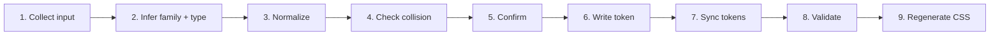

> **Path convention:** `{ds}` = the project's design-system root folder
> (default: `ai_resources/design-system`). Paths are relative to the project root.

# Creating a design token

## Goal

Add a well-formed DTCG token to the correct family file: infer family +
`$type`, normalize, check path collision, confirm, write to
`{ds}/token-families/<family>.json`, sync `{ds}/tokens.json`, validate.

## Rules

- **Caller-confirmed batch mode (R-ASK-4/5, `rules/interaction.md`).** Invoked by
  `create-atom` / `create-molecule` with tokens already confirmed in a consolidated
  review → accept the whole batch in ONE invocation, do not re-confirm: Steps 1, 2
  and 5 read from the caller context. Steps 3–4 and 7–8 (normalization, dedup,
  collision, sync, validation) run unchanged for every token — but only **surface
  anomalies** (a normalization diff, a dedup hit, a path collision re-opens the
  dialogue for that token); clean passes stay silent.
- **Provider-agnostic (R-PIPE-1).** Accept a value from any source (Figma variable, raw CSS, user input). Never tie logic to one provider.
- **No invention (R-PIPE-2).** `$value` comes from the user or an explicitly declared source — never inferred or invented.
- **Traceability (R-PIPE-3).** Populate `$extensions.source` with at minimum `{ "declaredBy": "<source>" }`.
- **Validate before write (R-PIPE-5 / R-PIPE-8).** Path collision in the family file → surface it, ask overwrite / abort.
- **Surface, don't silence (R-PIPE-8).** Report every normalization change (e.g. `#ff0000` → `#FF0000`).
- **Normalize (R-NORM-1..11).** Uppercase 6/8-char hex, explicit dimension units, numeric font weights, cubic-bezier as 4-number array, in-family dedup, numeric precision — full spec in `rules/normalization.md`.
- **Family/`$type` allow-list.** Authoritative list in `scripts/lib/constants.mjs`, enforced by `validate-tokens`; human view + naming + inference in [references/token-families.md](references/token-families.md).
- **Aliases.** DTCG reference syntax `"{path}"`; `$type` matches the referenced token.

## Workflow

### Step 1: Collect input

1. Ask (or read from caller context): **value** (hex, px, number, CSS
   shorthand, Figma variable name, alias ref), **intended path**
   (dot-notation, e.g. `color.primary.blue.500`), **source** (Figma variable,
   design spec, manual entry), optional **description**.
2. Value with no path → infer the likely family (Step 2), suggest a path for
   confirmation.

**Success:** value, intended path, source declared.

### Step 2: Infer family and `$type`

1. From the value shape, infer family + DTCG `$type` — inference table in
   [references/token-families.md](references/token-families.md).
2. Present for confirmation. Ambiguous (bare number, px → spacing vs sizing)
   → ask explicitly.

**Success:** family and `$type` confirmed.

### Step 3: Normalize value

1. Apply `rules/normalization.md` (R-NORM-1 hex, R-NORM-3 explicit units,
   R-NORM-6 numeric weights, R-NORM-8 cubic-bezier arrays, …).
2. Show a diff for every change: `Value normalized: "#ff0000" → "#FF0000"`.
3. Dedup (R-NORM-10): same value already in the family file → show its path,
   ask "Reuse `<existing-path>` or create a new token anyway?"

**Success:** normalized value ready; every change surfaced; dedup checked.

### Step 4: Check path collision

1. Traverse the dot-notation path in `{ds}/token-families/<family>.json`.
2. Path exists → show the existing token (value, type, extensions), ask
   "Overwrite, abort, or use a different path?" Else confirm the insertion
   point (parent node).

**Success:** path clear, or user explicitly chose to overwrite.

### Step 5: Confirm with user

1. Present the final token — confirmation draft table in
   [references/token-skeleton.md](references/token-skeleton.md).
2. Ask "Confirm creation of this token? (yes / modify / abort)". *modify* →
   loop back to the relevant step; *abort* → stop cleanly, no writes.

**Success:** token confirmed as presented.

### Step 6: Write token to family file

Insert at the correct path in `{ds}/token-families/<family>.json` — write
skeleton in [references/token-skeleton.md](references/token-skeleton.md).
Confirm: "Token `<path>` written to `{ds}/token-families/<family>.json`."

### Step 7: Sync tokens.json

Merge the new token at the same dot-notation path in `{ds}/tokens.json`;
update `$metadata.updatedAt` (ISO-8601). Confirm: "tokens.json synced."

### Step 8: Validate the tokens

Invoke `validate-tokens` with `--tokens-only --strict` — it surfaces every
finding (DTCG compliance, `$type` allow-list per family, section ownership)
as a corrective table. Fix every listed issue before proceeding.

### Step 9: (token CSS — separate Load step, never inside a create flow)

`create-token` stops at Step 8: the token lives in the source of truth
(`token-families/` + `tokens.json`). Token CSS (`{ds}/dist/tokens/*.css`,
the `--ds-*` custom properties) is a **derived Load artifact**:

- **Standalone** run: you MAY regenerate it afterwards via
  `generate-tokens-css`.
- **Sub-step of `create-atom` / `create-molecule`:** generate **NO** CSS.
  Those skills stop at the contract and own no CSS generation; token CSS is
  regenerated separately later (`generate-tokens-css`, or via
  `generate-styleguide`).

## Resources

| Type | Path | Description |
|---|---|---|
| Output | `{ds}/token-families/<family>.json` | Target family file |
| Output | `{ds}/tokens.json` | Master DTCG tokens |
| Output | `{ds}/dist/tokens/*.css` | Generated `--ds-*` CSS custom properties |
| Reference | [references/token-families.md](references/token-families.md) | Families, allowed `$type`s, naming, value→family inference |
| Reference | [references/token-skeleton.md](references/token-skeleton.md) | Write skeleton + confirmation draft table |
| Spec | `rules/normalization.md` | R-NORM-1 to R-NORM-11 |
| Spec | `rules/pipeline.md` | R-PIPE-1 to R-PIPE-10 |
| Rule | `rules/interaction.md` | Dialogue protocol (R-ASK-1..6) — caller-confirmed batch mode |
| Allow-list | `scripts/lib/constants.mjs` | Authoritative `TYPE_ALLOWLIST` per family |
| Skill | `skills/generate-tokens-css/SKILL.md` | Regenerates token CSS — separate Load step, never inside a create flow |
| Skill | `skills/validate-tokens/SKILL.md` | Tokens validation (Step 8) |
