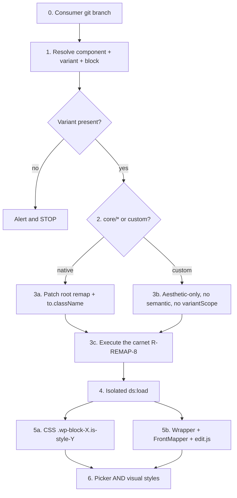

> **Path convention:** `{ds}` = design-system root (default `ai_resources/design-system`).
> `{p}` = `plugins/wonderwp-design-system`. `{theme}` = provider `themePath`.
> Paths relative to the **consumer** project root unless noted.

# Declaring a block style from a design-system variant

## Goal

Surface an **already declared** component variant as a WordPress block style
on a target block (`core/*` or `{ns}/{name}`): write the root remap carnet,
execute the CSS/`is-style-*` alignment the remap engine does not apply
(`R-REMAP-8`), generate the PHP `AbstractBlockStyle` class, and glue native
or custom markup so the picker **and** the visual styles both work.

## Rules

- **Variant first, never created here.** `{ds}/components/{layer}/{slug}/{axis}/{value}/contract.json` must exist. If it is missing: alert, point to [`declare-variant`](../declare-variant/SKILL.md), **stop**. Do not scaffold the variant.
- **Consumer git branch before any write.** `feature/` from `develop` via `create-or-manage-git-branches`. Clean tree. Never write on `develop` / `main`.
- **Remap lives on the component root**, never in `{axis}/{value}/`. Variant folders hold tokens; the root `variations` carnet feeds `register_block_style()`. A variant-level remap is for a **pattern** clone, not a block style.
- **Selector exactly `.is-style-{value}`.** `generate-block-styles.mjs` registers a PHP class only when the carnet selector is that shape. `.is-{axis}-{value}`, `.is-size-*`, `.is-icon-*` produce a notice, not a picker entry. Omit the classless default (never `""`).
- **A recorded carnet is not an applied one (`R-REMAP-8`).** Writing `strategy: "block-styles"` does not rewrite variant files or CSS. This skill **executes** the alignment: CSS (and `VARIANT_CLASSES`) must use `.is-style-{value}`. That is not a `tokens` remap.
- **Native: `to.className[0]` is the Gutenberg wrapper class.** The CSS generator hooks the first `to.className` entry. The editor emits `wp-block-{name}` (e.g. `wp-block-paragraph`), not `ds-*`. Keep `ds-*` second. Oracle: an existing remap in **this** DS onto the **same** `to.component`.
- **`variantScope` only when Gutenberg and CSS target different nodes** (typical: `core/button` — `is-style-*` on `.wp-block-button`, styles on `.wp-block-button__link`). On a custom block that already has `render.php`, `variantScope` wraps `WP_Block::render()` and recurses.
- **Custom block with its own `render.php`: `remaps: ["aesthetic"]` only.** Empty `tokens: {}` if nothing is re-pointed (the format rejects `remaps: []`). Do not add `semantic`. Keep `to.component` for enqueue + `VARIANT_CLASSES`. After every load, strip a generated `WP_Block::render()` from the molecule PHP.
- **Do not destroy an existing semantic remap.** If the component is already remapped, patch only `variations` + `to.className`. Aesthetic-only is for a **new** remap, not a rewrite of a native semantic mapping.
- **Picker ≠ visual styles.** Always verify both. The styleguide (`preview.html`) is not Gutenberg.
- **Do not commit an unrelated remap fix** in the same PR if `block-styles` fails on another component — isolate the route.
- **No project-specific slugs** in this skill. Placeholders: `{ds}`, `{theme}`, `{slug}`, `{axis}/{value}`, `{ns}/{name}`.

```bash
node {p}/scripts/load-wonderwp.mjs --routes components-css,php,block-styles
```

## Workflow



### Step 0: Consumer git branch

**Do:**

1. Follow `create-or-manage-git-branches`: `feature/` from `develop` in the **consumer** project.
2. Confirm a clean working tree. No writes on `develop` / `main`.

**Success criteria:** Feature branch checked out; tree ready for remap/CSS/PHP writes.

### Step 1: Resolve inputs

**Do:**

1. Collect: layer (`atoms` | `molecules`), component `{slug}`, variant `{axis}/{value}`, target block `{ns}/{name}`.
2. Confirm `{ds}/components/{layer}/{slug}/{axis}/{value}/contract.json` exists.
3. **If missing:** tell the user the variant must be declared first ([`declare-variant`](../declare-variant/SKILL.md)) and **stop**.
4. Read the root remap `{ds}/components/{layer}/{slug}/contract.<vocabulary>.remap.json` if it exists (default vocabulary `wordpress-core`).
5. Oracle: another remap **in this DS** whose `to.component` equals the target block — copy `to.className` / `variantScope` conventions from it, never invent a component name.

**Success criteria:** Variant file exists; target block is `ns/name`; existing remap (if any) is in view.

### Step 2: Native or custom

**Do:**

1. `core/*` → native path ([references/native-recipe.md](references/native-recipe.md)).
2. Otherwise → custom path ([references/custom-recipe.md](references/custom-recipe.md)): look for the block’s `render.php`, FrontMapper, and `edit.js` in the plugin that owns `{ns}/{name}`.

**Success criteria:** One path chosen; custom glue files located or confirmed absent.

### Step 3: Root remap and execute the carnet

**Do:**

1. On the **root** remap only:
   - `variations.{axis}.strategy: "block-styles"`
   - `selectors.{value}: ".is-style-{value}"` even when `{axis}` is not `style` (Gutenberg never emits `is-{axis}-{value}`)
   - `labels.{value}` in the project language (the generator titleizes the slug otherwise)
   - omit the classless default
2. **Execute `R-REMAP-8`:** align generated CSS (and PHP `VARIANT_CLASSES`) on `.is-style-{value}`. Do not add a `tokens` remap for this.
3. **Native:** `to.className` **starts** with the Gutenberg wrapper class (`wp-block-{name}`); keep `ds-*` second. Set `variantScope` only for the wrapper-vs-inner split (`core/button`).
4. **Custom, new remap:** `remaps: ["aesthetic"]`, `tokens: {}`, `to.component: "{ns}/{name}"`, no `semantic`, no `variantScope`. Put the post-load checklist in `to.note`.
5. **Custom or native, existing semantic remap:** patch `variations` + `to.className` only.

**Success criteria:** Root remap on disk; carnet selector is exactly `.is-style-{value}`; native hook or custom aesthetic-only constraints satisfied.

### Step 4: Isolated load

**Do:**

```bash
node {p}/scripts/load-wonderwp.mjs --routes components-css,php,block-styles
```

If the `block-styles` route fails on **another** component: isolate or skip; do not fold that fix into this style’s PR.

Confirm `{theme}/includes/BlockStyles/{PascalValue}{Block}Style.php` was written. If not, the selector was not `.is-style-{value}` — read the generator notices.

**Success criteria:** CSS, PHP component, and BlockStyle class generated; no unrelated remap committed.

### Step 5a: Native glue

**Do:** Follow [references/native-recipe.md](references/native-recipe.md).

1. Diff the component CSS: it must contain `.wp-block-{block}.is-style-{value}` (or a descendant form when `variantScope` is set).
2. No FrontMapper. Hard-refresh the editor.

**Success criteria:** Saved markup carries `is-style-{value}` on the Gutenberg wrapper; CSS matches that class.

### Step 5b: Custom glue

**Do:** Follow [references/custom-recipe.md](references/custom-recipe.md). After **every** load:

1. Remove `WP_Block::render()` reintroduced on the molecule PHP.
2. Add/keep the wrapper bridge: `.wp-block-{ns}-{name}.is-style-{value} .{ds-class}`.
3. FrontMapper: if `className` contains `is-style-{value}`, call the variant axis on the molecule.
4. `edit.js`: copy the style class onto the DS root for the canvas.
5. Enqueue via `to.component` + `childComponents` — no manual `wp_enqueue_style`.

**Success criteria:** One wrapper; molecule receives the variant; editor canvas and front match.

### Step 6: Verify both layers

**Do:**

1. Editor Styles panel lists the style (label from `labels`).
2. Applying it changes **visual** styles, not only the class on the wrapper.
3. Front (and Query Loop, if the custom block is a post card).
4. Do **not** treat `{ds}/preview.html` as proof.

**Success criteria:** Picker and visuals both confirmed on the target block.

## Advanced Features

- **Traps (R-REMAP-8, wrapper, load overwrite):** [references/traps.md](references/traps.md)
- **Native recipe:** [references/native-recipe.md](references/native-recipe.md)
- **Custom recipe:** [references/custom-recipe.md](references/custom-recipe.md)
- **Carnet strategies (documentary in remap v1):** [`remap-contract` / variation-strategies](../remap-contract/references/variation-strategies.md)
- **Load routes:** [`load-wonderwp`](../load-wonderwp/SKILL.md)

## Resources

| Type      | Path | Description |
| --------- | ---- | ----------- |
| Reference | [references/traps.md](references/traps.md) | Pitfalls this skill exists to avoid |
| Reference | [references/native-recipe.md](references/native-recipe.md) | `core/*` CSS hook checklist |
| Reference | [references/custom-recipe.md](references/custom-recipe.md) | Custom block glue checklist |
| Skill     | [`declare-variant`](../declare-variant/SKILL.md) | Declare the variant first (separate run) |
| Skill     | [`remap-contract`](../remap-contract/SKILL.md) | Full remap; this skill executes a `block-styles` axis |
| Skill     | [`load-wonderwp`](../load-wonderwp/SKILL.md) | Provider façade (`--routes block-styles`) |
| CLI       | `{p}/scripts/generate-block-styles.mjs` | Emits `AbstractBlockStyle` only for `.is-style-{value}` |
| CLI       | `{p}/scripts/load-wonderwp.mjs` | Isolated load of CSS / PHP / block-styles |
