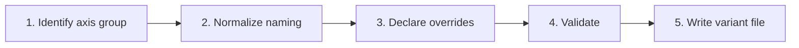

> **Path convention:** `{ds}` = the project's design-system root folder
> (default: `ai_resources/design-system`). Paths are relative to the project root.

# Declaring a component variant

## Goal

Create DTCG-compliant variant files at
`{ds}/components/{layer}/{slug}/{axis}/{value}/contract.json`. Each variant
is a standalone file in its own folder — never inline in the base
`contract.json`. The folder hierarchy IS the variant key
(`style:brand` = `style/brand/`).

## Rules

- **Batch input (R-ASK-5, `rules/interaction.md`).** One invocation covers a
  component's full axis/value list: Steps 1–3 run per variant as a collection
  (decision tables, not per-variant prompts — R-ASK-3), Steps 4–5 run ONCE at
  the end (one validation pass, then all variant files written).
  Caller-confirmed entries (from a create flow's consolidated review) are not
  re-confirmed (R-ASK-4). A single-variant invocation is a batch of one.
- **One file per variant.** `{axis-name}/{variant-value}/contract.json`; base
  `contract.json` has no variants section. File structure + full JSON examples
  (default, non-default, interaction):
  [references/variant-file-examples.md](references/variant-file-examples.md).
- **Five axis groups** (style, size, color, state, interaction) —
  classification, `defaultVariant` rules, DTCG override format:
  [references/axis-groups.md](references/axis-groups.md). Override format
  mirrors base mappings in `rules/contract-schema.md` (§ Aesthetic).
- **Everything kebab-case**, end-to-end: axis, value, folder, variant key,
  `defaultVariant` key, `axisGroup`/`axisValue`. Selector derived from the
  axis group — tables in
  [references/selectors-naming.md](references/selectors-naming.md).
- **Default vs non-default** differ only by selector: default →
  `"com.wonderwp.selector": null`; non-default → `.is-{axis}-{value}`
  (appearance) or a CSS pseudo (interaction). Base `defaultVariant` is the
  single source of truth; no `isDefault` flag in the variant file.
- **A default variant declares no redundant override (`R-CONTRACT-8`).** Never
  re-declare in the default variant a property the base — or a
  lower-specificity axis — already produces. The default's rule is emitted at
  class specificity, so a redundant declaration silently kills any axis whose
  selector is an element (a level axis mapped onto its tag). The symptom is not
  a visual glitch but an axis that stops working; check it before blaming the
  cascade. One property has exactly one owning axis.
- **Override `$type` must match the base** mapping's `$type` for the same
  `<part>.<property>`, reuse the SAME `cssVar`, and the token ref must
  resolve in `{ds}/tokens.json`.
- **Appearance axes** (style, size, color) must be in `defaultVariant`;
  state/interaction never are.

## Workflow



### Step 1: Identify axis group

1. Ask (or read from caller context): **component slug** + the **axis/value
   entries** — one, or the full list (e.g. `style: brand, dark-blue;
   size: sm, md, lg; interaction: hover, disabled`). Each entry: an **axis
   group** (style | size | color | state | interaction) + a **value name**
   (`brand`, `sm`, `hover`).
2. Axis group outside the 5 standard groups
   ([references/axis-groups.md](references/axis-groups.md)) → ask to confirm
   or map to the closest standard group.
3. Read the component's base `contract.json` to confirm it exists.
4. `{ds}/components/{layer}/{slug}/{axis}/{value}/` already exists → surface
   the existing file, ask "Overwrite, or abort?"

**Success:** axis groups identified; base composition loaded; no conflict.

### Step 2: Normalize naming

1. Kebab-case axis + value (`colorScheme` → `color-scheme`, `darkBlue` →
   `dark-blue`, `Extra Large` → `extra-large`).
2. Derive folder `{kebab-axis}/{kebab-value}/`, key
   `{kebab-axis}:{kebab-value}`, selector from the axis group — tables in
   [references/selectors-naming.md](references/selectors-naming.md).
3. Duplicate folder → surface and ask.
4. Present the normalized variants — path, key, selector, axis group (e.g.
   path `{ds}/components/atoms/button/style/dark-blue/contract.json`, key
   `style:dark-blue`, selector `.is-style-dark-blue`, group `style`
   appearance).

**Success:** all names kebab-case; paths and selectors confirmed.

### Step 3: Declare overrides

1. Per variant, collect the overrides — **part.property** (base mapping
   overridden) + **new token ref** (token path or literal value).
   Caller-provided overrides (design source or consolidated review) are used
   as-is (R-ASK-4); otherwise present ONE override table for all variants
   (R-ASK-3), never override-by-override prompts.
2. Verify each override: `part.property` exists in the base composition;
   `$type` matches the base mapping's; the token ref resolves in
   `{ds}/tokens.json`; `cssVar` matches the base mapping's.
3. Build the DTCG variant content — format + examples in
   [references/variant-file-examples.md](references/variant-file-examples.md)
   (override-entry spec in
   [references/axis-groups.md](references/axis-groups.md)).

**Success:** all overrides declared in DTCG format; types match base.

#### A molecule variant may re-select its children's variants — `slots`

A variant of a MOLECULE takes a `slots` key beside `overrides`. `overrides`
restyles the molecule's own parts; `slots` says WHICH variant each composed
child takes, so the values stay in the atom:

```json
{
  "overrides": { "root.gap": { "$value": "{spacing.md}" } },
  "slots": {
    "title-slot":       { "style": "lead", "size": "base" },
    "description-slot": { "size": "base" }
  }
}
```

Prefer it over restating the child's values in `overrides`: the CSS injection
is grouped by atom slug, so two slots filled by the SAME atom cannot be told
apart that way — the reason `editorial-icon-and-text` could not vary its
typography between `size:md` and `size:sm` before this existed.

It is inherited per slot through `extends`, and projected under
`$extensions["com.wonderwp.slots"]`. Every value of a covered axis is emitted,
the default included, so switching back restores the base composition instead
of leaving the child on the last value selected.

**Known limit:** the style guide does not apply it —
`page.mjs::applyFullVariant()` rewrites only the composed template's root
class, not the children's. A variant thumbnail therefore shows the BASE
composition; the PHP render is exact. Judge such a variant on the render, not
on the thumbnail.

### Step 4: Validate

1. Run `validate-contract` with `--strict` on the parent component — ONCE per
   invocation, after all variants of the batch are declared (R-ASK-5), not
   once per variant.
2. Per appearance-group variant (style, size, color): `defaultVariant` in the
   base `contract.json` must include its axis. New axis → ask the user which
   value is the default.

**Success:** validation passes; `defaultVariant` consistent.

### Step 5: Write variant file

1. Per variant of the batch: create
   `{ds}/components/{layer}/{slug}/{axis}/{value}/`, write `contract.json`.
2. New appearance axis introduced → update `defaultVariant` in the base
   `contract.json`.
3. One batch summary: "{n} variant(s) written for `{slug}`: `{axis}:{value}`
   ({k} overrides), …".

**Success:** variant files created; base updated if needed.

## Resources

| Type | Path | Description |
|---|---|---|
| Input | `{ds}/components/{layer}/{slug}/contract.json` | Base composition (type checking + defaultVariant) |
| Input | `{ds}/tokens.json` | Token resolution for override refs |
| Output | `{ds}/components/{layer}/{slug}/{axis}/{value}/contract.json` | Variant DTCG file |
| Reference | [references/variant-file-examples.md](references/variant-file-examples.md) | File structure + default / non-default / interaction JSON examples |
| Reference | [references/axis-groups.md](references/axis-groups.md) | The 5 axis groups, defaultVariant rules, DTCG override format |
| Reference | [references/selectors-naming.md](references/selectors-naming.md) | Kebab-case normalization + selector derivation + interaction mapping |
| Rule | `rules/interaction.md` | Dialogue protocol (R-ASK-1..6) — batch input, override tables, caller-confirmed entries |
| Spec | `rules/contract-schema.md` | Contract + aesthetic/override DTCG format |
| Skill | `skills/validate-contract/SKILL.md` | Per-component contract validation (Step 4) |
