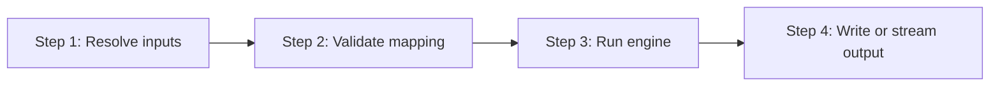

> **Path convention:** `{ds}` refers to the project's design-system root folder
> (default: `ai_resources/design-system`). All paths below are relative to the project root.

# Loading a contract (serialize)

## Goal

Given a component contract (`contract.json`) and a mapping document, produce
the corresponding final target output as a deterministic string. The skill is
the **Load** phase (the **L in the ETL**) of the design system:

- **Extract** = `create-atom` / `create-molecule` produce `contract.json`.
- **Transform** = `remap-contract` rewrites a contract into another vocabulary —
  still `component-contract`, **format A → format A** (pure morphism).
- **Load** = this skill serializes a contract to a final foreign format
  (HTML, CSS, theme.json, …) — **format A → format B** — which downstream
  consumers (wonderwp-theme, a build pipeline, a CMS importer) write wherever it
  belongs.

The engine is **target-agnostic**: new output formats are added by shipping a
new mapping JSON, not by editing the engine.

## Rules

- **Mappings are data, not code.** A mapping is a JSON document validated against
  the schema in `rules/mapping-format.md`. The engine refuses to execute any
  function or load any module from a mapping.
- **Determinism.** Identical `(contract, mapping)` inputs produce a
  byte-for-byte identical output. No timestamps, no I/O beyond what callers
  explicitly provide.
- **Walks declared once.** A mapping must declare `walks: "semantic"` (markup
  targets — HTML, JSX, native UI), `walks: "aesthetic"` (stylesheet targets —
  CSS, SCSS, Tailwind) OR `walks: "block-markup"` (serialized Gutenberg block
  markup — see `rules/mapping-format.md` § Block-markup section). The engine
  refuses any mapping that omits this or whose body is inconsistent with the
  declared axis.
- **Slot composition is downstream.** Slot Elements in `contract.semantic` emit
  as placeholders (e.g. `<!--slot:button-->` for HTML). A separate composition
  step substitutes them; the engine does NOT recursively load child contracts.
- **No coupling to creation skills.** Never invoked as a sub-step of
  `create-atom`, `create-molecule`, or `create-token`. Always deliberate.
- **R-PIPE-8 — Surface, don't silence:** Mapping validation errors are reported
  with the failing rule path so the author fixes the mapping, not the contract.

## Workflow



### Step 1: Resolve inputs

**Do:**

1. Identify the component contract: a component directory (the loader looks for
   `contract.json`) or a direct path
   to a contract JSON file.
2. Identify the mapping document: a JSON file conforming to
   `rules/mapping-format.md`.
3. If the mapping declares `walks: "aesthetic"` AND
   `aesthetic.tokens.fallbackFromBundle: true`, also resolve `{ds}/tokens.json`
   so the engine can produce fallback values for each token.

**Success criteria:** Contract, mapping, and (optionally) tokens paths are
resolved on disk.

### Step 2: Validate mapping

**Do:**

The engine validates the mapping at load time via
`scripts/lib/load/validate-mapping.mjs`, returning a list of rule-path / message
pairs. If you've just authored or edited the mapping, prefer running the
`validate-mapping` skill first — it surfaces the same findings as a corrective
table outside the transform pipeline.

If validation fails, **surface the full error list verbatim** and stop. Do not
attempt to transform with an invalid mapping.

**Success criteria:** Mapping passes validation OR the user is informed of every
rule violation.

### Step 3: Run engine

**Do:** Invoke the CLI from the project root:

```bash
node plugins/wonderwp-design-system/scripts/load-contract.mjs \
  --contract {ds}/components/atoms/<slug>             \
  --mapping  plugins/wonderwp-design-system/scripts/mappings/to-html.json \
  [--out     <path>]                                  \
  [--tokens  {ds}/tokens.json]
```

- `--contract`: component directory OR direct path to a contract JSON
- `--mapping`: path to a mapping JSON (see [references/reference-mappings.md](references/reference-mappings.md))
- `--out`: optional; when omitted, output streams to stdout
- `--tokens`: optional; required only when the mapping enables
  `aesthetic.tokens.fallbackFromBundle`

**Success criteria:** Engine exits with code 0; output stream or file is
populated.

### Step 4: Write or stream output

**Do:**

The CLI writes to `--out` when provided (creating parent directories) and emits
a one-line confirmation to stderr; otherwise streams to stdout for pipeline
composition (`load-contract.mjs ... | other-tool`).

Slot placeholders remain unsubstituted — the caller composes them in a
subsequent step (e.g. for a styleguide preview, fetch each `<!--slot:X-->`
placeholder's referenced atom contract and re-run the transform).

**Success criteria:** User receives the output (file or stream) and knows which
placeholders remain to be composed.

## Resources

| Type | Path | Description |
|---|---|---|
| Spec | `rules/mapping-format.md` | Formal mapping schema (walks, semantic, aesthetic, classNames, substitution grammar) |
| Spec | `rules/contract-schema.md` | Contract schema this skill consumes |
| Reference | [references/reference-mappings.md](references/reference-mappings.md) | Shipped reference mappings (to-html, to-css) + extension guidance |
| Engine | `scripts/lib/load/engine.mjs` | Pure target-agnostic walker |
| Engine | `scripts/lib/load/walk-semantic.mjs` | Markup walk implementation |
| Engine | `scripts/lib/load/walk-aesthetic.mjs` | Stylesheet walk implementation |
| Engine | `scripts/lib/load/walk-block-markup.mjs` | Gutenberg block-markup walk (+ seams manifest for code generators) |
| Engine | `scripts/lib/load/validate-mapping.mjs` | Mapping validator (run by the engine at load time and by the `validate-mapping` skill) |
| Skill | `skills/validate-mapping/SKILL.md` | Standalone mapping validator — produces a corrective table; recommended before a transform run on a fresh or edited mapping |
| CLI | `scripts/load-contract.mjs` | Command-line wrapper |
| Mapping | `scripts/mappings/to-html.json` | Reference HTML mapping |
| Mapping | `scripts/mappings/to-css.json` | Reference CSS mapping |
| Mapping | `scripts/mappings/to-block-markup.json` | Reference Gutenberg block-markup mapping (consumed by `load-wonderwp`) |
| Input | `{ds}/components/.../contract.json` | Source contracts |
| Input | `{ds}/tokens.json` | Required only for aesthetic walks with tokens fallback |
