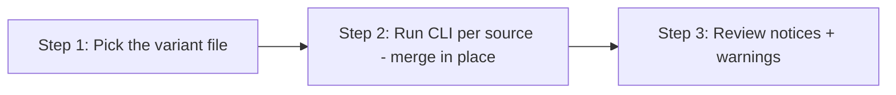

> **Path convention:** `{ds}` refers to the project's design-system root folder
> (default: `ai_resources/design-system`). All paths below are relative to the project root.

# Loading a design system into theme.json (TMJSON)

## Goal

Produce or update a WordPress `theme.json` from the design system. Unlike the
generic `load-contract` skill (which emits a final-format **string**), this Load
emits a **structured JSON fragment** and **deep-merges it in place** into a single
shared `theme.json`.

theme.json is **one target** (`$target: "theme-json"`). A single mapping describes
the whole document through two sections, and the engine applies the section that
matches the **source** you pass:

- **`tokens.json` source → the `settings` section** — the token tree projected
  into the presets the WordPress editor offers (palette, font sizes, font
  families, spacing sizes, and a `custom` mirror for families with no native
  bucket). This is what the editor UI *can choose*.
- **component `contract.json` source → the `styles` section** — the component's
  **root part** under its **default variant** projected into `styles.blocks.<block>`,
  the default appearance of a core block. This is what is *applied by default*.

Because the inputs differ, the load is **invoked once per source** (once on
`tokens.json`, once per component) — all merged into the same `theme.json`. That
is multiple invocations of **one** mapping file, not multiple files.

## The two value variants (the only axis that splits into files)

The value-emission policy is the mapping's `values` field (not a runtime flag), so
it ships as **two files**:

| File | `values` | Emits | Prerequisite |
|---|---|---|---|
| `to-theme-json-literal.json` | `"literal"` | resolved values (`"#0B5CFF"`, `"1.5rem"`, joined font-family) | `--tokens` when the source is a **contract** (to resolve refs) |
| `to-theme-json-vars.json` | `"vars"` | `settings` → `var(--ds-color-…)` (token vars); `styles` → `var(--ds-<slug>-…)` (component public vars, read verbatim from `com.wonderwp.cssVar`) | the DS token CSS (`{ds}/dist/tokens/_index.css`, the `--ds-*`) **enqueued in the editor + front** |

A given `theme.json` should receive **either** the literal **or** the vars
variant — never both. Merging both into one file overwrites the first; the CLI
surfaces an `overwrite` warning when this happens.

## Rules

- **Mappings are data, not code** (same engine guarantee as `load-contract`).
- **Structured output, not a string.** This target is dispatched by the engine's
  `transformStructured()` entry point and returns a `{ fragment, notices }` object.
  `transform()` (string-only) refuses it; `transformStructured()` refuses string
  targets.
- **Section chosen by source, not by the mapping.** The mapping has no `walks`;
  the engine applies `settings` to a `tokens.json` source and `styles` to a
  `component-contract` source.
- **Merge is idempotent, not pure** (R-PIPE-4). Re-merging the same fragment is a
  byte-identical no-op with zero warnings, but the output depends on the existing
  `theme.json` (counted as an input). Preset arrays upsert **by `slug`** preserving
  producer order (no alphabetical sort — that would reorder the editor UI);
  object keys are sorted on write-back for stable diffs.
- **Validate before write** (R-PIPE-5). The mapping is validated, then the produced
  fragment and the merged document pass a structural guard before any write.
- **Surface, don't silence** (R-PIPE-8). Every limitation is reported as a
  `notice:` — non-root parts, non-default variants, unmapped properties, skipped
  composites, synthesized preset names, unresolved aliases.
- **No invention** (R-PIPE-2). Preset `name`s are synthesized deterministically
  from the slug (no source label exists in `tokens.json`); this is surfaced.
- **theme.json is a foreign artifact.** It carries WordPress's own `version: 3`,
  not `$metadata.schemaVersion` — R-PIPE-10 governs *our* artifacts (contracts,
  tokens), not serialized targets, exactly like the CSS/HTML Load outputs.

## Workflow



### Step 1: Pick the variant file

**Do:** Choose **one** of the two shipped mappings (or a project copy) and use it
consistently for the target `theme.json`:

| Mapping | Variant | When |
|---|---|---|
| `mappings/to-theme-json-literal.json` | literal | self-contained theme.json (no runtime DS CSS dependency) |
| `mappings/to-theme-json-vars.json` | vars | theme.json references the DS token CSS loaded in editor + front |

The chosen file describes both `settings` (for a tokens source) and `styles` (for
a contract source).

### Step 2: Run the CLI per source (merge in place)

**Do:** Invoke from the project root, once per source, targeting the **same**
`--theme-json` so the document is assembled incrementally. The CLI auto-detects
whether the source is `tokens.json` (→ settings) or a contract (→ styles).

```bash
# settings — from tokens.json
node plugins/wonderwp-design-system/scripts/load-theme-json.mjs \
  --source     {ds}/tokens.json \
  --mapping    plugins/wonderwp-design-system/scripts/mappings/to-theme-json-vars.json \
  --theme-json {ds}/dist/theme.json
```

```bash
# styles — from a component contract (literal needs --tokens to resolve refs)
node plugins/wonderwp-design-system/scripts/load-theme-json.mjs \
  --source     {ds}/components/atoms/button \
  --mapping    plugins/wonderwp-design-system/scripts/mappings/to-theme-json-literal.json \
  --theme-json {ds}/dist/theme.json \
  --tokens     {ds}/tokens.json
```

- `--source`: `tokens.json` (→ settings) OR a component dir / `contract.json` (→ styles)
- `--mapping`: one of the two variant files above
- `--theme-json`: the shared target (created from the scaffold if missing)
- `--tokens`: **required** for a **contract** source with `values: "literal"`; ignored otherwise

Run it once for `tokens.json`, then once per component, all pointing at the same
`--theme-json`.

**Success criteria:** the CLI exits 0 and reports the merged section and byte size.

### Step 3: Review notices and warnings

**Do:**

- `notice:` lines list what was surfaced (dropped parts/variants, unmapped
  properties, skipped composites, synthesized names). Decide whether each gap
  needs a mapping addition or is acceptable.
- `warning: overwrite …` lines mean an incoming value replaced a differing
  existing value at the same path — usually the sign that the literal and vars
  variants both landed in the same file. Use a single variant per `theme.json`.

**Success criteria:** the `theme.json` is updated and the user understands every
surfaced gap and overwrite.

## v1 limitations (surfaced, not silenced)

- **styles emits the root part only.** theme.json `styles` has a fixed key
  vocabulary, not arbitrary BEM parts; non-root parts are dropped + surfaced.
  `styles.partToElement` is reserved for a future `styles.elements.<el>` mapping.
- **styles emits the default variant only.** A block style is a single
  appearance; non-default variant axes are surfaced. `styles.variations`
  (block style variations, WP 6.6+) is reserved (`styles.variantsTo`).
- **Typography composites** have no single settings/styles slot → skipped +
  surfaced.
- **`settings.custom` ≠ `--ds-*`.** WordPress derives its own `--wp--custom--*`
  vars from the `custom` mirror with a different naming algorithm; the mirror is
  themer-facing. A vars `styles` section references `--ds-*` (the enqueued DS
  token CSS), **never** `--wp--custom--*`.

## Resources

| Type | Path | Description |
|---|---|---|
| Spec | `rules/mapping-format.md` | Mapping schema incl. § theme.json target (`settings` / `styles` sections, `values` policy) |
| Spec | `rules/contract-schema.md` | Contract schema the styles section consumes |
| Engine | `scripts/lib/load/engine.mjs` | `transformStructured()` — source-selected dispatch |
| Engine | `scripts/lib/load/walk-tokens.mjs` | tokens.json → settings fragment |
| Engine | `scripts/lib/load/walk-styles.mjs` | contract → styles.blocks fragment (default variant, root part) |
| Engine | `scripts/lib/load/theme-json-merge.mjs` | Idempotent deep-merge (upsert-by-slug) + sorted-key write |
| Engine | `scripts/lib/load/validate-mapping.mjs` | Mapping validator (shared with `load-contract`) |
| CLI | `scripts/load-theme-json.mjs` | Command-line wrapper (read → transform → merge → write) |
| Scaffold | `scripts/scaffolds/theme-json-base.json` | Empty `version: 3` theme.json used when the target is absent |
| Mapping | `scripts/mappings/to-theme-json-{literal,vars}.json` | Unified theme.json mappings (settings + styles sections) |
| Skill | `skills/load-contract/SKILL.md` | The string-output Load (HTML, CSS) — sibling of this skill |
| Skill | `skills/generate-tokens-css/SKILL.md` | Produces the `--ds-*` token CSS the vars variant requires at runtime |
| Skill | `skills/load-wonderwp/SKILL.md` | WonderWP provider — invokes this Load against the real theme's `theme.json` (plus CSS + PHP components) |
