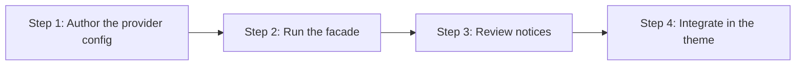

> **Path convention:** `{ds}` refers to the project's design-system root folder
> (default: `ai_resources/design-system`), `{theme}` to the provider config's
> `themePath`. All paths below are relative to the project root.

# Loading the design system into a WordPress theme (WonderWP provider)

## Goal

Install the design-system artifacts into a real theme. `build.mjs` stops at
`{ds}/dist/` (framework-agnostic, feeds the styleguide); this provider is the
step that knows a theme exists. One command, six routes:

| Route | What lands in the theme |
|---|---|
| `theme-json` | tokens → `settings` presets, contracts → `styles.blocks.<block>` (the **autowire** of existing core blocks), merged into `{theme}/theme.json` — existing content preserved |
| `tokens-css` | `--ds-*` family CSS → `{theme}/design-system/tokens/` |
| `components-css` | per-component BEM CSS (base + variant modifiers in one file), **co-located in the component folder** → `{theme}/design-system/<layer>/<slug>/<slug>.css` |
| `php` | contract interfaces + capability traits at the root + one generated class per atom/molecule in its component folder |
| `block-styles` | `register_block_style()` calls + per-variation stylesheets for every component declaring a `block-styles` axis in its remap → `{theme}/design-system/block-styles.php` |
| `patterns` | one block pattern per remapped molecule — serialized block markup, not PHP + native HTML → `{theme}/patterns/<slug>.php` |

Layout principle: **one self-contained folder per component** — everything
that concerns a component (PHP, CSS, future JS) lives together under
`{theme}/design-system/<layer>/<slug>/`.

The PHP classes' single role is to **generate the right HTML**: the
contract's semantics as markup carrying the `ds-*` classes (the same HTML
shape as `template.html` and the styleguide — styled by the co-located
component CSS), with runtime data escaped and injected in place. `getMarkup()`
returns the HTML (the theme echoes it) — components are
**framework-independent** and instantiate EMPTY (no contract sample content
ships). The theme injects every value fluently — see
`references/theme-integration.md`.

**The WordPress glue layer has landed.** A molecule IS conceptually a block
pattern, and the `patterns` route materializes that through the block-markup
walk; the `block-styles` route emits the `register_block_style()` calls and the
per-variation stylesheets that `wp_enqueue_block_style()` ships per rendered
block. Both are driven by each component's `contract.<vocabulary>.remap.json` —
a component with no remap keeps its native identity and neither route touches
it.

A variant an axis maps with the `block-attributes` strategy becomes a NATIVE
block attribute (`fontFamily`, `fontSize`, `gradient`, …), so the editor shows
it already selected. Mind what `save()` derives from that attribute: a preset
gradient also emits `has-<slug>-gradient-background has-background`, and markup
carrying the attribute without those classes cannot be revalidated — the block
shows as invalid content. Set them through the remap's `attrs.className`.

Still declared but not implemented: `customBlocks` (scaffolding a custom block
from a contract), the generated loader, native-block decoration through
`render_block` filters, and the hand-authoring `ElementComponent` — see
`rules/provider-wonderwp.md`. Where no block mechanism fits, the default
variant still lives in theme.json `styles.blocks` and non-default variants are
selected at runtime (`(new Button())->variant('dark-blue')` →
`is-style-dark-blue`, styled by the variant modifiers already in the component
CSS).

## Rules

- **The config is project data.** `{ds}/providers/wonderwp.json` encodes one
  project's choices (theme path, namespace, vocabulary); the plugin ships the
  spec (`rules/provider-wonderwp.md`), the validator and a reference example —
  never the live file. Same rule as remap mappings.
- **The provider installs INTO an existing theme.** It never scaffolds a
  theme; a missing `themePath` is a fatal config error.
- **`build.mjs` stays untouched.** The `{ds}` build and the styleguide remain
  framework-agnostic; never wire theme outputs into them.
- **Façade, not engine** (R-PIPE-7). `load-wonderwp.mjs` only sequences the
  per-step CLIs — each route is runnable standalone with the same result.
- **Idempotent, not pure** (R-PIPE-4). Re-running on unchanged inputs is a
  byte-identical no-op (theme.json merge is upsert-in-place).
- **Surface, don't silence** (R-PIPE-8). Fallback `"*"` block templates,
  reserved-word class renames, skipped `semantic: null` components, disabled
  routes — all reported, never guessed away.
- **Generated PHP lints without WordPress.** Every WP call (escaping) is
  `function_exists()`-guarded with a pure-PHP fallback — `getMarkup()` returns
  the same HTML anywhere, which is what the E2E smoke asserts.

## Workflow



### Step 1: Author the provider config (once per project)

**Do:** Copy the reference example and adapt it:

```bash
mkdir -p {ds}/providers
cp plugins/wonderwp-design-system/scripts/providers/wonderwp.reference.json {ds}/providers/wonderwp.json
```

Set `themePath` (the theme root), `php.namespace`, and the route toggles.
See `references/provider-config.md` for every field. `customBlocks` is the
only reserved route left — the validator rejects it at `true`
(`RESERVED_ROUTES` in `lib/providers/validate-provider.mjs`). `blockStyles` and
`patterns` are implemented and may be switched on.

**Success criteria:** the façade accepts the config (it validates before any
write; exit 2 lists every error at once).

### Step 2: Run the façade

**Do:** From the project root:

```bash
node plugins/wonderwp-design-system/scripts/load-wonderwp.mjs \
  --design-system {ds} \
  [--provider {ds}/providers/wonderwp.json] \
  [--vocabulary <vocab>] \
  [--routes tokens-css,theme-json,components-css,php,block-styles,patterns] \
  [--dry-run]
```

Routes default to all implemented ones, each also gated by the config's
`routes` section.
`--dry-run` prints the planned commands without writing.

**Success criteria:** `✓ load-wonderwp ok — routes: …` and the outputs listed
in `references/routes-and-outputs.md` exist under `{theme}`.

### Step 3: Review notices

**Do:** read every `notice:` line — fallback `"*"` inner template used
(editor fidelity not guaranteed for that block: add a curated template, see
`references/block-markup-fidelity.md`), slug renamed (PHP reserved word),
text-seam disambiguation. Decide whether each needs a mapping/config addition
or is acceptable.

**Success criteria:** every surfaced gap is understood and deliberate.

### Step 4: Integrate in the theme

**Do:** require the generated classes and enqueue the CSS — the theme owns
this wiring in v1 (no generated loader). Follow
`references/theme-integration.md`, then verify in WordPress that a component
renders: `echo (new Button())->label('Hi')->getMarkup();`.

**Success criteria:** the component renders its pure HTML with the `ds-*`
classes styled by the enqueued CSS, and theme.json presets appear in the
editor.

## Resources

| Type | Path | Description |
|---|---|---|
| Spec | `rules/provider-wonderwp.md` | Provider config schema, routes, output layout, PHP seam |
| Spec | `rules/mapping-format.md` | § Block-markup section (the semantic → Gutenberg serializer) |
| Reference | `references/provider-config.md` | Annotated config fields |
| Reference | `references/routes-and-outputs.md` | Route ↔ generated files table |
| Reference | `references/block-markup-fidelity.md` | Curated core-block templates, editor caveats |
| Reference | `references/theme-integration.md` | Requiring classes + enqueueing CSS in the theme |
| CLI | `scripts/load-wonderwp.mjs` | The façade (sequences the per-step CLIs) |
| CLI | `scripts/generate-php-components.mjs` | PHP layer generator (standalone) |
| Engine | `scripts/lib/load/walk-block-markup.mjs` | semantic → block markup walk (+ seams manifest) |
| Engine | `scripts/lib/providers/` | Config validator, path resolution, naming, PHP escaping |
| Mapping | `scripts/mappings/to-block-markup.json` | Reference nodeName → core-block mapping + inner templates |
| Scaffold | `scripts/scaffolds/wonderwp/*.tpl` | Contract interfaces, capability traits, generated-class template |
| Config | `scripts/providers/wonderwp.reference.json` | Reference provider config (copy to `{ds}/providers/`) |
| Skill | `skills/build-design-system/SKILL.md` | The framework-agnostic `{ds}` build (styleguide parity) |
| Skill | `skills/load-theme-json/SKILL.md` | The theme.json Load this façade invokes per source |
