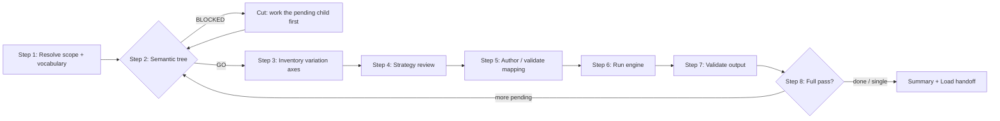

> **Path convention:** `{ds}` refers to the project's design-system root folder
> (default: `ai_resources/design-system`). All paths below are relative to the project root.

# Remapping contracts (Transform phase)

## Goal

Given a component contract (`contract.json`) and a **remap mapping**, produce a
**new contract** in a target vocabulary — same `component-contract` format, only
the definition inside changes. This is the **T in the ETL**:

- **Extract** = `create-atom` / `create-molecule` produce `contract.json`.
- **Transform** = this skill rewrites a contract's identity + attributes
  (semantic) and/or token references (aesthetic) into another vocabulary —
  **format A → format A**.
- **Load** = `load-contract` serializes a contract to a final foreign format
  (HTML, CSS, theme.json, …) — **format A → format B**.

It runs on **one component** or as a **full pass** over the design system
(Step 8): same decisions, same review, the pass just repeats them atoms-first
and resumes wherever it stopped. The engine is **vocabulary-agnostic** — new
targets are added by shipping new remap mappings, not by editing the engine.

## Rules

- **Mappings are data, not code.** A remap mapping is a JSON document validated
  against `rules/remap-format.md`. The engine refuses to execute any function or
  load any module from a mapping.
- **Same format in, same format out.** Input and output are both
  `component-contract`. Producing a foreign serialization is the Load phase, not
  this skill (`R-REMAP-1`).
- **Determinism.** Identical `(contract, mapping)` → byte-for-byte identical
  output. No timestamps, no I/O inside the engine (`R-REMAP-7`).
- **Jointure preserved.** The `part` attribute always survives; `Slot`s are
  never inlined. The output MUST re-validate against `contract-schema.md`
  (`R-REMAP-5`).
- **Semantic exhaustiveness.** Every non-reserved source nodeName and attribute
  MUST be handled by an explicit rule; anything unhandled is surfaced as an
  error with its path, never silently dropped (`R-REMAP-3`, `R-PIPE-8`).
- **Aesthetic stays DTCG.** Token remaps re-point references / css-var names but
  keep the `$value`/`$type` envelope; unmatched refs pass through as identity
  (`R-REMAP-2`, `R-REMAP-4`).
- **No coupling to creation skills.** Never invoked as a sub-step of
  `create-atom`, `create-molecule`, or `create-token`. Always deliberate.
- **Interactive resolution (R-ASK, `rules/interaction.md`).** Missing inputs
  are asked, never guessed: no argument → ask which component (or a full pass);
  strategies are confirmed in ONE consolidated review per component
  (R-ASK-2/3). Caller-confirmed context is not re-asked (R-ASK-4). The engine
  itself stays deterministic and non-interactive.
- **No silent invention (`R-PIPE-2`).** Never guess a target nodeName, attribute
  name, or value the user has not agreed to. Where the target is unknown, write
  `NEEDS DECISION` in the proposal and ask — do not fabricate.
- **Co-location is the only accepted format.** A remap lives next to the
  contract it overrides, `contract.<vocabulary>.remap.json`, at every level of
  the tree (component root and each `<axis>/<value>/` folder). No transforms
  tree, no path flag, no derived copy — so a missing remap always means "not
  remapped for this vocabulary", never "the step did not run". The set of these
  files IS the state (`R-PIPE-6`): `transform-status.mjs` derives it from the
  filesystem, so nothing can go stale or disagree with the disk.
- **One strategy per variation axis.** Every variant axis of the component gets
  an explicit mapping strategy — `block-attributes` or `block-styles`, both
  built on the base `css-selector` strategy — per
  [references/variation-strategies.md](references/variation-strategies.md).
- **A recorded decision is not an applied one (`R-REMAP-8`).** v1 validates and
  cross-checks the `variations` carnet; it never executes it. Say so *in the
  review*, while the user is confirming — not in a footnote afterwards
  (`R-PIPE-8`).
- **Children before parents (`R-REMAP-9`).** A component is remappable only once
  every component in its dependency **closure** declares a remap for the target
  vocabulary — transitively: a pending grand-child blocks the parent as surely
  as a direct child, and `--recurse` writes nothing either way.
  `semantic-tree.mjs` renders that closure and returns the verdict; a BLOCKED
  component is **cut** and resumed once its dependencies clear, never remapped
  on the assumption they will follow.
- **Full pass: atoms before molecules.** Process atoms first so a molecule's
  children already have a remap when its `--recurse` run resolves them.
- **Full pass: resume, never redo.** A component already `remapped` is not
  re-proposed from scratch — ask **keep / redefine / skip**. A re-run only stops
  on what is still `pending`.
- **Full pass: loop control.** After each component, **continue** unless the user
  clearly stops (`stop`, `done`, `assez`, `on s'arrête`). If unclear, ask once.
- **Full pass: increasing autonomy.** Reuse the conventions confirmed earlier in
  the session (e.g. `Label → core/paragraph`, `drop type on buttons`) to pre-fill
  later proposals, so the run moves from directive (confirm each) to
  supposition-led (`yes / next`). They live in the session and, durably, in the
  remaps already written — re-read a sibling's remap rather than inventing a
  convention twice.

## Workflow



### Step 1: Resolve scope and vocabulary (ask when not given)

**Do:**

1. **Argument given** (slug or path): resolve that source contract — a component
   directory (the loader looks for `contract.json`) or a direct path to a
   contract JSON file.
2. **No argument:** ASK one question offering both scopes — **one component**
   (list atoms and molecules from `{ds}/components.json`, grouped by layer) or
   **a full pass over everything still pending**. Never pick silently
   (`R-PIPE-2`).
3. Resolve the **target vocabulary** (e.g. `wordpress-core`): reuse the session
   context or the vocabularies a component already declares (its co-located
   `contract.<vocabulary>.remap.json` files); otherwise ask it alongside the
   scope question.
4. Read the état à date — it comes from the filesystem, nothing to create:
   ```bash
   node plugins/wonderwp-design-system/scripts/transform-status.mjs \
     --vocabulary <vocab> --components {ds}/components --json
   ```
   Each row carries `status` (`remapped` / `pending`), the resolved
   `mappingPath`, `variantRemaps` (variant-level remaps found) and
   `declaredVocabularies` (what the component is already remapped for) — use the
   last one to spot a component remapped for a *different* vocabulary before
   proposing from scratch.
5. A component already `remapped` for this vocabulary is surfaced with its
   current decision: **keep / redefine / skip** — never restarted silently. For
   a full pass, order the work-list **atoms first**.

**Success criteria:** Scope (one component or the pending list), target
vocabulary, and any pre-existing decision are all on the table.

### Step 2: Semantic tree — composition and readiness

**Do:**

1. Render the component's composition, annotated with what its remap is still
   waiting on:

   ```bash
   node plugins/wonderwp-design-system/scripts/semantic-tree.mjs \
     --contract {ds}/components/molecules/icons-and-text-grid-2 \
     --vocabulary <vocab>
   ```

   ```text
   Layout[root]
   └─ ✅ Slot[grid-slot] → columns [semantic]   props={"style": "grided"}
      ├─ ✅ Slot[column-slot-1] → column [semantic+aesthetic]
      │  └─ ❌ Slot[item-slot-1] → icon-and-text
      │     ╎ from icon-and-text/contract.json
      │     ├─ ❌ Slot[icon-slot] → icon-wrapper
      │     │  ╎ from icon-wrapper/contract.json
      │     │  └─ ✅ Slot[glyph-slot] → brand-icon [semantic]
      │     └─ ✅ Slot[text-slot] → text [aesthetic]
      └─ ✅ Slot[column-slot-2] → column [semantic+aesthetic]
         └─ ❌ Slot[item-slot-2] → icon-and-text ⤴

   Verdict: BLOCKED — 2 dependencies still pending. Remap them first, then come
   back to icons-and-text-grid-2.

   Work order (dependencies first):
      1. ❌ icon-wrapper           molecule
      2. ❌ icon-and-text          molecule
      3. ❌ icons-and-text-grid-2  molecule  ← the component you asked for
   ```

   A typed Element reads `NodeName[part]`; a Slot reads `Slot[part] → <slug>`,
   then the axes that child's remap declares — `[semantic]`, `[aesthetic]` or
   `[semantic+aesthetic]` — then the `props` the parent pins on it. A
   `╎ from <slug>/contract.json` line is where the tree leaves this contract and
   keeps going inside the child's own — the closure is what `--recurse` walks,
   and a pending grand-child is invisible from this contract alone. `⤴` marks a
   component already expanded above. A typed Element carrying `⚠ inlined
   component` is an atom written inline rather than slotted (R-CONTRACT-9): it
   is reported, never counted — `--recurse` walks declared dependencies and
   never reaches it, so no remap of that atom applies to the node.

2. **Read the two icons the way the recursion reads them.** `✅` = this
   component *and its whole closure* are remapped for the vocabulary; `❌` =
   something in there is not. A component that has its own remap but a pending
   child still reads `❌`, because `--recurse` refuses it just the same. Which of
   the two it is belongs to the work order under the tree, not to the icon.

   A `✅` above a `❌` is not a contradiction: each icon scores **its own**
   component's closure. Above, `columns` is remapped and so is everything
   `columns` itself declares — `icon-and-text` hangs under it because the
   *parent* pins it there, and it counts against the parent's verdict, not
   against `columns`.

3. **Either axis is enough — read the labels for what it costs you.** `text`
   above is `✅` on `[aesthetic]` alone: a child remapped for its tokens
   unblocks its parent exactly like one remapped for its identity, because
   `--recurse` asks that a remap *exist* and never which axis it carries. The
   labels are printed precisely because the icon cannot say it — `[semantic]`
   means that child's target identity is decided (the Load can emit it as block
   markup), `[aesthetic]` means only its tokens are re-pointed and it keeps its
   native identity. Same `✅`, very different Load output.

   A remap that exists but declares no usable `remaps` axis — or that cannot be
   parsed — reads `❌` with the reason as a `warning:`. The engine would reject
   it on the next run; counting it as done is exactly how a GO becomes a failed
   `--recurse`.

4. **Branch on the verdict.**
   - `GO` → every dependency is remapped. Continue to Step 3 with this
     component.
   - `BLOCKED` → say so, **cut this component**, and take the work order's first
     line instead — the deepest pending dependency. Come back to the original
     one when its tree turns GO. Remapping a parent first would author its
     `semantic` rules against target identities its children have not chosen
     yet, and the `--recurse` run writes nothing anyway.

5. Surface every `warning:` line verbatim (`R-PIPE-8`). Two of them change the
   verdict's meaning: a `Slot` missing from `childComponents` (`--recurse` never
   reaches it, so a GO would be a lie) and a component with no `contract.json` on
   disk (the closure cannot be completed at all).

Drop `--vocabulary` to get the structure alone — same tree, no icons, no verdict
— when reading a molecule's composition outside a remap run. `--json` carries
`ready`, the pending list and the work order for a caller.

**Success criteria:** The user has seen the composition and the verdict, and the
component about to be worked on is one whose dependencies are all remapped.

### Step 3: Inventory the variation axes

**Do:**

1. Read the base `contract.json`: inventory the semantic surface — every typed
   `nodeName` (reserved `Slot`/`Fragment`/`#text` excluded) and every
   non-reserved attribute.
2. List the component's variant folders `{axis}/{value}/contract.json` (see
   `declare-variant`) and build the variations list: per axis — its group
   (style, size, color, state, interaction), its values, the default value
   (`com.wonderwp.defaultVariant`), and the current `com.wonderwp.selector`
   per value.
3. Present both inventories as one table each — this is the list of the
   component's possible variations that the strategies must cover.

Full procedure, including what to inventory and when to stop and ask:
[references/proposal-heuristics.md](references/proposal-heuristics.md).

**Success criteria:** The user sees every variation axis and the semantic
surface before any strategy is proposed.

### Step 4: Strategy review (one consolidated review)

**Do:**

ASK **one consolidated review** (R-ASK-2/3) covering:

1. **Semantic — native block identity:** per source `nodeName`, the target
   native WordPress block (pre-fill from
   [references/wordpress-core-vocabulary.md](references/wordpress-core-vocabulary.md);
   a target absent from it is `NEEDS DECISION`, never a guess). Remapping the
   HTML to a native block is what lets the **Load** phase later emit a
   `content` output — serialized block markup — instead of generating PHP +
   native HTML templates.
2. **Aesthetic — one strategy per variation axis**, per
   [references/variation-strategies.md](references/variation-strategies.md):
   `block-attributes` (axis → target-block attribute) or `block-styles`
   (axis → `is-style-{value}`), both built on the base `css-selector` strategy
   (re-point the variant selector); `css-selector` alone when neither block
   mechanism fits (typically `state` / `interaction`). Pre-fill the default
   per axis group from the reference; each row shows the induced target
   selector. **Every axis found in Step 3 gets a row** — an axis left undecided
   keeps its native selectors, and the engine says so on every run.
3. Residual ambiguities still interrupt individually (R-ASK-2): an unknown
   target attribute, an unlisted block, an ambiguous selector — asked, never
   defaulted.

**When the user already wants one existing variant as an editor block style**
(variant folder on disk, target block known): do not only record the carnet —
hand off to [`declare-block-style`](../declare-block-style/SKILL.md), which
**executes** `R-REMAP-8` (CSS hook, generated `AbstractBlockStyle`, native or
custom glue). This skill still writes and validates the remap; that skill
makes the picker and the visuals agree.

**State the limit inside this review, not afterwards (`R-REMAP-8`).** The user
is confirming a **record**, not an action: in v1 the strategies are written to
the remap, validated and cross-checked against the variant folders — but never
applied. No variant file is rewritten, no `com.wonderwp.selector` is re-pointed,
no `is-style-*` class is emitted; the variants keep activating through their
current selectors until a future `$version` executes the carnet. A user who
believes the axes are mapped will debug the wrong thing.

For a non-trivial component, **think first**: list the source nodeNames and
attributes, draft the mapping, then self-critique it against the source
contract before putting it up for review.

**Success criteria:** Every source nodeName has a target block (or an explicit
`NEEDS DECISION`) and every variation axis has a user-confirmed strategy.

### Step 5: Author / validate mapping

**Do:**

Translate the confirmed decisions into the remap JSON (format examples:
[references/reference-mappings.md](references/reference-mappings.md)). The
envelope is specified in `rules/remap-format.md`, each section in its own spec —
read only the one you are writing:

| Section | Spec |
|---|---|
| `semantic` | `rules/remap-semantic.md` |
| `tokens` | `rules/remap-aesthetic.md` |
| `variations` | `rules/remap-variations.md` |

- `remaps` axes: `["semantic"]` (identity + attributes), `["aesthetic"]`
  (tokens), or both.
- **Semantic** axis: every source `nodeName` and non-reserved attribute
  acknowledged (`rename`/`keep`/`drop`/`values`/`defaults`/`constant`/
  `omitWhen`) — anything missed becomes an exhaustiveness error. A
  `block-attributes` strategy lands here (e.g. `values`/`defaults` on the
  controlling attribute); a `block-styles` strategy usually pairs with a
  `constant`/`values` rule on `className`.
- **Aesthetic** axis: declare only the token refs / css-vars that actually
  change; the rest pass through unchanged.
- **Variations record:** persist the per-axis strategy decisions under the
  top-level `variations` key. Declarative in v1 (`R-REMAP-8`) — but validated
  like any other section: an unknown `strategy`, a `block-attributes` axis with
  no `attribute`, or a mistyped top-level key is a **hard validation error**.
  A carnet that is never executed can only be checked here.

Write the remap **co-located with the contract it overrides** —
`{ds}/components/<layer>s/<slug>/contract.<vocabulary>.remap.json`, and a
deviating variant's own in its `<axis>/<value>/` folder. This is the only
accepted location: there is no transforms tree and no path flag. **Write it now**
— the file IS the persistence, so an interrupted pass never loses confirmed work.

The engine validates the mapping at load time (`validate-remap.mjs`).

**Success criteria:** The remap is on disk next to its contract and passes
validation, or every rule violation is surfaced verbatim.

### Step 6: Run engine

**Do:** Run the CLI on the source contract (streams to stdout, or writes
`--out`):

```bash
node plugins/wonderwp-design-system/scripts/remap-contract.mjs \
  --contract {ds}/components/atoms/heading \
  --vocabulary wordpress-core \
  [--out {ds}/.remapped/wordpress-core/atoms/heading/contract.json]
```

The remap is addressed by **vocabulary** — the engine resolves it co-located with
the contract. There is no path flag: co-location is the only accepted location.
Any materialized output is **inspection only**, never a Load input (Load applies
the co-located remap itself at load time) — send it to a scratch path, never
back into `components/`.

Read the engine's stderr as part of this step. Beyond the usual remap warnings it
reports the carnet's state: axes declared for folders that no longer exist, axes
on disk nobody decided on, and the per-axis `RECORDED, NOT EXECUTED` notice.
Surface these to the user verbatim — they are the difference between a decision
that is stored and one that is applied.

For a molecule with its whole dependency closure (`--recurse --out-dir`), all
flags, and the per-flag reference, see
[references/cli.md](references/cli.md). On any exhaustiveness violation the
engine writes nothing and lists every failing path (`R-REMAP-6`).

**Success criteria:** Engine exits 0; the remapped contract(s) are produced.

### Step 7: Validate output

**Do:**

Run the `validate-contract` skill on the remapped output (and `validate-dtcg`
when the aesthetic axis was touched). The morphism is correct only if the output
re-validates — `part` jointure intact, semantic shape well-formed, DTCG envelope
preserved.

**Success criteria:** The remapped contract passes `validate-contract` with no
new errors.

### Step 8: Next component, or wrap up

**Do:**

**Single component** → go straight to the wrap-up below.

**Full pass** → take the next component from the work-list (atoms first) and
return to Step 2 — its tree either clears the component or hands you the
dependency to do first. Continue unless the user clearly stops; carry forward
every convention confirmed so far so later proposals need only a `yes`.

**Wrap up** (end of a single run, or when the pass stops):

1. Re-run `transform-status.mjs` and summarize: remapped / pending.
2. List the remaining `NEEDS DECISION` items and every variation axis left with
   no strategy — both are open decisions, not finished work.
3. Hand off to the **Load** phase — it consumes the co-located remaps directly,
   so there is nothing to copy or point elsewhere: pass the vocabulary and each
   component that declares a remap is loaded in it (the others keep their native
   identity). [`load-contract`](../load-contract/SKILL.md) serializes one
   contract (`--vocabulary <vocab>`); the
   [`load-wonderwp`](../load-wonderwp/SKILL.md) provider installs the whole
   system into the theme (`--vocabulary <vocab>`, or `vocabulary` in its
   provider config). A `block-styles` axis that should appear in the editor
   Styles panel still needs [`declare-block-style`](../declare-block-style/SKILL.md)
   to execute the carnet (`R-REMAP-8`) and glue CSS / FrontMapper.

**Success criteria:** Clear état à date, no forced continuation, Load handoff
stated.

## Artifacts produced

Committed source, co-located with the contract it overrides — this is everything
this skill writes:

```text
ai_resources/design-system/components/<layer>s/<slug>/
├── contract.json                                    # the native contract (untouched)
├── contract.<vocabulary>.remap.json                 # THE decision for this component
└── <axis>/<value>/contract.<vocabulary>.remap.json  # a variant's own decision, if it deviates
```

No ledger, no state folder, no transformed-contracts copy: the état à date is
derived from this tree by `transform-status.mjs`, so there is nothing to keep in
sync and nothing that can disagree with the disk.

## Resources

| Type | Path | Description |
|---|---|---|
| Spec | `rules/remap-format.md` | Remap envelope: top-level shape, co-location, `R-REMAP-*` rules, versioning |
| Spec | `rules/remap-semantic.md` | The `semantic` section: `nodeNames`, attribute rules, resolution order |
| Spec | `rules/remap-aesthetic.md` | The `tokens` section: token refs, css-vars, `$type`s, values |
| Spec | `rules/remap-variations.md` | The `variations` carnet: strategies + how it is kept honest (`R-REMAP-8`) |
| Spec | `rules/contract-schema.md` | Contract schema this skill consumes and re-emits |
| Rule | `rules/interaction.md` | Dialogue protocol (R-ASK-1..6) — consolidated reviews, decision tables |
| Reference | [references/proposal-heuristics.md](references/proposal-heuristics.md) | How to propose a mapping; no-silent-invention; the open questions |
| Reference | [references/variation-strategies.md](references/variation-strategies.md) | Per-axis strategies (block-attributes / block-styles / css-selector) + what the `variations` carnet does NOT do |
| Skill | [`declare-block-style`](../declare-block-style/SKILL.md) | Executes a `block-styles` axis (CSS hook, generated PHP class, native/custom glue) |
| Reference | [references/wordpress-core-vocabulary.md](references/wordpress-core-vocabulary.md) | Starter cheatsheet WonderWP → WordPress core blocks (semantic pre-fill) |
| Reference | [references/reference-mappings.md](references/reference-mappings.md) | Shipped reference mappings (semantic + aesthetic) |
| Reference | [references/cli.md](references/cli.md) | Full CLI: single + `--recurse` + all flags + what the engine reports |
| Script | `scripts/transform-status.mjs` | Work-list + état à date (remapped/pending) derived from the co-located remaps |
| Script | `scripts/semantic-tree.mjs` | Step 2: composition of one component + closure readiness verdict (GO / BLOCKED) |
| Engine | `scripts/lib/remap/semantic-tree.mjs` | Tree builder + renderer (pure; filesystem access injected) |
| Engine | `scripts/lib/remap/engine.mjs` | Pure orchestrator (`remapContract`) |
| Engine | `scripts/lib/remap/remap-semantic.mjs` | Semantic morphism (identity + attributes) |
| Engine | `scripts/lib/remap/remap-aesthetic.mjs` | Aesthetic morphism (token refs, css-vars, types) |
| Engine | `scripts/lib/remap/validate-remap.mjs` | Mapping validator (run at load time) |
| Engine | `scripts/lib/remap/verify-variations.mjs` | Carnet cross-check + `RECORDED, NOT EXECUTED` notice |
| CLI | `scripts/remap-contract.mjs` | Command-line wrapper (single + `--recurse`) |
| Skill | `skills/load-contract/SKILL.md` | The Load phase (contract → final format) |
| Skill | `skills/load-wonderwp/SKILL.md` | The WordPress installation façade; loads a whole vocabulary via `--vocabulary` |
