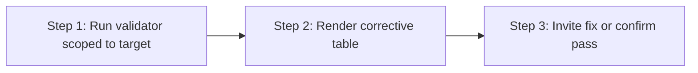

> **Path convention:** `{ds}` = project design-system root (default
> `ai_resources/design-system`). `{p}` = `plugins/wonderwp-design-system`.

# Validating a contract

## Goal

Confirm the contract(s) just produced by `create-atom` / `create-molecule`
conform to the format every downstream consumer (validate, the styleguide
renderer, transform engine) expects. On failure, present a corrective table
naming each finding and the exact fix.

Scoped: by default validates only the `--target` component(s), not the whole
design system. Tokens-wide checks belong to `validate-tokens`.

## Rules

- **R-PIPE-5 — Validate before publish:** Creation skills run this skill
  before claiming success; a failing contract is "produced but not yet usable".
- **R-PIPE-8 — Surface, don't silence:** Every finding (error AND warning)
  appears in the table verbatim from the validator — no filtering, no
  aggregation. (Both rules: `rules/pipeline.md`.)
- **Per-component scope:** Pass `--target` with the slug or `<layer>/<slug>` of
  every fresh component; tokens reporting is skipped (tokens still loaded
  silently for ref resolution).
- **Strict mode for fresh contracts:** When chained from a creation skill, pass
  `--strict` so legacy `token`/`cssVar` formats become errors.

## What is checked

Aesthetic (DTCG), semantic (WHATWG DOM shape + R-CONTRACT-1/2/3/7 jointure),
composition (R-CONTRACT-9..12 — no free electrons), `semantic: null`, and
variants — full checklist in [checks](references/checks.md). Canonical rule
definitions: `rules/contract-schema.md`.

Composition findings are severity-gated by `--strict`: errors on a contract a
creation skill just wrote, warnings on an untouched existing one. That is what
lets the rules land on a design system that predates them without breaking it.

## Workflow



### Step 1: Run validator scoped to target(s)

**Do:**

```bash
node {p}/scripts/validate-dtcg.mjs       \
  --tokens     {ds}/tokens.json           \
  --components {ds}/components.json \
  --target     <layer>/<slug>             \
  [--strict]
```

- Several at once, comma-separated: `--target atoms/button,atoms/label,molecules/card-courses`.
- Bare slugs work when unambiguous (`--target button` = `*/button`).
- Capture stdout, stderr, and the exit code. Do not parse the format yourself —
  read the reporter's section-grouped output and map each finding into the table.

**Success criteria:** validator ran; exit code and grouped findings captured.

### Step 2: Render corrective table

**Do:** Emit one markdown table grouping every finding under the target
component(s): columns `Severity | Component | Section | Rule | Finding | What to
fix`, `❌` errors / `⚠️` warnings, one row per finding, each row ending with a
concrete fix. Format spec, severity legend, and example rows:
[corrective-table](references/corrective-table.md).

**Success criteria:** every captured finding has exactly one actionable row; or,
on exit 0 with zero findings, the table is omitted and `✓ contract(s) valid —
<targets>` is shown.

### Step 3: Invite fix or confirm pass

**Do:**

- **All pass (exit 0):** confirm with the contract path(s) and slug(s) validated.
- **At least one finding (exit 1):** after the table, ask:
  > "Fix the listed issues now? (yes — walk me through each / no — leave the
  > contract as-is, I'll handle later / abort the creation flow)"
- **Missing input (exit 2):** surface the missing path and stop — the caller
  must resolve it before re-running.

The skill does NOT auto-fix. It points; the user (or caller skill) acts.

## Caller contract

| Caller | When invoked | Mode |
|---|---|---|
| `create-atom` | After writing `contract.json` (Step 5) | `--target atoms/<slug> --strict` |
| `create-molecule` | After writing `contract.json` (Step 6) | `--target molecules/<slug> --strict` |
| `create-token` | After syncing tokens — only contracts referencing the new token, if named | optional `--target` |
| standalone | Any time, with the slugs just modified | user-chosen mode |

## Resources

| Type | Path | Description |
|---|---|---|
| Script | `{p}/scripts/validate-dtcg.mjs` | Validator (`--target` per-component scoping) |
| Reference | `rules/contract-schema.md` | Contract schema (aesthetic + semantic + jointure rules) |
| Reference | [references/checks.md](references/checks.md) | What this skill checks, per section |
| Reference | [references/corrective-table.md](references/corrective-table.md) | Corrective-table format, legend, example |
| Input | `{ds}/tokens.json` | Token tokens (loaded silently for ref resolution under `--target`) |
| Input | `{ds}/components.json` | Component registry (resolves Slot atom slugs) |
| Input | `{ds}/components/<layer>/<slug>/contract.json` | Contract(s) under test |
