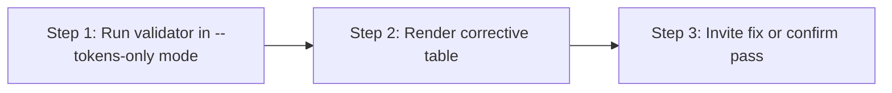

> **Path convention:** `{ds}` = project design-system root (default
> `ai_resources/design-system`). `{p}` = `plugins/wonderwp-design-system`.

# Validating the tokens

## Goal

Confirm `{ds}/tokens.json` and the per-family files under
`{ds}/token-families/` conform to the DTCG format and the WonderWP family
contract that every downstream consumer (contracts, transform engine,
generate-tokens-css) relies on. On failure, present a corrective table naming
each finding and the exact fix.

Scoped: validates the **tokens and token families only**, never per-component
contracts. Contract checks belong to `validate-contract`.

## Rules

- **R-PIPE-5 — Validate after every tokens sync:** `create-token` MUST invoke
  this skill after writing a token family and syncing `tokens.json`; a failing
  tokens file is "synced but not yet usable".
- **R-PIPE-8 — Surface, don't silence:** Every finding (error AND warning)
  appears in the table verbatim from the validator — no filtering. (Both rules:
  `rules/pipeline.md`.)
- **Tokens-only scope:** Pass `--tokens-only` so the script skips every contract
  check. The two skills do not overlap.
- **Strict mode for fresh edits:** When chained from a creation skill, pass
  `--strict` so legacy formats become errors.

## What is checked

Tokens (`$schema`, `$metadata.schemaVersion`, per-family `$type` allow-lists,
no stray top-level keys) and token families (section ownership, allow-listed
`$type`, two-way sync with `tokens.json` — no divergence, no orphans) — full
checklist in [checks](references/checks.md). Does NOT walk any component
contract.

## Workflow



### Step 1: Run validator in --tokens-only mode

**Do:**

```bash
node {p}/scripts/validate-dtcg.mjs \
  --tokens      {ds}/tokens.json   \
  --tokens-only                    \
  [--strict]
```

Capture stdout, stderr, and the exit code. Tokens validation does NOT need
`--components` — the components index is ignored in this mode.

**Success criteria:** validator ran; exit code and grouped findings captured.

### Step 2: Render corrective table

**Do:** Emit one markdown table grouping every finding under `tokens.json` or
the relevant token-family file: columns `Severity | File | Section | Rule |
Finding | What to fix`, `❌` errors / `⚠️` warnings, one row per finding, each
ending with a concrete fix. Format spec, severity legend, and example rows:
[corrective-table](references/corrective-table.md).

**Success criteria:** every captured finding has exactly one actionable row; or,
on exit 0 with zero findings, the table is omitted and `✓ tokens valid
({ds}/tokens.json + {ds}/token-families/*)` is shown.

### Step 3: Invite fix or confirm pass

**Do:**

- **All pass (exit 0):** confirm with the tokens path and the families scanned.
- **At least one finding (exit 1):** after the table, ask:
  > "Fix the listed issues now? (yes — walk me through each / no — leave the
  > tokens as-is, I'll handle later / abort the creation flow)"
- **Missing input (exit 2):** surface the missing path and stop — the caller
  must resolve it before re-running.

The skill does NOT auto-fix. It points; the user (or caller skill) acts.

## Caller contract

| Caller | When invoked | Mode |
|---|---|---|
| `create-token` | After Step 7 (sync tokens) | `--tokens-only --strict` |
| `generate-tokens-css` | Optionally as a pre-check before generation | `--tokens-only` |
| standalone | Any time the tokens file has been hand-edited | user-chosen mode |

## Resources

| Type | Path | Description |
|---|---|---|
| Script | `{p}/scripts/validate-dtcg.mjs` | Validator (`--tokens-only` for tokens-scoped runs) |
| Reference | [references/checks.md](references/checks.md) | What this skill checks (tokens + token families) |
| Reference | [references/corrective-table.md](references/corrective-table.md) | Corrective-table format, legend, example |
| Reference | `rules/pipeline.md` | R-PIPE-* rules |
| Sibling | `skills/validate-contract/SKILL.md` | Per-component contract validation (do not overlap) |
| Input | `{ds}/tokens.json` | Tokens file under test |
| Input | `{ds}/token-families/*.json` | Per-family token files under test |
