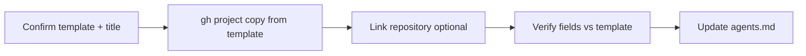

# Creating a New GitHub Project

## Goal

Provision a **GitHub Project v2** for a WonderWP consumer repo by **copying** the org template project, then wire it to the repository and document the project number in the consumer **`agents.md`**.

## Rules

- Prefer **`gh project copy`** over **`gh project create`**: `create` yields a bare board (default Status only); **`copy`** clones fields, single-select options, iterations, and views from the template.
- Default template: org **`agencewonderful`**, project **`7`** ([Site template](https://github.com/orgs/agencewonderful/projects/7)). Override with `GH_PROJECT_TEMPLATE_OWNER` / `GH_PROJECT_TEMPLATE_NUMBER` when needed.
- Auth must include the **`project`** scope: `gh auth refresh -s project` (or `read:project` for read-only checks).
- An **existing** project created without the template **cannot** be retrofitted via API. Either migrate to a copied project or manually add missing fields (see [references/github-project-template.md](references/github-project-template.md)).
- After creation, update the consumer **`agents.md`** (`GitHub Project` line and any `GITHUB_PROJECT_NUMBER` env used by backlog sync).
- Do not delete or close an in-use project without explicit user approval and a migration plan for existing items.

```bash
# From consumer repo root
bash .wonderful/plugins/wonderwp-github/skills/creating-a-new-github-project/scripts/create_github_project_from_template.sh \
  --title "My Site Project" \
  --link-repo agencewonderful/my-repo \
  --dry-run

bash .wonderful/plugins/wonderwp-github/skills/creating-a-new-github-project/scripts/create_github_project_from_template.sh \
  --title "My Site Project" \
  --link-repo agencewonderful/my-repo
```

## Workflow



### Step 1 — Confirm target and auth

**Do:**

1. Read the consumer **`agents.md`**: org, repo, current project number (if any).
2. Confirm template project exists and is marked template: `gh project view 7 --owner agencewonderful --format json`.
3. Ensure `gh auth status` shows **`project`** scope.

**Success criteria:** Template number/owner confirmed; token can list template fields (`gh project field-list 7 --owner agencewonderful`).

### Step 2 — Copy the template project

**Do:**

1. Run the bundled script (or equivalent `gh project copy`) with the desired **title**.
2. Capture the new project **number** and **URL** from script output.
3. Use `--dry-run` first when validating permissions or title.

**Success criteria:** New project exists with template fields (Status: Backlog / Ready / In progress / In review / Done; Priority; Size; Estimate; Iteration; Start/End date).

### Step 3 — Link repository and document

**Do:**

1. Link the consumer repo: `gh project link <number> --owner agencewonderful --repo <owner>/<repo>`.
2. Update **`agents.md`**: GitHub Project link and number; note for `GITHUB_PROJECT_NUMBER` in backlog sync.
3. If replacing a non-template project: add existing issues to the new board (`gh project item-add`) or run backlog sync with the new number; close/archive the old project only after validation.

**Success criteria:** Repo linked; field list matches template; `agents.md` references the new project number.

## Advanced Features

- **Migrating a blank project** — [references/github-project-template.md](references/github-project-template.md) (field diff, item migration, when to copy vs patch).
- **GraphQL** — Same pattern as `sync_backlog_plan_to_github.py` (`gh auth token` + `api.github.com/graphql`) for `copyProjectV2`, `linkProjectV2ToRepository`, `addProjectV2ItemById`.

## Resources

| Type | Path | Description |
| ---- | ---- | ----------- |
| Script | [scripts/create_github_project_from_template.sh](scripts/create_github_project_from_template.sh) | Copy template project, optional repo link, field verification |
| Reference | [references/github-project-template.md](references/github-project-template.md) | Template #7 fields, migration from non-template projects |
