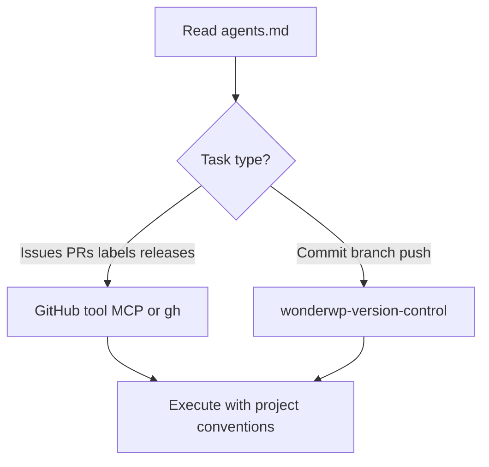

# Working With GitHub

## Goal

Carry out GitHub-related tasks in WonderWP repositories using the integrations and conventions the project documents, without mixing up **hosted GitHub** work with **local git** work.

## Rules

- Read **`AGENTS.md`** / **`agents.md`** (or the project’s equivalent) first to see which GitHub tools are enabled, how authentication is expected, and any naming or workflow rules.
- **Hosted operations** (issue/PR bodies on GitHub, reviews, labels, milestones, releases): stay in this plugin’s mindset and use the configured GitHub path. Always prefer the use of gh command line tool over MCP.
- **Local operations** (status, add, commit, branch, rebase): prefer **wonderwp-version-control** skills unless the user explicitly wants both in one flow—then sequence clearly (local first, then push/PR on GitHub).
- When GitHub MCP tools are available, follow MCP server instructions (schemas, auth); never invent API calls when a documented tool exists.
- Respect org/repo boundaries: confirm **owner/repo** (or remote URL) before mutating hosted data.

## Workflow

### Step 1: Resolve tooling

**Do:**

1. Open the project’s agent/tool configuration (typically `agents.md`).
2. Note GitHub-related entries: MCP servers, `gh` usage, required scopes, and artefact languages if shared with product management.

**Success criteria:** You know **which** GitHub integration to use and any constraints (repo list, label taxonomy, French artefacts, etc.).

### Step 2: Execute the GitHub task

**Do:**

1. For read-only discovery (list issues, get PR), use the lightest available method consistent with `agents.md`.
2. For writes, confirm defaults (base branch, draft vs ready, linked issues).
3. After local commits that should become a PR, hand off explicit PR creation steps if the user requests GitHub-side completion.

**Success criteria:** Hosted state on GitHub matches the user’s intent and project rules.

## Advanced Features

- **Bulk backlog creation** on GitHub often flows through **wonderwp-product-manager** artefacts first; this skill covers **generic GitHub** use when not in that pipeline.
- **CI / Actions**: prefer linking workflows and explaining failure modes; changing workflow YAML is still file/git work—coordinate branch and PR steps with version-control skills as needed.

## Resources

| Type      | Path                                  | Description                          |
| --------- | ------------------------------------- | ------------------------------------ |
| Reference | `agents.md` (project root)            | GitHub MCP, CLI, and domain rules    |
| Agent     | `plugins/wonderwp-github/agents/wonderwp-github.md` | Full agent scope and activation |
