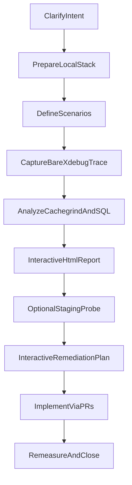

# Auditing Back-Office Request Performance

## Goal

Turn a vague “the editor is slow when I save” into a **reproducible audit** (local Xdebug + hook traces + SQL), an **interactive HTML report** with prioritized findings, optional **staging/prod metrics** via a temporary probe, and a **human-validated remediation plan** that remediates at the highest relevant layer (framework → `wwp-*` → project) without breaking other consumers.

## Rules

- **Evidence before patches.** Do not open upstream PRs until findings are ranked with measured cost (self/inclusive time, query count, URL fan-out, blocking HTTP).
- **Interactive remediation.** After the report, build the plan **step-by-step with the human** (scope, accept / defer / cancel each finding). Do not silently implement speculative fixes.
- **Highest relevant layer.** Prefer fixing WonderWP packages / plugins over project-only overrides when the bug is structural (other projects benefit).
- **Source checkouts for packages.** With Composer `preferred-install: source`, patch in the package checkout and open upstream PRs. **Never** auto-merge or auto-`composer update` on the consumer project unless the human asks.
- **Keep heavy artifacts out of git.** Cachegrind (~hundreds of MB), raw traces, and analysis JSON live under `~/tmp/<project>-profiles/` (or equivalent). Commit only `ai_resources/perf/<stamp>-…/index.html` + `README.md` (+ optional small findings JSON).
- **Xdebug multiplies wall time (~1.5×).** Trust **proportions and counts**, not absolute ms under profiler, for ranking. Always also capture a **bare** (no profiler) timing per scenario.
- **Separate local artefacts from prod.** Example: Kinsta MU classes present in DDEV can fire localhost purge curls — document as local artefact, confirm with a staging probe.
- **Temporary probes must auto-expire and be deleted** after before/after measurement. Never leave measurement mu-plugins in production indefinitely.
- **Probe API must track factory renames.** Prefer `CacheGatewayFactory::getActiveGateway()->getName()` (or equivalent current API), not obsolete helpers.
- **Cleanup is part of Done.** Remove Xdebug ini, tracer mu-plugin, conditional `SAVEQUERIES`, temp users, restore content, `ddev xdebug off`.
- **Project-agnostic docs.** Keep examples generic (`<project>`, `<topic>`). Do not hardcode consumer-project paths or chantier names from a single site.

## Workflow



### Step 1: Clarify intent and success criteria

**Do:**

1. Restate the user-visible symptom (e.g. Gutenberg save hangs / 500 after ~50 s proxy timeout).
2. Agree the **primary request** under study (usually `POST /wp-json/wp/v2/{type}/{id}`).
3. Agree **Done** metrics:
   - Local: e.g. POST ≤ 2× GET bare time.
   - Staging/prod: e.g. no blocking outbound HTTP on save; `flush_urls` in a small band; total_ms / flush_ms drop.
4. List in/out of scope early (e.g. core double REST render may be OOS; media URL resolver may be deferred).

**Success criteria:** Written intent + Done criteria shared with the human before tooling changes.

### Step 2: Prepare the local stack

**Do:**

1. Confirm DDEV project is up (`ddev describe`), PHP ≥ project requirement, admin credentials available.
2. Add a **temporary** Xdebug profile ini under `.ddev/php/` (name with `zz-` prefix so it is easy to delete). Copy from [assets/xdebug-profile.ini.template](./assets/xdebug-profile.ini.template); set `xdebug.trigger_value` to a project-specific token.
3. `ddev restart && ddev xdebug on && ddev exec 'mkdir -p /tmp/xdebug /tmp/<project>-trace && chmod 777 /tmp/xdebug /tmp/<project>-trace'`.
4. Trigger profiling with cookie `XDEBUG_TRIGGER=<trigger_value>` on the request under study.
5. Optional: gate `SAVEQUERIES` on a second cookie in `config/environments/development.php` only (never production).
6. Create a throwaway tracer mu-plugin (cookie-gated) that:
   - wraps critical hooks (`save_post`, `rest_*`, `wwp.cache.*`, `the_content`, `render_block`, …);
   - records duration, SQL delta, attributed package;
   - dumps JSON under `/tmp/<project>-trace`.
7. Prefer **automation** (curl + cookie jar + REST nonce) over browser login when agent browsers cannot submit credentials.

**Success criteria:** A bare request and a profiled request both complete; cachegrind files appear in `/tmp/xdebug`; tracer JSON appears when the trace cookie is set.

### Step 3: Define scenario matrix

**Do:**

1. Always include a **bootstrap witness** (GET same resource `context=edit`) to separate shared bootstrap from write path.
2. Cover the user complaint path (rich page save), plus variants that change fan-out:
   - home / shortcode-heavy page;
   - save without content change;
   - another CPT if `isConcerned` differs;
   - autosave / revision (expect little or no cache fan-out).
3. For each scenario: **3 bare passes** (median), **≥1 Xdebug**, **≥1 tracer** when SQL/hooks matter.
4. Mutate content with a reversible marker paragraph; restore after capture.

**Success criteria:** Scenario table documented (id, endpoint, intent, bare_ms).

### Step 4: Capture and collect

**Do:**

1. Run captures (manual or `~/tmp/<project>-profiles/tools/*-capture.py` if present).
2. Copy artefacts out of the container:

```bash
docker cp ddev-<project>-web:/tmp/xdebug/. ~/tmp/<project>-profiles/cachegrind/
docker cp ddev-<project>-web:/tmp/<project>-trace/. ~/tmp/<project>-profiles/trace/
```

3. Keep tools + raw data **outside** the git repo; only publish distilled report assets into `ai_resources/perf/`.

**Success criteria:** Named cachegrind + trace files mapped to each scenario id.

### Step 5: Analyze cachegrind, hooks, and SQL

**Do:**

1. Parse cachegrind into per-function self/inclusive time; attribute PHP internals to the **calling package** when possible.
2. Build caller/callee graphs for top offenders.
3. Aggregate tracer phases into a timeline (hook → callback → ms → SQL count → package).
4. Normalize SQL (strip literals) to spot N+1 shapes (`get_permalink`, meta-by-id loops, repeated `LIKE`).
5. Cross-check Network/HAR when available (blocking `wp_remote_get`, purge API batching).

**Success criteria:** Ranked list of suspects with evidence pointers (function, package, SQL form, scenario deltas).

### Step 6: Produce the interactive HTML report

**Do:**

1. Create `ai_resources/perf/<YYMMDDHHmm>-profiling-<topic>/`.
2. Generate a **standalone** `index.html` (embedded JSON, no CDN dependency) with tabs:
   - **Synthèse** — cards, top findings, bare vs profiled caveat.
   - **Séquence** — hook/callback timeline.
   - **Packages** — time by package, scenario compare.
   - **Fonctions** — sortable table, callers/callees.
   - **SQL** — normalized shapes + slow queries.
   - **Remédiation** — finding sheets F1…Fn (priority, evidence, proposed fix layer, risks).
   - **Protocole** — how to reproduce.
3. Add `README.md` summarizing results + protocol (see [references/html-report-structure.md](./references/html-report-structure.md)).
4. Finding sheet fields: id, priority (P1–P4), symptom, evidence, root cause hypothesis, proposed fix (package path), acceptance metric, out-of-scope note if deferred.

**Success criteria:** Human can open `index.html` offline and agree the ranking before any remediation coding.

### Step 7: Optional staging/prod metrics probe

**Do:**

1. Add a **versioned, auto-expiring** mu-plugin (e.g. `web/app/mu-plugins/<project>-save-probe.php`) that:
   - activates only on REST writes to `wp/v2/*`;
   - wraps the expensive action under study (often `wwp.cache.flush-urls`) with `-PHP_INT_MAX` / `PHP_INT_MAX` bookends;
   - logs `total_ms`, `flush_calls`, `flush_urls`, `flush_ms`, `post_id`, `post_type`, `gateway`, `uri`;
   - dual-writes `error_log` + `WP_CONTENT_DIR/uploads/<probe>.log` (Kinsta SSH often cannot read PHP error_log);
   - no-ops after `EXPIRES_AT` (deploy + ~48h).
2. Deploy via normal CI; capture **baseline** before remediations land.
3. After remediations + `composer update` + deploy: re-save witness posts; diff before/after.
4. Remember: last `save_post` in the request may be a **revision** — use `uri=` to map to the edited resource.
5. **Delete the probe** when closing the chantier (do not rely only on expiry).

Details: [references/metrics-probe.md](./references/metrics-probe.md).

**Success criteria:** Before/after table with flush_urls + flush_ms + total_ms on the same posts.

### Step 8: Build the remediation plan interactively

**Do:**

1. Open Plan mode (or an explicit interactive checklist) **with the human**.
2. For each finding F1…Fn, walk:
   - keep / defer / cancel;
   - target package vs project;
   - acceptance test;
   - sequencing dependencies (e.g. gateway gating before purge batching).
3. Write `ai_resources/plans/<stamp>-<topic>-remediation.md` with:
   - YAML status (`validated` → `implemented` → `closed`);
   - intent one-liner + Done criteria;
   - mermaid lot/step graph;
   - step table (todo, files, agent/skill, acceptance, result);
   - explicit out-of-scope;
   - risks;
   - diffusion rules (1 PR / repo, human merge, human composer update).
4. If a finding (or coherent group) is **too large** for the main plan — multi-package redesign, long discovery, or a different Done criterion — **spin a dedicated plan** (`ai_resources/plans/<stamp>-<subtopic>-remediation.md`), link it from the main plan, and keep only a short pointer + acceptance gate in the parent. Do not inflate the main plan into an unreadable epic.
5. Prefer small, reviewable upstream PRs over a monorepo dump.
6. When a step introduces SQL that looks faster but may N+1, **bench it** (query count + ms) before merging — join/`_prime_post_caches` beats `get_posts` + per-id meta loops.

Procedure: [references/interactive-remediation-plan.md](./references/interactive-remediation-plan.md).

**Success criteria:** Plan file marked `validated` by the human; each in-scope step has acceptance criteria.

### Step 9: Implement, re-measure, close

**Do:**

1. Implement via the agreed agents/skills; keep conventional commits per package.
2. Open PRs in dependency order (foundations → cache core → secondary plugins → consumer project last).
3. After human merges + composer update + deploy: re-measure (local protocol and/or probe).
4. Update `ai_resources/perf/…-after/README.md` with numbers; set plan `status: closed`.
5. Remove probe, Xdebug ini leftovers, tracers; restore content/users.

**Success criteria:** Plan closed; probe gone from the tree; before/after numbers recorded.

## Advanced Features

- **HTML report structure**: [references/html-report-structure.md](./references/html-report-structure.md)
- **Metrics probe design**: [references/metrics-probe.md](./references/metrics-probe.md)
- **Interactive remediation planning**: [references/interactive-remediation-plan.md](./references/interactive-remediation-plan.md)
- **Offline tools** (not in git): `~/tmp/<project>-profiles/tools/` — capture / analyze / report scripts when present
- Consumer projects may keep their own `ai_resources/perf/` and `ai_resources/plans/` artefacts as worked examples; do not bind this skill to one site’s paths.

## Resources

| Type | Path | Description |
| --- | --- | --- |
| Reference | [references/html-report-structure.md](./references/html-report-structure.md) | Tabs, finding sheet schema, README protocol section |
| Reference | [references/metrics-probe.md](./references/metrics-probe.md) | Auto-expiring REST-write probe, dual-write log, pitfalls |
| Reference | [references/interactive-remediation-plan.md](./references/interactive-remediation-plan.md) | Human-in-the-loop plan validation pattern |
| Asset | [assets/xdebug-profile.ini.template](./assets/xdebug-profile.ini.template) | Temporary DDEV Xdebug profile snippet |
| Asset | [assets/save-probe.php.template](./assets/save-probe.php.template) | Starting point for a project-specific probe |
