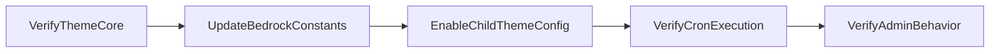

# Enable Auto-Update

## Goal

Activate WordPress updates (automatic and manual, including **major** core releases) on a WonderWP Bedrock consumer project while keeping the code editor disabled and blocking new plugin/theme installations and deletions from the admin.

## Rules

- Confirm `agencewonderful/wonderwp-theme-core` includes `enable_auto_updates` config and `ThemeHookService` restriction hooks; run `composer update agencewonderful/wonderwp-theme-core` if needed.
- Change Bedrock constants as documented in [references/bedrock-constants.md](./references/bedrock-constants.md).
- **Do not** set `DISALLOW_FILE_EDIT` to `false` — keep the built-in file editor disabled.
- **Do not** rely on SecuPress « minor updates » as a substitute — this skill uses Bedrock constants + theme-core hooks.
- Set `enable_auto_updates` to `true` on the child theme manager **before** `parent::register()`.
- **`AUTOMATIC_UPDATER_DISABLED=false` alone only unlocks minor/security core releases.** WordPress requires a separate, explicit opt-in — `define('WP_AUTO_UPDATE_CORE', true);` in `config/application.php` — for **major** core version auto-updates (e.g. 7.0.x → 7.1.x). Without it, `wp cron event list` will show `wp_version_check` scheduled but `wp_maybe_auto_update` **never scheduled**, and the site will silently stall on the last minor release of its current major version even though every constant "looks" correct. Always set this constant alongside `AUTOMATIC_UPDATER_DISABLED`.
- If `DISABLE_WP_CRON` is `true`, ensure a system cron hits `wp-cron.php` or updates will not be scheduled.
- **Do not treat a correct crontab entry as proof cron works.** Verify actual execution: `wp cron event list --fields=hook,next_run_relative | grep wp_version_check` must show a future run, and after that time passes, `wp core version` should reflect any pending minor update. A stuck **minor** version (which needs no opt-in) after several hours is strong evidence the poller isn't actually running, not a constants problem.
- On restricted/mutualized hosting (e.g. some OVH mutualized offers), `crontab -l` may return "command not found" over SSH — cron there is managed outside the shell and cannot be audited or trusted via this route. Flag it explicitly as unverifiable rather than assuming it works, and check whether WP-CLI itself even runs on the box's default PHP (some mutualized hosts default to an old PHP incompatible with current Composer requirements — you may need `WP_CLI_PHP=/path/to/php8.x` to invoke `wp` at all).
- Warn the user that BO updates on Composer-managed packages can create Git/Composer drift; validate on staging first.
- Set `CORE_UPGRADE_SKIP_NEW_BUNDLED`, `ALLOW_UNFILTERED_UPLOADS`, `WP_ALLOW_REPAIR`, and `DIEONDBERROR` in **both** `config/environments/production.php` and `config/environments/staging.php` whenever this skill touches those files — see [references/bedrock-constants.md](./references/bedrock-constants.md) for the value and rationale of each.
- **`DIEONDBERROR`'s core check is `defined( 'DIEONDBERROR' )`, not its value.** Setting it to `false` matches convention and documents intent, but does not itself suppress the DB-error `wp_die()` — confirm SecuPress's "Hide Database Errors" submodule (or equivalent) is active for an actual guarantee.
- After committing in the `ai-rules` submodule, run `./.wonderful/scripts/install.sh cursor` from the consumer project root to propagate the skill.

## Workflow



### Step 1: Verify theme-core version

**Do:**

1. Open `web/app/themes/wonderwp-theme-core/includes/ThemeManager.php` and confirm `enable_auto_updates` exists (default `false`).
2. Open `web/app/themes/wonderwp-theme-core/includes/Service/ThemeHookService.php` and confirm `restrictAutoUpdateFileMods` and `restrictAutoUpdateCaps` are registered when the config is `true`.
3. If missing, update the package: `composer update agencewonderful/wonderwp-theme-core`.

**Success criteria:** Theme-core exposes the config and conditional hooks.

### Step 2: Update Bedrock constants

**Do:**

1. In `config/application.php`, set `AUTOMATIC_UPDATER_DISABLED` to `false`.
2. In `config/application.php`, right after `AUTOMATIC_UPDATER_DISABLED`, add `define('WP_AUTO_UPDATE_CORE', true);` — this is the major-release opt-in and is easy to forget since the site will look fully configured without it.
3. In `config/environments/production.php`, set `DISALLOW_FILE_MODS` to `false`.
4. In `config/environments/staging.php`, set `DISALLOW_FILE_MODS` to `false`.
5. Leave `DISALLOW_FILE_EDIT` at `true` in `config/application.php`.
6. In both `config/environments/production.php` and `config/environments/staging.php`, alongside `DISALLOW_FILE_MODS`, set the following hardening constants — enabling a writable filesystem for updates is the moment to also close off the attack surface that comes with it:
   - `CORE_UPGRADE_SKIP_NEW_BUNDLED` to `true`
   - `ALLOW_UNFILTERED_UPLOADS` to `false`
   - `WP_ALLOW_REPAIR` to `false`
   - `DIEONDBERROR` to `false`

See [references/bedrock-constants.md](./references/bedrock-constants.md) for the full table and the rationale behind each hardening constant.

**Success criteria:** Constants match the reference, including `WP_AUTO_UPDATE_CORE` and the four hardening constants on both `production.php` and `staging.php`; no unintended constant changes.

### Step 3: Enable child ThemeManager config

**Do:**

1. Locate the child theme manager (typically `web/app/themes/wwp_child_theme/includes/ChildThemeManager.php`).
2. At the start of `register()`, before `parent::register($container)`, add:

   ```php
   $this->setConfig('enable_auto_updates', true);
   ```

**Success criteria:** Child manager overrides the default before parent registration.

### Step 4: Verify cron execution

**Do:**

1. Over SSH on the target environment, confirm the crontab (or hosting panel equivalent) actually invokes `wp cron event run --due-now` on a schedule — do not just confirm the line exists, confirm it runs (e.g. tail its log, or diff before/after `wp core version`).
2. Run `wp cron event list --fields=hook,next_run_relative` and confirm `wp_version_check` has a future `next_run_relative`. If a core update is available, confirm `wp_maybe_auto_update` becomes scheduled too — its absence with `WP_AUTO_UPDATE_CORE` set to `true` means the update decision logic is declining for another reason (e.g. `DISALLOW_FILE_MODS` still `true` on the deployed environment, not just in git).
3. If `crontab -l` fails with "command not found" or similar (some mutualized hosts), treat cron as **unverifiable from SSH** — say so explicitly rather than assuming it works, and check the hosting panel's own cron configuration instead.

**Success criteria:** `wp_version_check` is scheduled and its log shows real, periodic executions; when an update is pending, `wp_maybe_auto_update` gets scheduled too.

### Step 5: Verify admin behavior

**Do:**

1. Deploy or reload config on the target environment.
2. Check **Dashboard → Updates**: the message « All automatic updates are disabled » should no longer appear.
3. Confirm an existing plugin can be updated from the admin.
4. Confirm **Plugins → Add New** and plugin deletion are blocked.
5. Confirm **Appearance → Theme File Editor** remains inaccessible.

**Success criteria:** Updates work; install/delete and file editor remain blocked.

## Resources

| Type      | Path                                      | Description                          |
| --------- | ----------------------------------------- | ------------------------------------ |
| Reference | `references/bedrock-constants.md`       | Bedrock constant values and rationale |
