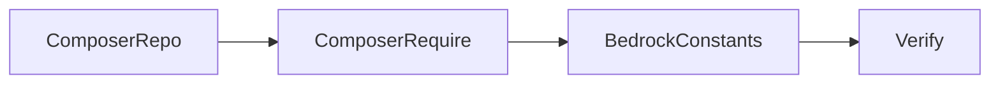

# Installing Kinsta Cache

## Goal

Install and configure the Kinsta MU plugin (`kinsta/kinsta-mu-plugins`) on a WonderWP Bedrock project so full-page cache, CDN integration, and admin cache controls work on Kinsta hosting.

## Rules

- **Composer package repository:** declare `kinsta/kinsta-mu-plugins` as a `type: package` entry in `composer.json` `repositories`, pointing at the official zip (`https://kinsta.com/kinsta-tools/kinsta-mu-plugins.zip`). Set an explicit `version` matching the zip contents — update it on each upgrade.
- **Require constraint:** add `"kinsta/kinsta-mu-plugins": "^3.6"` (or the current major) to `require`; run `composer require kinsta/kinsta-mu-plugins:^3.6` from the project root. If DDEV is configured, run the composer commands through DEV and never the host `composer` or Docker workarounds on WonderWP projects.
- **Installer path:** WonderWP Bedrock already maps `type:wordpress-muplugin` to `web/app/mu-plugins/{$name}/` — the plugin lands in `web/app/mu-plugins/kinsta-mu-plugins/` (subfolder install).
- **MU autoloader required:** Composer installs into a **subfolder** of `mu-plugins/`. The project must have a Must-Use autoloader (`web/app/mu-plugins/bedrock-autoloader.php` on WonderWP projects). Do **not** move `kinsta-mu-plugins.php` to the mu-plugins root — that breaks Composer updates.
- **Bedrock path constants:** add after `WP_CONTENT_URL` is defined in `config/application.php`:
  - `KINSTA_CDN_USERDIRS` → `'app'` (WonderWP uses `CONTENT_DIR = '/app'`, not `wp-content`)
  - `KINSTAMU_CUSTOM_MUPLUGIN_URL` → `WP_CONTENT_URL . '/mu-plugins/kinsta-mu-plugins'`
- **Do not use `Config::get()`** unless the project already uses Roots `Config` — WonderWP projects define `WP_CONTENT_URL` directly.
- **Branching:** use a `hotfix/install-kinsta-cache` branch from `master` (or `main`) for production hotfixes; merge back to production and `develop`.
- **Local dev:** Kinsta Cache admin UI appears locally but server cache only works on Kinsta infrastructure — no need to remove the plugin from local `.env`.
- **After deploy:** purge edge cache if needed (`wp kinsta cache purge` on Kinsta, or MyKinsta UI). When `wwp-cache` is active, also run `wp wwp-cache:rebuild` after deploy (see project plugin READMEs).

## Workflow



### Step 1: Declare the Composer package repository

**Do:**

1. Open root `composer.json`.
2. Add a `repositories` entry:

```json
{
  "type": "package",
  "package": {
    "name": "kinsta/kinsta-mu-plugins",
    "type": "wordpress-muplugin",
    "version": "3.6.1",
    "dist": {
      "url": "https://kinsta.com/kinsta-tools/kinsta-mu-plugins.zip",
      "type": "zip"
    }
  }
}
```

3. Check [Kinsta MU plugin changelog](https://kinsta.com/fr/docs/hebergement-wordpress/mu-plugin-kinsta/) for the latest zip version and align the `version` field before upgrading.

**Success criteria:** `composer.json` contains the package repository with a version matching the intended zip.

### Step 2: Require the package

**Do:**

1. From the project root (where `composer.json` lives):

```bash
composer require kinsta/kinsta-mu-plugins:^2.3
```

2. Confirm files exist under `web/app/mu-plugins/kinsta-mu-plugins/` and `composer.lock` is updated.
3. Commit `composer.json` and `composer.lock`.

**Success criteria:** `vendor/` and `web/app/mu-plugins/kinsta-mu-plugins/` contain the plugin; `composer.lock` references `kinsta/kinsta-mu-plugins`.

### Step 3: Fix Bedrock resource paths

**Do:**

1. Edit `config/application.php` immediately **after** the `WP_CONTENT_URL` define.
2. Add:

```php
/**
 * Kinsta MU plugin (Bedrock paths)
 * @see https://kinsta.com/fr/docs/hebergement-wordpress/mu-plugin-kinsta/#installation-via-composer
 */
define('KINSTA_CDN_USERDIRS', 'app');
define('KINSTAMU_CUSTOM_MUPLUGIN_URL', WP_CONTENT_URL . '/mu-plugins/kinsta-mu-plugins');
```

3. Confirm `web/app/mu-plugins/bedrock-autoloader.php` exists (WonderWP default).

**Success criteria:** Constants are defined before WordPress bootstrap; no PHP notices on load.

### Step 4: Verify

**Do:**

1. Load wp-admin → **Plugins → Must-Use** — **Kinsta Cache** (or MU plugin entry) should appear.
2. Confirm the left admin menu shows **Kinsta Cache** (unless whitelabeled).
3. On Kinsta staging/production over SSH:

```bash
wp plugin list --status=must-use
wp kinsta cache autopurge status
```

4. After deploy, purge caches if the site was previously served without the MU plugin.

**Success criteria:** MU plugin active; cache controls visible in admin; no broken asset URLs under `/app/mu-plugins/kinsta-mu-plugins/`.

## Advanced Features

- **Upgrading the MU plugin:** bump `version` in the Composer package repository, run `composer update kinsta/kinsta-mu-plugins` locally, commit lock file, deploy, purge cache.
- **White-label admin UI:** set `KINSTAMU_WHITELABEL` in config — see [Kinsta docs](https://kinsta.com/fr/docs/hebergement-wordpress/mu-plugin-kinsta/#libeller-et-personnaliser-cette-extension-kinsta-mu).
- **Disable autopurge during bulk imports:** `wp kinsta cache autopurge disable` then re-enable when done.
- **SFTP install (non-Composer):** only when Composer is not used — see [references/kinsta-composer-vs-sftp.md](./references/kinsta-composer-vs-sftp.md).

## Resources

| Type | Path | Description |
| --- | --- | --- |
| Reference | [references/kinsta-composer-vs-sftp.md](./references/kinsta-composer-vs-sftp.md) | When to use Composer vs SFTP on Kinsta |
| External | [Kinsta MU plugin — Installation via Composer](https://kinsta.com/fr/docs/hebergement-wordpress/mu-plugin-kinsta/#installation-via-composer) | Official procedure |
| External | [Kinsta MU plugin changelog](https://kinsta.com/fr/docs/hebergement-wordpress/mu-plugin-kinsta/) | Version checks before package bump |
