# Setting Up DDEV on an Existing WonderWP Project

## Goal

Bring a WonderWP Bedrock codebase to a working local URL under DDEV with correct PHP/Node, database alignment, URL replacement, Composer credentials, and compiled front-end assets—without repeating one-off debugging each time.

## Rules

- Read **`composer.json`** for `require.php` and **`package.json`** for `engines.node` before choosing DDEV versions; map semver to a concrete `php_version` and `nodejs_version` DDEV supports.
- Use **`wp-bedrock`** with **`docroot: web`** when the layout matches Roots Bedrock (`web/index.php`, `web/wp`, Composer at repo root). Details: [references/ddev-config-and-verification.md](./references/ddev-config-and-verification.md).
- **`ddev composer`** runs inside the container; host `~/.composer/auth.json` is not visible unless wired via `homeadditions` or `COMPOSER_AUTH`. See [references/composer-auth-homeadditions.md](./references/composer-auth-homeadditions.md).
- After importing a production database, **`DB_PREFIX` in `.env` must match** the imported tables or `ddev wp` will report the site as not installed. Then run URL search-replace with **`--all-tables`** so non-core and plugin tables are included. See [references/bedrock-db-import-and-url-replace.md](./references/bedrock-db-import-and-url-replace.md).
- For database import and URL migration: **ask the user** for the **absolute path to the SQL dump** (host path passed to `ddev import-db --file=`) and for the **canonical production site URL** used as the `search-replace` *old* string. **Do not guess** the dump path or production URL. **Resolve the local URL from DDEV** via `ddev describe` (HTTPS primary URL), not by asking the user, unless `ddev describe` is unavailable—in that case derive from `.ddev/config.yaml` `name` and the default `ddev.site` pattern and confirm with the user.
- Keep **uploads proxy** rules in **`web/app/uploads/.htaccess`**, not a stray `.htaccess` at the repo root. Template: [references/uploads-proxy-htaccess-template.md](./references/uploads-proxy-htaccess-template.md).
- If the repo has a /CI/exclude-file.txt file, add **`.ddev/`** to the project **exclude manifest**—for example **`CI/exclude-file.txt`** under listing « Unneeded / Unwanted directories »—so Docker/DDEV metadata never reaches production artefacts.
- For automation or CI, `DDEV_NONINTERACTIVE=true` avoids interactive prompts (and may skip hosts-file updates when DNS for `*.ddev.site` is enough).
- Run **`ddev npm`** (not host `npm`) so Node matches `package.json` `engines.node` and the DDEV `nodejs_version`.
- After dependencies are installed, read root **`package.json`** `scripts` and run asset builds in order: **`sprites` first** (when defined), then **`build`**, then any other **`build:*`** scripts. Skip dev-only scripts (`start`, `watch`, `test`, etc.).

## Workflow

```mermaid
flowchart LR
    A[Read manifests] --> B[ddev config and start]
    B --> C[Verify PHP and Node]
    C --> D[Align Bedrock .env from ddev describe]
    D --> E[Ask dump path and prod URL]
    E --> F[ddev import-db then search-replace]
    F --> G[Optional uploads proxy]
    G --> H[CI exclude .ddev if applicable]
    H --> I[Composer auth if needed]
    I --> J[ddev npm install and build scripts]
```



### Step 1: Read project constraints

**Do:**

1. Open `composer.json` and note `require.php` (e.g. `>=8.3` → use `8.3` in DDEV).
2. Open `package.json` and note `engines.node` (e.g. `>=16 <17` → `nodejs_version: "16"`).
3. Confirm Bedrock layout: `web/index.php` bootstraps `web/wp`, `composer.json` at project root.

**Success criteria:** Target `php_version`, `nodejs_version`, and `docroot` are decided.

### Step 2: Configure and start DDEV

**Do:**

1. From the project root, run non-interactive config (adjust versions and web server as needed):

   ```bash
   ddev config --auto \
     --project-type=wp-bedrock \
     --docroot=web \
     --php-version=8.3 \
     --nodejs-version=16 \
     --webserver-type=apache-fpm
   ```

2. Start the project: `ddev start` (use `DDEV_NONINTERACTIVE=true` when appropriate).

3. Confirm tooling: `ddev exec php -v` and `ddev exec node -v`.

**Success criteria:** `ddev describe` shows the expected URL; PHP and Node match policy from the manifests.

### Step 3: Align Bedrock environment

**Do:**

1. Set `DB_*` in `.env` to DDEV defaults (`db` / `db` / `db` / `db` host) unless the project documents otherwise.
2. Run `ddev describe` and note the **HTTPS** project URL (primary site URL). Set `WP_HOME` to that URL and `WP_SITEURL` to `{that URL}/wp` per Bedrock convention.

**Success criteria:** `.env` matches DDEV database credentials and the local URLs reported by `ddev describe`.

### Step 4: Database import and URL migration

**Do:**

1. **Ask the user** to provide:
   - **Database dump path:** absolute path on the host to the file to import (e.g. `.sql`, `.sql.gz`, `.tar`, `.zip` as supported by `ddev import-db`). Do not invent or assume a path.
   - **Production URL:** the main public URL of the site whose database is being imported (e.g. `https://www.example.com`), exactly as it should appear in the `search-replace` *old* string. Normalize trailing slashes consistently with what exists in the database if the user knows it; otherwise start with the URL they give.

2. **Resolve the local URL** from DDEV (do not ask the user for it unless you cannot read DDEV output):
   - Run `ddev describe` and use the **https://** URL shown for the project (or `ddev describe -j` and read the primary URL field if you rely on machine parsing).
   - If needed, cross-check `.ddev/config.yaml` key `name` against the hostname in that URL.

3. **Import the database** using the user’s path:

   ```bash
   ddev import-db --file="<ABSOLUTE_PATH_FROM_USER>"
   ```

4. If `ddev wp` errors about table prefix mismatch, set `DB_PREFIX` in `.env` to the **imported** prefix (inspect DB or the error message), then `ddev restart` if needed.

5. **Search-replace** production → local using the user’s production URL and the URL from `ddev describe`. Always pass **`--all-tables`** so plugin and custom tables (Action Scheduler, SEO, forms, etc.) are updated, not only core WordPress tables:

   ```bash
   ddev wp search-replace '<PRODUCTION_URL_FROM_USER>' '<LOCAL_HTTPS_URL_FROM_DDEV_DESCRIBE>' --all-tables --report-changed-only
   ```

   Optional preview: add `--dry-run` first (remove it for the real run). Keep **`--all-tables`** on dry-run and apply passes alike.

6. Plan extra passes for `http://`, bare domain, or path variants if content still references production.

**Success criteria:** Import completed from the user-supplied file; admin and front reflect the local DDEV URL; no “site not installed” from WP-CLI.

### Step 5: Optional media proxy (Apache)

**Do:**

1. If `web/app/uploads` is empty or partial, add `.htaccess` per [references/uploads-proxy-htaccess-template.md](./references/uploads-proxy-htaccess-template.md) with the real local host and production base URL.

**Success criteria:** Requests for missing files under `/app/uploads/` redirect to production for local host only.

### Step 6: Exclude `.ddev/` from CI or deploy sync (when applicable)

**Do:**

1. If the repo defines an exclude list consumed by Jenkins, rsync, or another packaging step, add **`.ddev/`** to that manifest (Pink Lady convention: **`CI/exclude-file.txt`**, « Unneeded / Unwanted directories »). Match the toolchain’s glob style (often `- .ddev/` or similar).

**Success criteria:** Dry-run previews of deploy artefacts omit `.ddev` entirely.

### Step 7: Composer authentication (when private packages prompt)

**Do:**

1. If `ddev composer install` asks for a token, apply global or project `homeadditions` per [references/composer-auth-homeadditions.md](./references/composer-auth-homeadditions.md), then `ddev restart`.

**Success criteria:** `ddev composer install` completes non-interactively with valid credentials.

### Step 8: Node dependencies and asset builds

**Do:**

1. From the project root, install Node dependencies inside DDEV:

   ```bash
   ddev npm install
   ```

2. Open root **`package.json`** and inspect the **`scripts`** object. Identify build-related scripts; typical WonderWP projects define `sprites`, `build`, and sometimes `build:prod` or other `build:*` variants.

3. Run scripts **in this order** (skip any script not defined in `package.json`):

   | Order | Script | Notes |
   | ----- | ------ | ----- |
   | 1 | `sprites` | Often required **before** webpack; compiles SVG sprites used by the theme. |
   | 2 | `build` | Primary webpack (or equivalent) build. |
   | 3 | Other `build:*` | e.g. `build:prod` — run each remaining `build:*` script except duplicates already run. |

   ```bash
   ddev npm run sprites   # when "sprites" exists in scripts
   ddev npm run build     # when "build" exists in scripts
   ddev npm run build:prod   # example: other build:* scripts, one command per script
   ```

4. **Do not run** dev-only or long-running scripts during setup: `start`, `watch`, `test`, and similar.

5. If a build script fails, read the error output; fix missing deps or path issues before treating the DDEV stack as complete.

**Success criteria:** `node_modules` exists (or npm install reports up to date); sprite and webpack output directories contain expected compiled assets; the front-end loads styles/scripts locally without 404s on built bundles.

## Resources

| Type      | Path |
| --------- | ---- |
| Reference | [references/ddev-config-and-verification.md](./references/ddev-config-and-verification.md) |
| Reference | [references/composer-auth-homeadditions.md](./references/composer-auth-homeadditions.md) |
| Reference | [references/bedrock-db-import-and-url-replace.md](./references/bedrock-db-import-and-url-replace.md) |
| Reference | [references/uploads-proxy-htaccess-template.md](./references/uploads-proxy-htaccess-template.md) |
