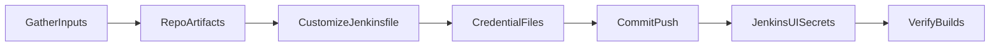

# Setting Up Jenkins CI Pipeline

## Goal

Bring a WonderWP Bedrock repo from no Jenkins integration to a first successful CI pipeline: develop deploys to staging, `main` deploys to production (legacy repos may still use `master`), with incremental builds, Cypress integration tests, and org-standard Slack — without database migration.

## Rules

- **Jenkinsfile under CI/:** place `Jenkinsfile` at **`CI/Jenkinsfile`**; do not place it at project root (legacy layout used root `Jenkinsfile`).
- **Never commit credentials:** filled JSON under `CI/` only; gitignore `CI/{slug}_*_credentials.json` at repo root (keep patterns like `wonderwp_credentials.json`).
- **CI folder:** ensure `CI/` exists with `exclude-file.txt` (copy from [assets/exclude-file.txt.template](./assets/exclude-file.txt.template)) and committed `CI/credentials.template.json` (copy from [assets/credentials.template.json](./assets/credentials.template.json)).
- **Org defaults (do not re-ask):** Slack → `#jenkins` / `wdf-team`; Jenkins Cypress → `cypress run --env host=$host` (full suite). Initial `cypress.json` smoke setup only — see [references/org-ci-conventions.md](./references/org-ci-conventions.md).
- **Ask the user** for: project slug, hosting SSH details (from provider email), staging and production `siteUrl`, **remote PHP version/path on hosting** (may differ from `composer.json`), `cacheEnabled` if unclear, and any extra `npm run` scripts beyond `sprites` + `build`/`build:prod`. **Do not invent** SSH hosts, paths, or passwords.
- **Credential naming (two layers):** local files under `CI/` are named by **environment** (`{slug}_preprod_credentials.json`, `{slug}_prod_credentials.json`); Jenkins secret file **IDs** are named by **branch** (`{slug}_develop_credentials`, `{slug}_main_credentials`) because `loadCreds("{slug}_${BRANCH_NAME}_credentials")` resolves `$BRANCH_NAME` at deploy time. Upload preprod → develop ID, prod → main ID. Legacy repos on `master` use `{slug}_master_credentials` instead — see [references/credential-files.md](./references/credential-files.md).
- **Production branch:** new projects use **`main`**; `master` is legacy-only. Confirm the repo default branch before choosing the prod Jenkins credential ID.
- **No database migration:** do not wire, document, or scaffold `CI/DB/`, `db-migration.sh`, or Jenkinsfile helpers `deployDbChanges` / `execDbChanges`. Stages: **Build → Deploy (rsync + finalizeDistantMigration) → Integration tests → notify**.
- **Post-deploy finalize (not DB):** after rsync, run remote WP-CLI when `cacheEnabled || remoteCommandNeeded` — doctrine plugin cycle + optional `wwp-cache:rebuild`. See [references/post-deploy-finalize.md](./references/post-deploy-finalize.md).
- **Credential JSON shape:** [assets/credentials.template.json](./assets/credentials.template.json) — includes optional `sshPort` for non-standard SSH ports and `wpCliCommand` for the remote WP-CLI invocation.
- **Remote WP-CLI per hosting (`wpCliCommand`):** the WP-CLI invocation belongs to the hosting, so it lives in credentials JSON — **Kinsta: `"wp"`** (pre-installed on PATH); classic hosts: leave empty → vendor fallback `WP_CLI_PHP={WP_CLI_PHP} vendor/wp-cli/wp-cli/bin/wp`. The template `chmod +x`'s the vendor binary before use (rsync drops the exec bit → exit 126), probes with `wp cli version`, and never redirects WP-CLI stderr to `/dev/null` (it hides `Permission denied`). See [references/post-deploy-finalize.md](./references/post-deploy-finalize.md#remote-wp-cli-command-credswpclicommand).
- **Verify secret content = ID:** after uploading Jenkins secrets and on the first deploy, check the rsync target (`user@host:path`) in the log belongs to this project/environment — a wrong JSON under the right ID deploys to **another project's server with `--delete`**. See [references/credential-files.md](./references/credential-files.md#verify-the-secret-content-matches-its-id-critical).
- **Toolchain from manifests**, not stale doc defaults — see [references/manifest-driven-toolchain.md](./references/manifest-driven-toolchain.md):
  - `{PHP_BIN}` on the Jenkins agent from `composer.json` minimum (confirm binary exists on agent)
  - `{WP_CLI_PHP}` from **remote hosting** PHP (verify over SSH — often newer than composer minimum)
  - Node NVM path from `package.json` `engines.node` — pick an installed version from [references/jenkins-node-versions.md](./references/jenkins-node-versions.md)
  - Verify all npm scripts exist before committing
- **Remote finalize SSH:** never pass remote commands as quoted SSH arguments or use `timeout:` on `sh()` — use the template’s `sshRemoteSh()` heredoc helper. See [references/post-deploy-finalize.md](./references/post-deploy-finalize.md).
- **Exclude manifest:** copy [assets/exclude-file.txt.template](./assets/exclude-file.txt.template) to `CI/exclude-file.txt` if missing; add project-specific paths (e.g. `.ddev/`) under « Project Specific excludes ».
- **Cypress config:** commit root `cypress.json` from [assets/cypress.json.template](./assets/cypress.json.template) with minimal `smoke-pages` for day-one setup; Jenkins still runs the full suite.
- **First build fails** until Jenkins secret files are uploaded — expected, not a bug.
- **Incremental build caveat:** after long idle periods, touch `CI/Jenkinsfile` to force a full rebuild if assets look stale.
- **Template source:** [assets/Jenkinsfile.template](./assets/Jenkinsfile.template). Replace placeholders: `{PROJECT_SLUG}`, `{PHP_BIN}`, `{WP_CLI_PHP}`, `{NODE_BIN_DIR}`, `{EXTRA_NPM_BUILD}`. Slack and Cypress command are pre-filled.

## Workflow

### Step 1: Gather inputs

**Do:**

1. Read `composer.json` (`require.php`) and `package.json` (`engines.node`, `scripts`).
2. Inspect existing `CI/` (`exclude-file.txt`, `credentials.template.json`) and `.gitignore`.
3. **Ask the user** for project slug, SSH hosting email details (host, port, user, remote path), staging and production public URLs, **remote PHP version** (for `{WP_CLI_PHP}` / optional `phpPath`), and whether to skip Cypress entirely.
4. Detect whether doctrine plugins are likely (WonderWP Doctrine plugins in `composer.json` / `web/app/plugins`).
5. Set `cacheEnabled` to `true` when `wwp-cache` is in `composer.json` unless the user says otherwise.
6. **Verify remote WP-CLI** once over SSH before committing: `cd {sshRemotePath}` then `which wp && wp cli version` — if it works (Kinsta), plan `"wpCliCommand": "wp"`; otherwise test `WP_CLI_PHP=… vendor/wp-cli/wp-cli/bin/wp cli version`. Catches wrong path, PHP binary, or missing PATH `wp` early.

**Do not ask** for Slack channel/domain/token — use org conventions.

**Success criteria:** Slug, URLs, PHP/Node targets, and npm script chain are decided.

### Step 2: Repo artefacts

**Do:**

1. Ensure `CI/` exists.
2. Copy [assets/exclude-file.txt.template](./assets/exclude-file.txt.template) to `CI/exclude-file.txt` if missing; merge any missing org baseline sections if the file already exists.
3. Add project-specific excludes under « Project Specific excludes ».
4. Copy [assets/credentials.template.json](./assets/credentials.template.json) to `CI/credentials.template.json` if missing (commit this file).
5. Add `CI/{slug}_*_credentials.json` to `.gitignore` if not already covered.
6. Copy [assets/cypress.json.template](./assets/cypress.json.template) to repo root as `cypress.json` (replace `{PROJECT_SLUG}` in `host`).

**Success criteria:** `CI/` layout ready; filled credentials gitignored; minimal Cypress config committed.

### Step 3: Customize Jenkinsfile

**Do:**

1. Copy [assets/Jenkinsfile.template](./assets/Jenkinsfile.template) to `CI/Jenkinsfile`.
2. Substitute placeholders per [references/manifest-driven-toolchain.md](./references/manifest-driven-toolchain.md):
   - `{PROJECT_SLUG}`, `{PHP_BIN}`, `{WP_CLI_PHP}`, `{NODE_BIN_DIR}`
   - `{EXTRA_NPM_BUILD}` — e.g. ` && npm run build:theme` or empty string
3. Confirm `loadCreds("{slug}_${BRANCH_NAME}_credentials")` matches slug from step 1.
4. Do **not** rewrite `sshRemoteSh()` or revert to `ssh "cd … && wp …"` / `sh(…, timeout: …)`.
5. Do **not** add DB migration functions or stages.

**Success criteria:** `CI/Jenkinsfile` validates Groovy structure; all referenced npm scripts exist in `package.json`.

### Step 4: Credential files (local only, under `CI/`)

**Do:**

1. Copy `CI/credentials.template.json` twice per [references/credential-files.md](./references/credential-files.md) — **environment names**, not branch names:
   - `CI/{slug}_preprod_credentials.json` — staging / preprod hosting
   - `CI/{slug}_prod_credentials.json` — production hosting
2. Fill `sshServer`, `sshPort`, `sshUser`, `sshRemotePath`, `siteUrl`, `cacheEnabled`, and `wpCliCommand` (Kinsta: `"wp"`; classic hosts: leave empty).
3. SSH passwords from the hosting email are for Jenkins agent SSH key setup — **not** stored in the JSON.

**Success criteria:** Two environment-named JSON files under `CI/` ready for Jenkins upload; gitignored.

### Step 5: Commit and push

**Do:**

1. Commit `CI/Jenkinsfile`, `cypress.json`, `CI/credentials.template.json`, and any `CI/exclude-file.txt` / `.gitignore` updates on `develop`.
2. Do **not** commit `CI/{slug}_*_credentials.json`.
3. Push to trigger Jenkins auto job creation.

**Success criteria:** Jenkins job appears; first build runs (expected credential failure).

### Step 6: Jenkins secret files

**Do:**

1. Walk user through [references/jenkins-credentials-ui.md](./references/jenkins-credentials-ui.md).
2. Upload the filled **environment** files from `CI/` with **branch-based** IDs (content ≠ ID):
   - `{slug}_preprod_credentials.json` → Jenkins ID `{slug}_develop_credentials`
   - `{slug}_prod_credentials.json` → Jenkins ID `{slug}_main_credentials` (or `{slug}_master_credentials` on legacy repos)
3. Use [references/jenkins-ci-checklist.md](./references/jenkins-ci-checklist.md) for first-build expectations.
4. **Double-check the JSON content under each ID** — especially `sshUser` / `sshRemotePath` when several projects share the same hosting IP (Kinsta).

**Success criteria:** Both branch credentials registered in Jenkins; each ID points at the correct environment JSON.

### Step 7: Verify builds

**Do:**

1. Re-run develop build — confirm composer/npm/build/deploy/finalize stages.
2. **Check the rsync target in the Deploy log** (`user@host:path`) matches this project and environment — wrong secret content deploys elsewhere with `--delete`.
3. Verify staging URL loads; check Slack notify on `#jenkins`.
4. When ready, verify `main` production deploy and URL.
5. Confirm integration tests run: `cypress run --env host=$siteUrl`.
6. Document force-rebuild workaround (touch `CI/Jenkinsfile`) if incremental skip caused stale assets.

**Success criteria:** develop → staging and main → production deploys succeed reproducibly; no DB migration steps involved.

## Advanced Features

- **PHP-FPM reload on develop:** See [references/post-deploy-finalize.md](./references/post-deploy-finalize.md#optional-php-fpm-reload-advanced)
- **`creds.phpPath` for WP-CLI:** When remote PHP path differs — [references/manifest-driven-toolchain.md](./references/manifest-driven-toolchain.md#optional-credspphpPath-for-wp-cli)
- **Legacy node-sass rebuild:** Node 14 projects only — [references/manifest-driven-toolchain.md](./references/manifest-driven-toolchain.md#legacy-edge-cases)
- **Single `build:all` (no branch split):** baillargues pattern — [references/manifest-driven-toolchain.md](./references/manifest-driven-toolchain.md#legacy-edge-cases)

## Resources

| Type | Path |
| --- | --- |
| Template | [assets/exclude-file.txt.template](./assets/exclude-file.txt.template) |
| Template | [assets/Jenkinsfile.template](./assets/Jenkinsfile.template) |
| Template | [assets/credentials.template.json](./assets/credentials.template.json) |
| Template | [assets/cypress.json.template](./assets/cypress.json.template) |
| Reference | [references/org-ci-conventions.md](./references/org-ci-conventions.md) |
| Reference | [references/credential-files.md](./references/credential-files.md) |
| Reference | [references/jenkins-ci-checklist.md](./references/jenkins-ci-checklist.md) |
| Reference | [references/jenkins-credentials-ui.md](./references/jenkins-credentials-ui.md) |
| Reference | [references/jenkins-node-versions.md](./references/jenkins-node-versions.md) |
| Reference | [references/manifest-driven-toolchain.md](./references/manifest-driven-toolchain.md) |
| Reference | [references/post-deploy-finalize.md](./references/post-deploy-finalize.md) |
| External | [Wonderful Jenkins CI doc](https://github.com/agencewonderful/documentation/blob/master/src/07_DevOps/02_CI/02_Jenkins_CI_Pipeline.md) |
