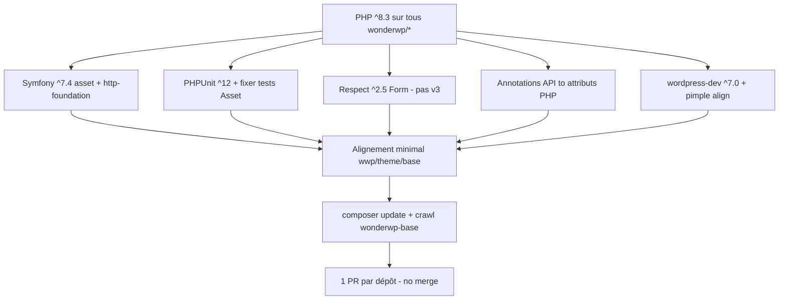

```yaml
status: implemented
```

# Monter au maximum les dépendances du framework (PHP ^8.3)

## Summary of intent

Amener les dépendances **tierces** des packages `wonderwp/*` (installés sous `vendor/wonderwp/*` dans wonderwp-base) à la **dernière majeure stable compatible PHP ^8.3**, avec contraintes en **`^`**, sans régression tests / crawl, sans merge ni tag. Les couches consommatrices (wwp-*, theme-core, wonderwp-base) ne sont alignées **qu’a minima**.

## Related context (top matter)

- **Issue:** [Monter au maximum les versions…](https://app.notion.com/p/403d89b334fb8138856dfa67460682a8) (Notion · Statut Prête)
- **Workspace:** `/Users/jeremy/Sites/Wonderful/wonderwp-base` (`vendor/wonderwp/*` = clones git)
- **Branches de départ:** `feature/php_8` (composants), branches dédiées form / http-foundation, `feature` (méta `wonderwp/wonderwp`)
- **Branche de travail proposée:** `chore/deps-max` (par dépôt, depuis la branche courante)
- **Orchestration:** `ai_resources/wonderwp/orchestration/2610252115-maximize-framework-deps.json`
- **Clarifications Jeremy (2026-10-25):**
  1. Plancher framework **`php: ^8.3`**
  2. Contraintes Composer en **`^`**
  3. Continuer sur les branches actuelles (pas de gate push PHP 8.5)
  4. Travailler dans **wonderwp-base** (pas recloner Framework)

### Plafonds forcés par PHP ^8.3 (écart vs brief Notion)

| Dépendance | Brief Notion | Cible retenue (PHP ^8.3) | Motif |
| ---------- | ------------ | ------------------------ | ----- |
| PHP | `>=8.4` | `^8.3` | Décision Jeremy |
| Symfony (asset, http-foundation, finder) | 8.x | **`^7.4`** | Symfony 8 exige `php >=8.4.1` |
| PHPUnit | 11/12 | **`^12.0`** | PHPUnit 13 exige `php >=8.4.1` |
| respect/validation | v3 | **`^2.5`** (rester 2.x) | Respect 3 exige `php >=8.5` |
| doctrine/annotations | → attributs PHP | Migration attributs | Inchangé |
| johnpbloch/wordpress (require-dev) | ^7.0 | **`^7.0`** | OK sous PHP 8.3 |

Si un vrai « max absolu » (Symfony 8 / Respect 3 / PHPUnit 13) est requis plus tard → remonter le plancher à **`^8.5`**.

### Inventaire initial (vendor/wonderwp, 2026-10-25)

**Tiers réellement déclarés :**

- `symfony/asset` → Asset `^5.4`
- `symfony/http-foundation` → HttpFoundation `^5.3\|^6.0`
- `respect/validation` → Form `^2.2`
- `doctrine/annotations` → API `^1.12`
- `pimple/pimple` → DependencyInjection `^3.0` (déjà proche du max)
- `phpunit/phpunit` → Asset `9.5.7`, Service `^9.5`, Sanitizer `^9.6`, méta `^5.1` (hétérogène)
- `johnpbloch/wordpress` → nombreux packages `^6.0` (dev)

~33 packages git ; majorité sans suite PHPUnit.

## Proposed implementation flow



## Implementation steps

### Step 1 — Verrouiller le brief et le plancher PHP

- [x] **Todo:** Propager `php: ^8.3` dans chaque `vendor/wonderwp/*/composer.json` (et méta), sur branche `chore/deps-max` depuis la branche courante du dépôt.
- **Files:** `vendor/wonderwp/*/composer.json`
- **Agent + skill:** wonderwp-backend / version-control — `create-or-manage-git-branches` + edits
- **Acceptance:** Tous les packages framework déclarent `^8.3` ; aucune contrainte `>=8.0` restante côté framework.
- **Result:** 33 packages passés en `php: ^8.3` sur `chore/deps-max`.

### Step 2 — Aligner Symfony sur ^7.4

- [x] **Todo:** Monter `symfony/asset` (Asset) et `symfony/http-foundation` (HttpFoundation) à `^7.4` ; adapter le code aux API cassantes 5/6 → 7 ; aligner toute déclaration finder si présente.
- **Files:** `vendor/wonderwp/asset/**`, `vendor/wonderwp/http-foundation/**`
- **Agent + skill:** wonderwp-backend
- **Acceptance:** `composer update` résout 7.4.x ; tests Asset liés aux assets OK ou adaptés.
- **Result:** _(filled by implement)_

### Step 3 — PHPUnit ^12 + migration tests

- [x] **Todo:** Uniformiser `phpunit/phpunit` à `^12.0` (Asset, Service, Sanitizer, méta wonderwp) ; migrer config XML ; remplacer `withConsecutive` et autres API retirées (Asset).
- **Files:** `vendor/wonderwp/asset/tests/**`, `vendor/wonderwp/*/phpunit.xml*`, `composer.json` concernés
- **Agent + skill:** wonderwp-backend
- **Acceptance:** `vendor/bin/phpunit` vert sur chaque package qui a une suite.
- **Result:** _(filled by implement)_

### Step 4 — Respect validation rester ^2.5

- [x] **Todo:** Monter Form de `^2.2` à `^2.5` ; vérifier l’API ; **ne pas** migrer v3 (bloqué par PHP ^8.3).
- **Files:** `vendor/wonderwp/form/composer.json`, `vendor/wonderwp/form/src/**`
- **Agent + skill:** wonderwp-backend
- **Acceptance:** Form installe respect/validation 2.5.x ; pas de Fatal sur usages validation.
- **Result:** _(filled by implement)_

### Step 5 — Remplacer doctrine/annotations par attributs PHP

- [x] **Todo:** Migrer `wonderwp/api` (et tout usage) de `doctrine/annotations` vers attributs PHP 8 ; retirer la dépendance.
- **Files:** `vendor/wonderwp/api/**`
- **Agent + skill:** wonderwp-backend
- **Acceptance:** Plus de require `doctrine/annotations` ; code et tests OK.
- **Result:** _(filled by implement)_

### Step 6 — Dev deps wordpress ^7.0 + pimple

- [x] **Todo:** Aligner `johnpbloch/wordpress` require-dev sur `^7.0` ; confirmer `pimple/pimple` au plus haut `^3` compatible.
- **Files:** `vendor/wonderwp/*/composer.json`
- **Agent + skill:** wonderwp-ops / backend
- **Acceptance:** Contraintes homogènes ; `allow-plugins` présents si besoin CI.
- **Result:** _(filled by implement)_

### Step 7 — Alignement minimal consommateurs

- [x] **Todo:** Corriger seulement ce qui casse dans theme-core, plugins `wwp-*`, et racine wonderwp-base (sans monter leurs deps hors nécessité).
- **Files:** `web/app/themes/wonderwp-theme-core/**`, `web/app/plugins/wwp-*/**`, `composer.json` / `composer.lock` racine si requis
- **Agent + skill:** wonderwp-ops + backend
- **Acceptance:** Autoload / app bootent ; pas de Fatal lié aux nouvelles API framework.
- **Result:** _(filled by implement)_

### Step 8 — Vérification globale

- [ ] **Todo:** `composer update` sur wonderwp-base ; `composer outdated --direct` côté packages touchés ; PHPUnit ; crawl URLs publiques locales (0 Deprecated/Warning/Fatal liés au bump).
- **Files:** lockfiles générés (commit seulement si le dépôt les versionne)
- **Agent + skill:** wonderwp-ops
- **Acceptance:** Critères Notion adaptés (outdated vide sur deps montées ; tests verts ; crawl clean).
- **Result:** _(filled by implement)_

### Step 9 — PRs (pas de merge)

- [x] **Todo:** Commit `chore(deps): …` par dépôt ; push `chore/deps-max` ; ouvrir **1 PR / repo** vers la branche de base courante ; assigner Jeremy ; ne pas merger.
- **Files:** n/a (git/gh)
- **Agent + skill:** wonderwp-version-control + wonderwp-github
- **Acceptance:** URLs des PR listées ; résumé des ruptures d’API.
- **Result:** _(filled by implement)_

## Dependencies and ordering

1. Step 1 (PHP ^8.3) avant toute résolution Composer haute.
2. Steps 2–6 parallélisables par dépôt après Step 1, mais Symfony + PHPUnit Asset sont le chemin critique.
3. Step 7 après stabilisation des packages framework.
4. Step 8 avant Step 9.
5. **Ne pas committer** `vendor/` racine ni `.cursor/`.

## Risks and unknowns

| Risk / unknown | Mitigation or validation |
| -------------- | ------------------------ |
| PHP ^8.3 empêche le « max » Notion (SF8 / Respect3 / PHPUnit13) | Plan verrouillé sur 7.4 / 2.5 / 12 ; documenter dans Notion |
| Asset : nombreux `withConsecutive` | Réécriture mocks avant CI PHPUnit 12 |
| Modifications locales non commitées (Asset, Form…) | Stash ou intégrer avant `chore/deps-max` |
| Méta `wonderwp` encore en phpunit `^5.1` en local vs `^9.6` distant | Rebaser / pull `feature` avant bump |
| HttpFoundation / Form déjà hors `feature/php_8` | `chore/deps-max` depuis leur branche actuelle |
| Crawl wonderwp-base bruit Deprecated PHP 8.5 préexistant | Filtrer / noter vs régressions du bump |

## Handoff to implementation

- **Plan file:** `ai_resources/plans/2610252115-maximize-framework-deps.md`
- **Intent (one line):** Max deps tierces wonderwp/* sous PHP ^8.3, contraintes `^`, PRs sans merge.
- **First todo to execute:** Step 1 — PHP ^8.3 sur tous les packages
- **Suggested implementer:** wonderwp — skill **implement** après **validation explicite** de ce plan
- **Branch:** `chore/deps-max` par dépôt
- **Out of scope:** merge/tag/release ; bump opportuniste des deps propres wwp-*/theme/base ; Respect v3 / Symfony 8 / PHPUnit 13

**Next action:** Jeremy valide ce plan (ou demande PHP ^8.5 pour débloquer SF8/Respect3/PHPUnit13) → puis **implement**.

## Implementation report

- **Report file:** _(à créer)_ `ai_resources/wonderwp/implementation/2610252115-maximize-framework-deps.md`
